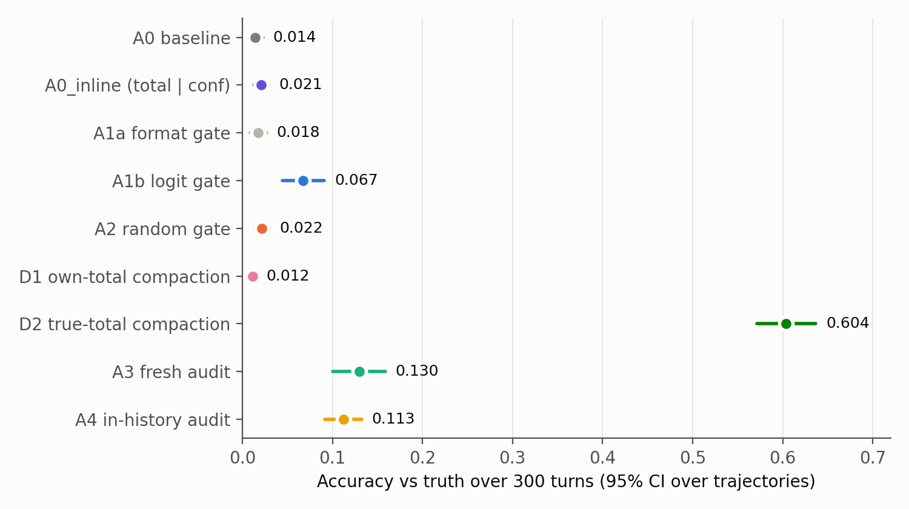
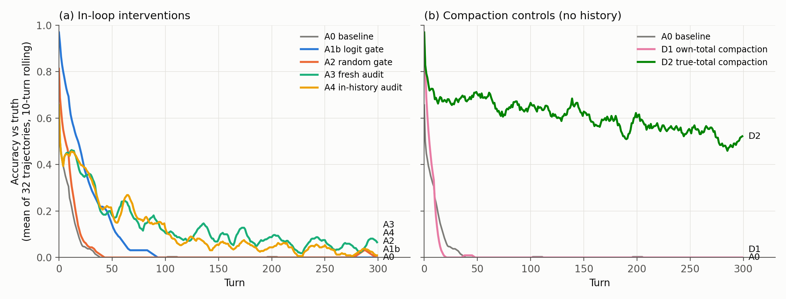
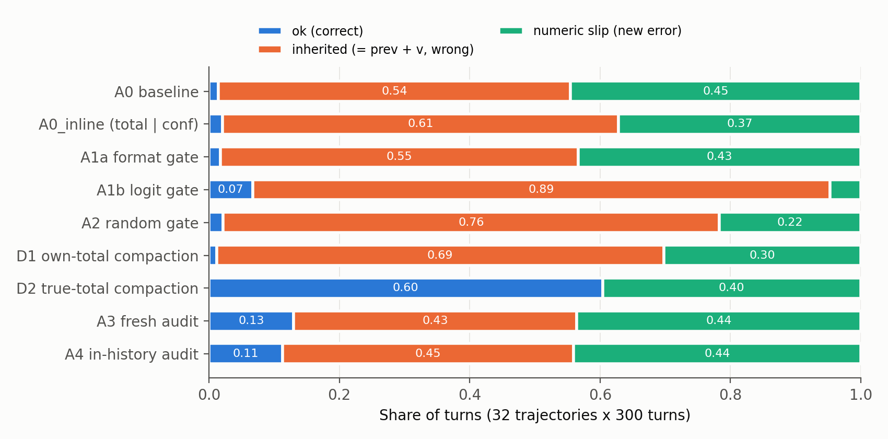
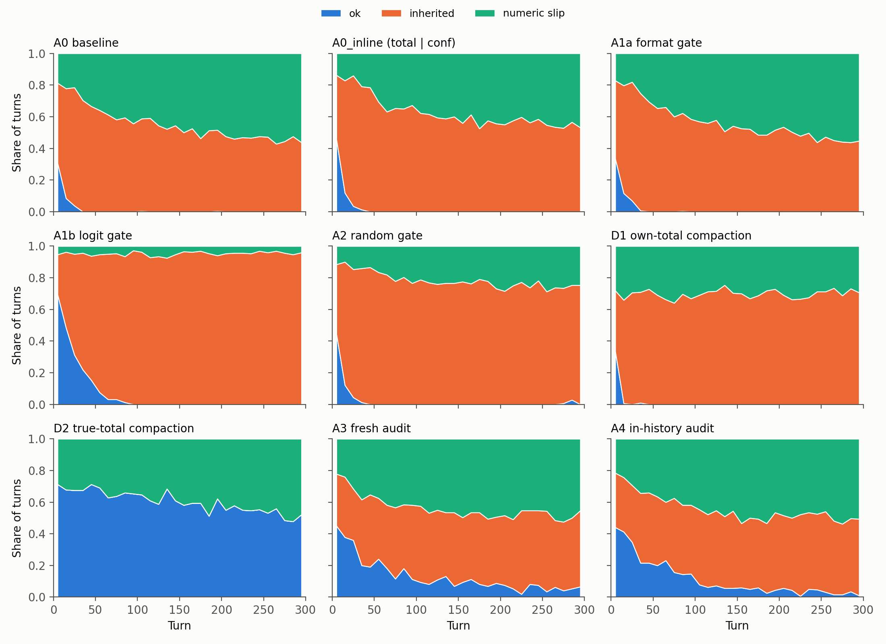
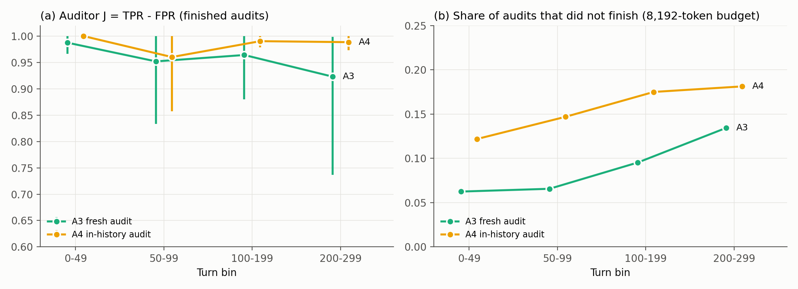
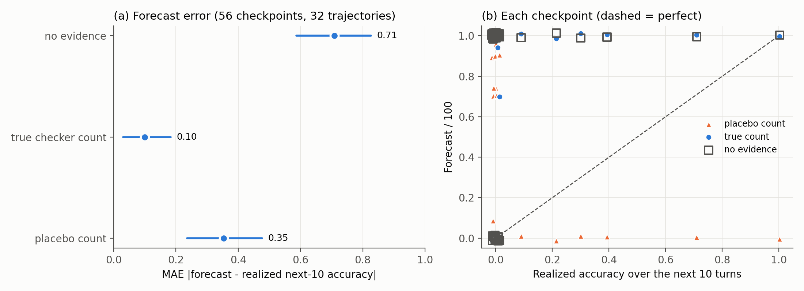
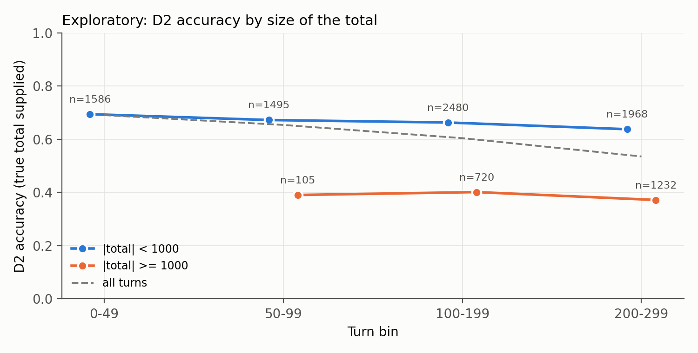
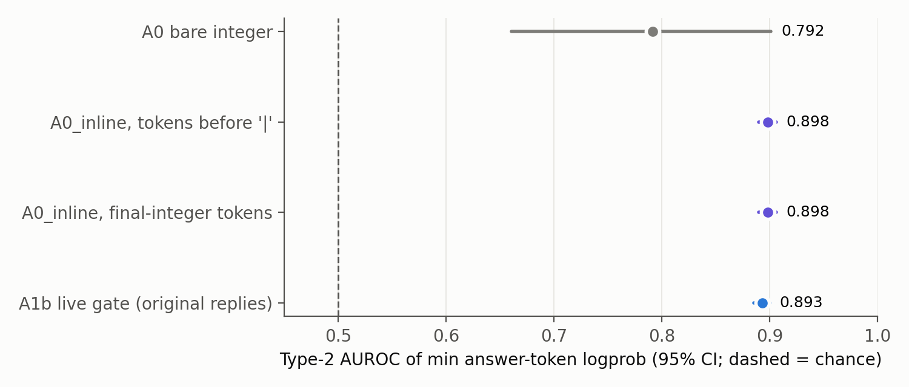

# Main results: Catching Silent Collapse (Granite 4.2 8B)

**Run:** stamp `20261113-173033`, 2026-11-13 17:30 → 2026-11-14 18:04 IST, GPU 0.
**Scope:** all 9 arms × 32 test trajectories (samples 20–51) × 300 turns. Every trajectory finished; none was excluded.
**Code and registration:** code commit `6c6ac8c` = pre-registration commit (`prereg.md`). Every checksum matched at launch.
**Analysis:** `scripts/analyze_main.py` (committed as `4a605de`, 10 minutes after launch and before any test output existed) → `main_results.json`.
**Figures:** `scripts/figures.py` → `figures/`, `figure_data.json`.
**Secondary analyses:** `scripts/secondary.py` → `secondary.json`.
**Raw outputs:** one archive per arm in `raw_main_20261113-173033/`.

Anything not stated in `prereg.md` §4 is marked **exploratory**. Post-registration notes are in `implementation-plan.md` §13.

---

## 1. Verdicts (pre-registered rules, Holm over four tests)

HE's condition did not hold, so, as pre-registered, it is reported as "not reproduced" and Holm runs over HA–HD.

| | Hypothesis | Decisive numbers (paired bootstrap, 10,000 resamples) | Holm p | **Verdict** |
|---|---|---|---|---|
| **HA** | Catch the seed: a logit-gated re-compute beats a random gate | Accuracy A1b − A2 **+0.045 [+0.024, +0.068]**; A1b − A0 **+0.053 [+0.032, +0.077]**. Error chains per trajectory: A1b − A2 −50.8 [−55.7, −45.6]; A1b − A0 −119.4 [−138.5, −103.4]. Live-gate AUROC 0.893 [0.885, 0.900] | < 0.001 | **Supported** |
| **HB** | An audit outside the history stays accurate; inside the history it degrades | Accuracy A3 − A0 **+0.115 [+0.086, +0.147]**. ΔJ (turns 200–299 minus 0–49): A3 −0.064 [−0.265, +0.023], which includes 0 ✓. A4 −0.012 [−0.026, **0.000**], **not entirely below 0** | 0.088 | **Partial: A3 works, but the in-history decline is not shown** |
| **HC** | Awareness is input-starved | Forecast MAE true − none **−0.609 [−0.749, −0.460]**; true − placebo **−0.254 [−0.404, −0.104]**. Spearman(true-evidence forecast, realized) 0.880 [0.613, 0.999]. 56 checkpoints in 32 trajectories | 0.0008 | **Supported** |
| **HD** | Collapse is inheritance, not context length | D1 − A0 accuracy −0.003, 90% CI [−0.010, +0.003], inside ±0.05 ✓. D2 slope −0.00069/turn [−0.00090, −0.00047], **not inside ±0.0005** ✗ | — | **Not supported.** The D1 equivalence part holds; the D2 flatness part fails |
| **HE** | The logit format effect is a scoring artifact | AUROC(A0_inline, before `\|`) − AUROC(A0) = **+0.107** [−0.005, +0.241], so the condition (a lower AUROC) does not hold | — | **Discrepancy not reproduced on this task** |

HD's Holm p (< 0.001) is the TOST p of its D1 part. The D2 slope part has no p-value, and the verdict is decided by both parts together, as pre-registered.

## 2. Accuracy per arm

| Arm | Accuracy (95% CI) | Turns to first error | New-slip rate | Inherited-error rate |
|---|---|---|---|---|
| A0 baseline | 0.014 [0.008, 0.023] | 4.2 | 0.446 | 0.540 |
| A0_inline | 0.021 [0.013, 0.029] | 6.2 | 0.37 | 0.61 |
| A1a format gate | 0.018 [0.009, 0.027] | 5.2 | 0.43 | 0.55 |
| **A1b logit gate** | 0.067 [0.045, 0.091] | **20.1** | 0.048 | 0.885 |
| A2 random gate | 0.022 [0.014, 0.030] | 5.8 | 0.217 | 0.761 |
| D1 own-total compaction | 0.012 [0.008, 0.015] | 3.4 | 0.302 | 0.686 |
| D2 true-total compaction | **0.604** [0.571, 0.637] | 3.4 | 0.396 | 0.000 |
| **A3 fresh audit** | **0.130** [0.100, 0.159] | 4.9 | 0.436 | 0.434 |
| A4 in-history audit | 0.113 [0.092, 0.133] | 4.9 | 0.440 | 0.447 |

The accuracy CIs above come from figure bootstraps (2,000 resamples). Rates are shares of all turns.

**Phase 4 quality checks:**
- **Completeness.** Every arm has 32 × 300 rows and 0 non-answers, and each arm ran in one pass with no resume and no stitching.
- **Consistency, checked on all 86,400 rows.** For every row:
  - the truth equals the running sum of the dictionary values;
  - the label agrees with the committed total;
  - in D2, the state line equals the true total.
- **Spot-check.** 18 random rows (2 per arm) were read by hand, including gate re-computes and audit corrections. All were consistent.

## 3. Per-hypothesis details

### HA: catch the seed
- **The gate catches most slips.** The A1b gate fired on 45.0% of turns. It caught **87.1%** of the original replies that were local slips. It also fired on 23.7% of locally correct replies.
- **The re-compute is accurate.** Re-computes were locally correct 99.1% of the time and always finished.
- **A random gate catches far less.** A2 fired at the same rate (45.7%) but caught only 45.7% of slips.
- **The effect is a delayed seed.**
  - The first error comes at turn **20.1** in A1b, against 4.2 in A0 and 5.8 in A2.
  - The new-slip rate after the gate is 0.048, about 5% per turn, flat across bins (0.049 / 0.049 / 0.051 / 0.042).
- **Accuracy stays low anyway.** Each surviving slip is inherited for the rest of the run, so the inherited share in A1b is high (0.885). This is the mechanical effect that motivated counting chains instead (§13).
- A1b − A1a accuracy +0.049 [+0.031, +0.070], about equal to A1b − A0, as pre-registered. A1a's gate never fired.

### HB: audit outside the history

| Turn bin | 0–49 | 50–99 | 100–199 | 200–299 |
|---|---|---|---|---|
| J, A3 fresh | 0.987 [0.967, 1.000] | 0.952 [0.833, 1.000] | 0.964 [0.880, 1.000] | 0.923 [0.737, 0.998] |
| J, A4 in-history | 1.000 [1.000, 1.000] | 0.960 [0.857, 1.000] | 0.990 [0.979, 1.000] | 0.988 [0.973, 1.000] |
| Unfinished, A3 | 6.2% | 6.6% | 9.5% | 13.4% |
| Unfinished, A4 | 12.2% | 14.7% | 17.5% | 18.1% |

- **Both auditors detect almost every wrong total at every position.** True-positive rate ≥ 0.95 in every bin.
- **The in-history auditor doesn't lose accuracy for Granite, but it costs more.** It runs out of the 8,192-token budget more often, uses 3,382 against 3,030 thinking tokens per audit, and its correction is right a little less often when it flags WRONG (0.82 against 0.85).
- **A3 − A4 accuracy is +0.017 [−0.001, +0.037]** (exploratory).
- **Why accuracy stays near 0.12 with a nearly perfect auditor:**
  - The agent still makes a new slip on about 44% of turns.
  - Audits run only every 5 turns, so a correction rarely survives until the next audit.
  - The audit fixes inherited errors (the inherited-error rate drops 0.540 → 0.434), but it can't stop new slips.
- **Caveat: the false-positive rate rests on few cases late in the run.** At near-floor accuracy, few audited totals are actually correct, especially late. So the FPR part of J rests on few cases, which explains A3's wide late-bin CI.

### HC: awareness is input-starved

Forecast MAE:

| Evidence given | MAE (95% CI) |
|---|---|
| None | 0.708 [0.586, 0.826] |
| True checker count | **0.099 [0.031, 0.183]** |
| Placebo count | 0.354 [0.236, 0.476] |

- **Caveat: forecasts are close to 0 or 100.**
  - The realized next-10 accuracy is 0 at most checkpoints.
  - Across all 32 A0 trajectories, mean no-evidence forecasts at checkpoints 10, 25, 50, 100, 150, 200 and 250 are **90.625, 62.4375, 62.46875, 0, 3.125, 0 and 0%**, respectively. Thus “about 100” does not describe the full run; pessimism increases with position even without checker evidence. These all-checkpoint summaries differ from the 56 eligible checkpoints used for HC above. See [the exploratory metacognition analysis](meta_analysis.md) for counts, confidence intervals, and realized next-10 accuracy.
  - The placebo control shows the model reacts to the count itself, not just to being told a checker exists.

### HD: inheritance vs. context length

- **D1 (no history, own total) is equivalent to A0 in accuracy.** The long history adds no measurable collapse beyond inheritance.
- **D1 makes fewer new slips than A0 (exploratory).** Its new-slip rate is 0.302 against 0.446, a difference of −0.144 [−0.208, −0.087]. But every wrong total is still carried forward (inherited rate 0.686), so accuracy is unchanged.
- **D2 (true total, no history) reaches 0.604, but its accuracy still declines over turns.** This fails the pre-registered flatness band.
- **Exploratory, post hoc:** the decline tracks the size of the running total.
  - The mean |total| grows from about 230 in turns 0–49 to about 985 in turns 200–299.
  - With |total| < 1000, accuracy is 0.69 / 0.67 / 0.66 / 0.64 across bins.
  - With |total| ≥ 1000, it is about 0.37–0.40 in every bin with at least 20 such turns.
  - Number size explains only part of the drift. A logistic regression of new slips on turn and digit count (`scripts/magnitude_analysis.py`, trajectory bootstrap) gives +0.30 log-odds per extra digit [+0.10, +0.42]. A turn effect of +0.21 log-odds per 100 turns [+0.14, +0.28] remains after this coarse control. Finer-grained size may explain the rest; Study 2's bounded-total control (D2b) tests this directly.
  - Related, and more informative: with the full history (A0), the slip rate rises with position (+0.56 log-odds per 100 turns [+0.50, +0.64], digits controlled). Without history (D1, same own-total state), it is flat (+0.03 [−0.02, +0.08]). The long context does raise the rate of *new* slips, but accuracy does not change, because inheritance already dominates.

### HE: logit format effect

| Logit signal | AUROC (95% CI) |
|---|---|
| A0, bare integer | 0.792 [0.661, 0.901] |
| A0_inline, tokens before `\|` | 0.898 [0.890, 0.906] |
| A0_inline, final-integer tokens | 0.898 [0.890, 0.906] |
| A1b live gate | 0.893 [0.885, 0.900] |

- **The inline format did not lower AUROC.** It is nominally higher, so the instructor's format discrepancy does not reproduce here.
- **Under forced-integer decoding the two scorings are identical.** The tokens before `|` and the final-integer tokens are the same tokens, so they give the same AUROC.

## 4. Secondary results (prereg §5, not used for verdicts)

- **Side-question confidence probes are blind.** On A0, 9,600 turns, locally correct vs. slip:
  - **P(Yes) AUROC = 0.489**, at chance.
  - **Verbal-confidence AUROC = 0.613**.
  - Inline confidence was **100 on every one of the 9,600 turns**.
  - Only the token logprobs carry the signal (0.79–0.90).
- **The slip rate rises with position.** In A0 the new-slip rate goes 0.251 → 0.403 → 0.470 → 0.540 across the bins.
  - In D1 it is flat (0.296 / 0.328 / 0.292 / 0.302).
  - In D2 it rises (0.309 → 0.465), which fits the size effect above.
- **About a third of A0's slips look like retrieval errors.** 36.6% of A0 slips are `retrieval_like`, against 14.9% in D2 (exploratory).
- **Extra cost per turn**, as generated tokens:

  | Arm | Tokens per turn |
  |---|---|
  | A0 | 2.8 |
  | A1b | 11.8 |
  | A2 | 12.1 |
  | A3 | 612 |
  | A4 | 762 |

  The gate costs about 4× the baseline, and the audits about 220–270×.
- **Reproducibility: A0 and A1a are equivalent but not identical.** A1a's gate never fires, so it should replay A0, but only **15.5%** of all replies are identical.
  - In the first 10 turns, 87.2% are identical. After the first divergence, the two runs follow different error paths.
  - The cause is vLLM batching nondeterminism under greedy decoding.
  - Their accuracies are equal within CI (0.014 against 0.018), so conclusions hold at the arm level, not turn by turn.
- **The before/after-first-error slip contrast is degenerate.** Before the first error, the slip rate is 0 by definition. The after-first-error rates are A0 0.452, D1 0.306, D2 0.401. See §13.

## 5. Limitations

1. **Narrow scope.** One model, one synthetic task, one decoding setup (forced-integer replies, as in the instructor's E8). The other group members' runs (Qwen3-8B, Llama) test whether this generalizes.
2. **The baseline is near the floor** (accuracy 0.014; first error at turn 4.2). Most turns after the first error are inherited. This compresses every accuracy difference and leaves few correct audited totals late in the run, which makes the late-bin FPR noisy.
3. **Number size grows with position on this task.** The pre-registered position tests (D2 slope, ΔJ) cannot separate position from number size. The size analysis is post hoc.
4. **Logit AUROC is lower on the test set than on calibration.** The pilot gave 0.88–0.91 per bin; A0 on test gives 0.79. τ was not re-tuned.
5. **Nondeterminism.** vLLM batch nondeterminism makes paired arms diverge after the first differing turn. Comparisons are paired by trajectory, not by turn.
6. **HC is coarse.** It rests on 56 checkpoints whose forecasts are mostly 0 or 100.
7. **Wall-clock times can't be compared.** GPU 0 was shared, so times are not comparable across arms. The token counts above are.
