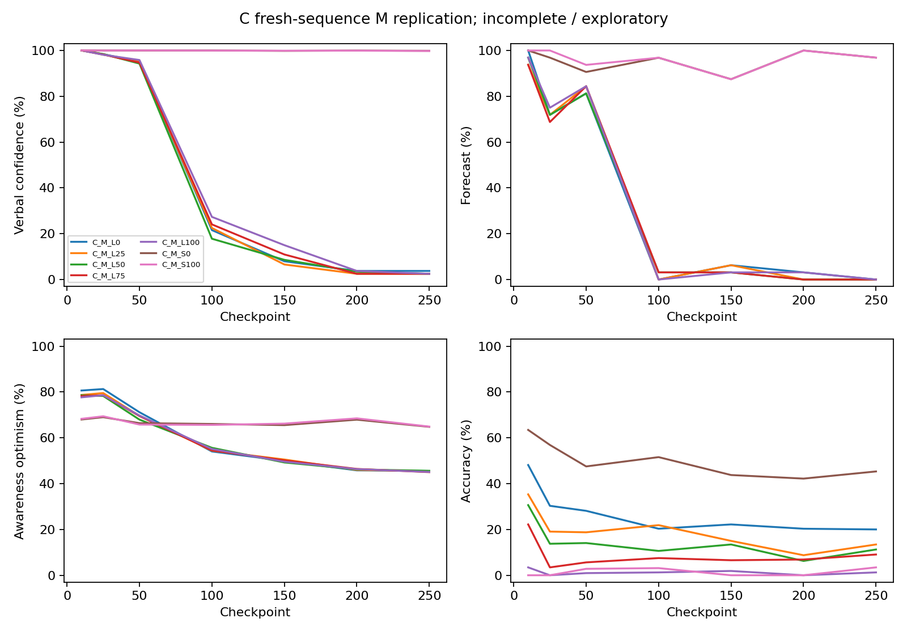
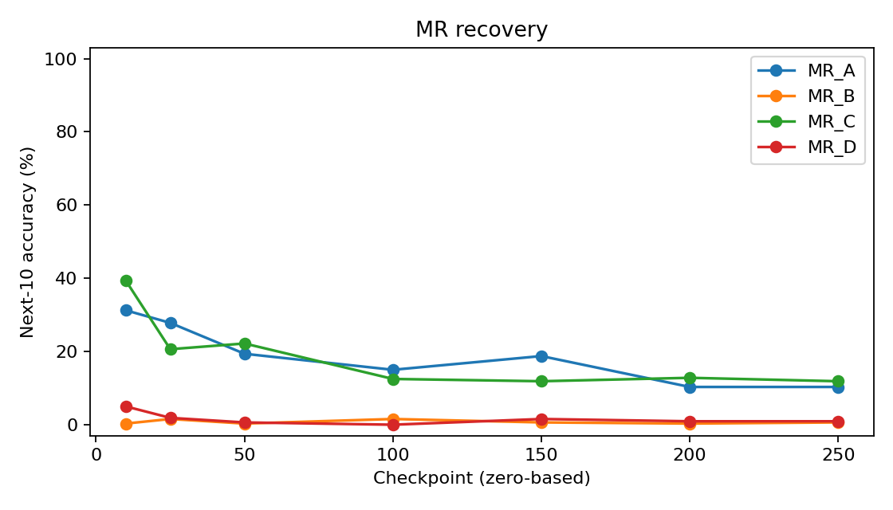
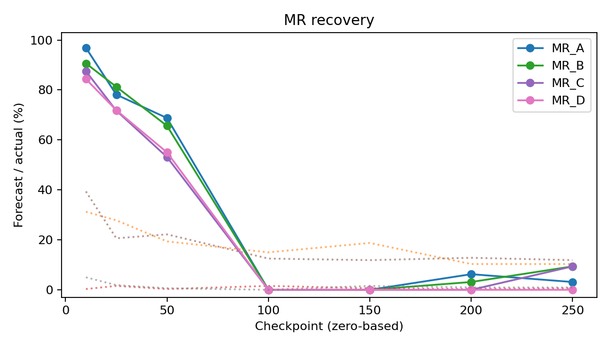
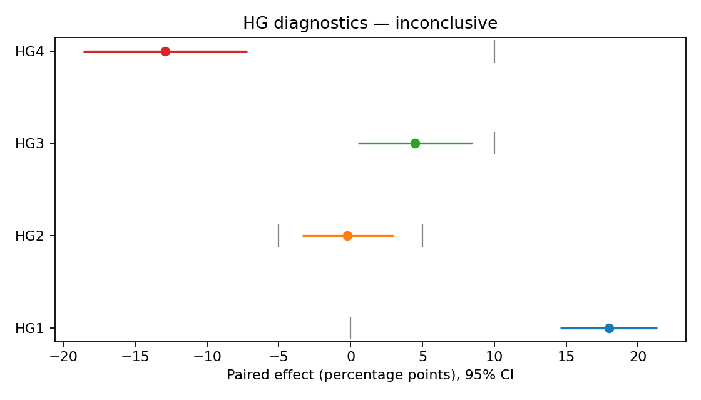
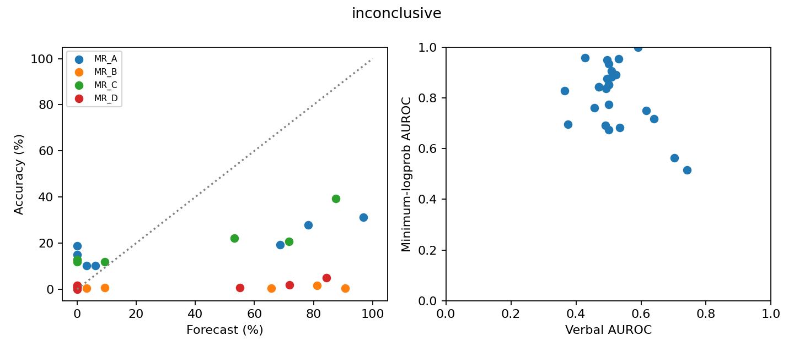

# Independent-sequence study C

Status: **independent confirmation**.

C-HF: length-driven.

C-HG: inconclusive.

Figures retain canonical core arm fields within the new C run; no original observations are reused. All tests, intervals, missingness, floors, class support and source/sample provenance are in `analysis.json`. Mock/partial outputs never receive an empirical verdict.

