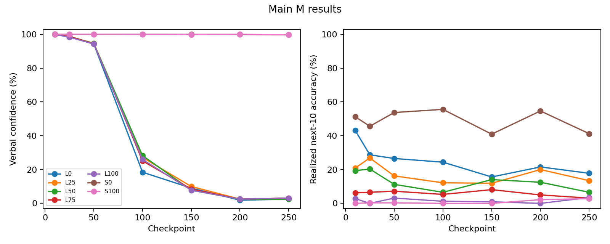
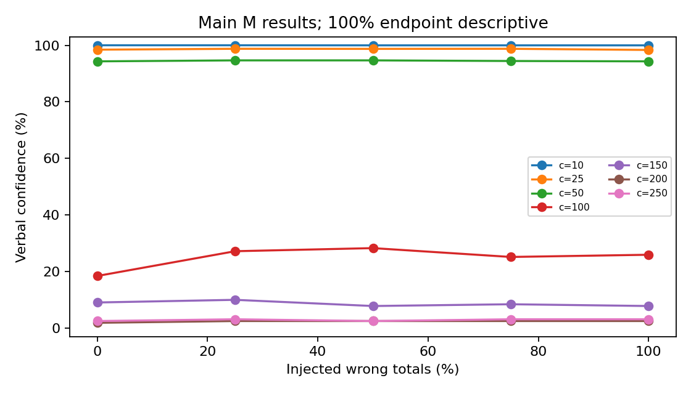
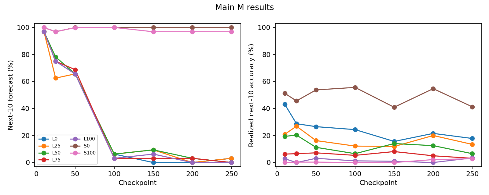
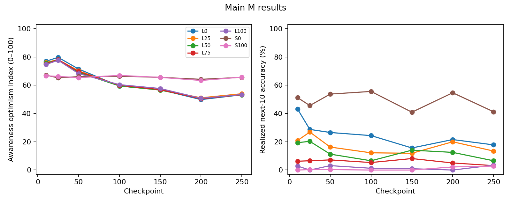

# M / HF main results — completed 2026-11-18

**Registered classification: length-driven (operational history-truncation contrast).**

All 32 test trajectories, seven arms and seven checkpoints completed: 1,568 checkpoint conditions, 15,680 real task answers and seven verified archives. Analysis uses 10,000 whole-trajectory bootstrap draws and the registered four-test Holm family. No primary checkpoint verbal, forecast or awareness values were invalid. Registration commit: `1d11bc5a2a665062b3aec023f2dc18ba0c0d02a4`.

## Primary estimates

| Quantity | Estimate, confidence points | 95% CI |
|---|---:|---|
| P: S0 − L0 confidence | 53.57 | [51.71, 55.36] |
| D: minus intermediate-dose slope | -1.23 | [-3.86, 1.40] |
| E100: L0 − L100, descriptive | -1.05 | [-2.89, 0.78] |

The dose effect’s 90% equivalence interval is [-3.43, 0.94], inside the preregistered ±10-point band. Meaningful pessimism P>10 and small-dose equivalence both pass the combined interval/Holm criteria; the error-effect superiority criterion does not pass. Bootstrap tail estimates recorded as zero are below the empirical resampling resolution, not mathematically zero probabilities.

## What this supports

Under the specified teacher-forced-history treatments, verbal confidence responds strongly to long versus five-turn histories, while the intermediate wrong-total dose has no practically large effect by the registered margin. This directly addresses the instructor’s length-versus-accumulated-errors question. It does not establish accurate introspection or a universal absence of error sensitivity.

S0 truncates earlier keys and reconstruction evidence as well as tokens. Thus “length-driven” is the registered operational label; the contrast does not isolate physical token count from every information/content difference. The histories are supplied, not naturally generated failures. Accuracy and report validity must be interpreted separately.

## Arm means across checkpoints and trajectories

| Arm | Verbal (0–100) | Forecast % | Realized next-10 accuracy % |
|---|---:|---:|---:|
| L0 | 46.38 | 35.27 | 25.40 |
| L25 | 48.03 | 34.82 | 17.37 |
| L50 | 47.78 | 37.05 | 12.95 |
| L75 | 47.48 | 35.71 | 5.94 |
| L100 | 47.43 | 35.25 | 1.65 |
| S0 | 99.95 | 99.50 | 49.02 |
| S100 | 99.94 | 98.17 | 0.80 |

L100 and S100 are at the global-accuracy floor overall; they are not sufficient evidence of monitoring. The intermediate-dose contrast remains primary. Very high confidence in the short wrong-history arm is not evidence of correctness.

## Secondary evidence and limits

Only 31 of 490 strict checkpoint/offset cells support minimum-logprob AUROC under the ≥15-per-class rule. Report these support counts; do not replace missing cells by zero, silently pool positions, or infer universal token superiority from this subset.

Forecast calibration with checkpoint effects has slope 0.100 (95% CI [0.057, 0.141]); ideal calibration slope is 1. This is a pooled cross-arm conditional regression, not a causal mechanism or a complete calibration characterization. Verbal confidence concerns the current supplied answer; its association with future accuracy is not direct future-probability calibration. Awareness optimism is ordinal, not a calibrated probability.

These are prospective intervention results on the same benchmark sequences previously inspected in A0, not an independent replication on new sequences. Granite/LHE-specific findings do not establish generality across models or domains.

## Recovery study status

MR main is complete: 896 conditions / 8,960 answers, four validated archives,
32 paired trajectories, registered analysis and figures. It finished on GPU 0
at 13:15 IST under amendment commit `e45f9df`, releasing the model allocation.
HG is inconclusive: execution repair and clean-reference equivalence pass,
but the forecast-margin and actual-underconfidence criteria do not. See the
[MR main summary](../recovery_HG_gpu0_main_20261118/main_summary.md).
Completed M numerical results remain unchanged.

[Full registered analysis](meta_experiment.md) · [Machine-readable estimates and tests](meta_experiment.json)

