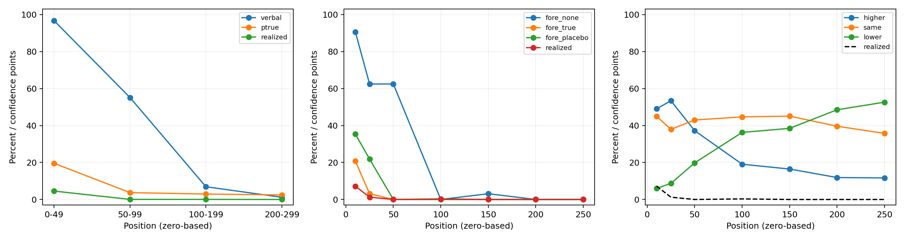
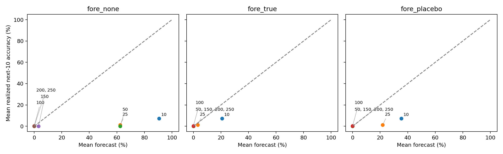
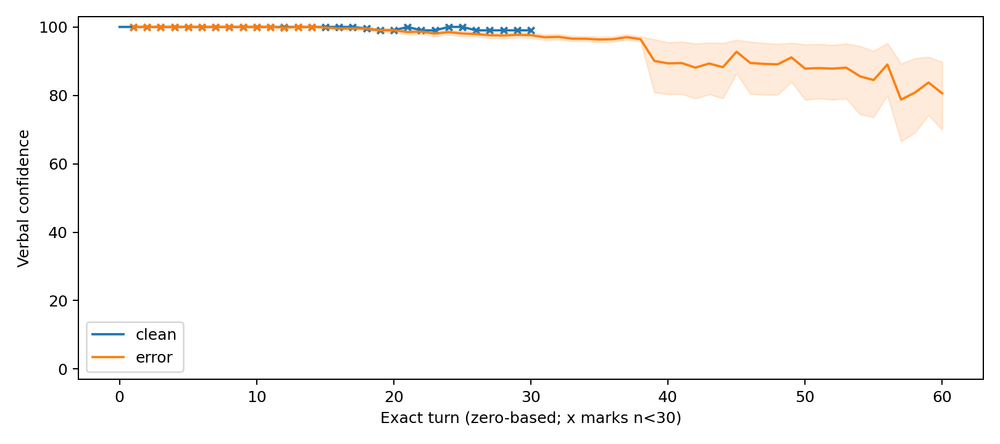

# A0 metacognition (exploratory)

Source: `/home/viswanath/mithun/previous work/results/raw_main_20261113-173033/A0.tar.gz`; SHA-256: `eb9fc0edf8ff78e213d09e52837ad81630b77d1ec3b754dbdd40cbf28360fb57`.
32 complete trajectories; 9600 rows. Missing ids: [].
Whole-trajectory bootstrap: 10000 resamples, seed 0; 95% percentile intervals.

Turns are zero-based. Next-10 means t+1…t+10; incomplete windows are missing, never zero-filled.
Means weight trajectories equally. P(Yes) is normalized over Yes/No first-token mass; awareness is normalized A/B/C mass.
Forecasts are clipped to [0,100] as in HC. All checkpoints are included here, including equal true/placebo counts; HC used a restricted subset.

| Bin | Verbal | P(Yes) | Forecast none | True | Placebo | Higher | Same | Lower | Next-10 accuracy |
|---|---:|---:|---:|---:|---:|---:|---:|---:|---:|
| 0-49 | 96.72 | 0.20 | 76.53 | 11.95 | 28.61 | 0.51 | 0.41 | 0.07 | 0.05 |
| 50-99 | 55.13 | 0.04 | 62.47 | 0.00 | 0.00 | 0.37 | 0.43 | 0.20 | 0.00 |
| 100-199 | 6.88 | 0.03 | 1.56 | 0.00 | 0.00 | 0.18 | 0.45 | 0.37 | 0.00 |
| 200-299 | 1.20 | 0.02 | 0.00 | 0.00 | 0.00 | 0.12 | 0.38 | 0.51 | 0.00 |

Bin CIs and per-metric counts are in `meta_analysis.json`. Forecast/awareness use only checkpoint rows;
verbal/P(Yes) use all turns; next-10 accuracy excludes the final ten turns.
The JSON also gives realized accuracy on the rows available for each signal (`matched_realized`).

| Checkpoint | n forecast | Verbal | None | True | Placebo | Next-10 accuracy |
|---|---:|---:|---:|---:|---:|---:|
| 10 | 32 | 100.00 | 90.62 | 20.78 | 35.34 | 0.07 |
| 25 | 32 | 98.12 | 62.44 | 3.12 | 21.88 | 0.01 |
| 50 | 32 | 87.81 | 62.47 | 0.00 | 0.00 | 0.00 |
| 100 | 32 | 20.31 | 0.00 | 0.00 | 0.00 | 0.00 |
| 150 | 32 | 5.47 | 3.12 | 0.00 | 0.00 | 0.00 |
| 200 | 32 | 1.88 | 0.00 | 0.00 | 0.00 | 0.00 |
| 250 | 32 | 1.25 | 0.00 | 0.00 | 0.00 | 0.00 |

## Slip-step localization

Positive = locally correct (ok + inherited); negative = numeric_slip; nonanswers excluded.
Higher scores always indicate confidence; entropy is negated. Minimum 15 rows per class.

| Position | Score | AUROC [95% CI] | n local / slip |
|---|---|---:|---:|
| all | verbal | 0.613 [0.596, 0.631] | 5322 / 4278 |
| all | ptrue | 0.489 [0.447, 0.526] | 5322 / 4278 |
| all | lp_min | 0.792 [0.659, 0.901] | 5322 / 4278 |
| all | lp_mean | 0.790 [0.657, 0.899] | 5322 / 4278 |
| all | neg_ent_max | 0.792 [0.659, 0.902] | 5322 / 4278 |
| all | margin_min | 0.778 [0.647, 0.886] | 5322 / 4278 |
| all | fin_lp_min | 0.792 [0.659, 0.901] | 5322 / 4278 |
| 0-49 | verbal | 0.539 [0.488, 0.600] | 1198 / 402 |
| 0-49 | ptrue | 0.519 [0.468, 0.570] | 1198 / 402 |
| 0-49 | lp_min | 0.830 [0.735, 0.934] | 1198 / 402 |
| 0-49 | lp_mean | 0.830 [0.737, 0.932] | 1198 / 402 |
| 0-49 | neg_ent_max | 0.829 [0.731, 0.934] | 1198 / 402 |
| 0-49 | margin_min | 0.812 [0.706, 0.928] | 1198 / 402 |
| 0-49 | fin_lp_min | 0.830 [0.735, 0.934] | 1198 / 402 |
| 50-99 | verbal | 0.562 [0.495, 0.634] | 955 / 645 |
| 50-99 | ptrue | 0.423 [0.370, 0.476] | 955 / 645 |
| 50-99 | lp_min | 0.772 [0.629, 0.898] | 955 / 645 |
| 50-99 | lp_mean | 0.770 [0.628, 0.895] | 955 / 645 |
| 50-99 | neg_ent_max | 0.773 [0.630, 0.900] | 955 / 645 |
| 50-99 | margin_min | 0.755 [0.612, 0.883] | 955 / 645 |
| 50-99 | fin_lp_min | 0.772 [0.629, 0.898] | 955 / 645 |
| 100-199 | verbal | 0.549 [0.517, 0.583] | 1697 / 1503 |
| 100-199 | ptrue | 0.417 [0.363, 0.464] | 1697 / 1503 |
| 100-199 | lp_min | 0.776 [0.639, 0.888] | 1697 / 1503 |
| 100-199 | lp_mean | 0.773 [0.636, 0.886] | 1697 / 1503 |
| 100-199 | neg_ent_max | 0.776 [0.638, 0.889] | 1697 / 1503 |
| 100-199 | margin_min | 0.765 [0.631, 0.876] | 1697 / 1503 |
| 100-199 | fin_lp_min | 0.776 [0.639, 0.888] | 1697 / 1503 |
| 200-299 | verbal | 0.524 [0.503, 0.549] | 1472 / 1728 |
| 200-299 | ptrue | 0.431 [0.388, 0.472] | 1472 / 1728 |
| 200-299 | lp_min | 0.785 [0.651, 0.891] | 1472 / 1728 |
| 200-299 | lp_mean | 0.785 [0.651, 0.890] | 1472 / 1728 |
| 200-299 | neg_ent_max | 0.788 [0.653, 0.894] | 1472 / 1728 |
| 200-299 | margin_min | 0.766 [0.636, 0.869] | 1472 / 1728 |
| 200-299 | fin_lp_min | 0.785 [0.651, 0.891] | 1472 / 1728 |

## Exact-position matched histories, turns 0–60

Clean = all answers strictly before this turn are correct; error = at least one earlier wrong answer.
Each cell counts trajectories at exactly one turn. `*` flags n<30. Empty cells are NA.

Primary history definition: error − clean = -0.48 [-0.76, -0.21], equal-weighted over 30 overlapping turns; 6359 valid bootstrap replicates.
Including current answer (sensitivity): error − clean = -0.41 [-0.68, -0.17], equal-weighted over 30 overlapping turns; 6359 valid bootstrap replicates.

| Turn | Clean n | Clean mean [CI] | Error n | Error mean [CI] |
|---|---:|---:|---:|---:|
| 0 | 32 | 100.00 [100.00, 100.00] | 0* | NA [NA, NA] |
| 1 | 21* | 100.00 [100.00, 100.00] | 11* | 100.00 [100.00, 100.00] |
| 2 | 11* | 100.00 [100.00, 100.00] | 21* | 100.00 [100.00, 100.00] |
| 3 | 11* | 100.00 [100.00, 100.00] | 21* | 100.00 [100.00, 100.00] |
| 4 | 10* | 100.00 [100.00, 100.00] | 22* | 100.00 [100.00, 100.00] |
| 5 | 9* | 100.00 [100.00, 100.00] | 23* | 100.00 [100.00, 100.00] |
| 6 | 9* | 100.00 [100.00, 100.00] | 23* | 100.00 [100.00, 100.00] |
| 7 | 7* | 100.00 [100.00, 100.00] | 25* | 100.00 [100.00, 100.00] |
| 8 | 7* | 100.00 [100.00, 100.00] | 25* | 100.00 [100.00, 100.00] |
| 9 | 6* | 100.00 [100.00, 100.00] | 26* | 100.00 [100.00, 100.00] |
| 10 | 6* | 100.00 [100.00, 100.00] | 26* | 100.00 [100.00, 100.00] |
| 11 | 5* | 100.00 [100.00, 100.00] | 27* | 100.00 [100.00, 100.00] |
| 12 | 5* | 100.00 [100.00, 100.00] | 27* | 99.81 [99.40, 100.00] |
| 13 | 4* | 100.00 [100.00, 100.00] | 28* | 99.96 [99.88, 100.00] |
| 14 | 3* | 100.00 [100.00, 100.00] | 29* | 100.00 [100.00, 100.00] |
| 15 | 2* | 100.00 [100.00, 100.00] | 30 | 99.83 [99.48, 100.00] |
| 16 | 2* | 100.00 [100.00, 100.00] | 30 | 99.53 [99.03, 99.91] |
| 17 | 2* | 100.00 [100.00, 100.00] | 30 | 99.57 [99.06, 99.94] |
| 18 | 2* | 99.50 [99.00, 100.00] | 30 | 99.53 [99.03, 99.90] |
| 19 | 1* | 99.00 [99.00, 99.00] | 31 | 99.00 [98.34, 99.58] |
| 20 | 1* | 99.00 [99.00, 99.00] | 31 | 99.03 [98.37, 99.61] |
| 21 | 1* | 100.00 [100.00, 100.00] | 31 | 98.48 [97.73, 99.17] |
| 22 | 1* | 99.00 [99.00, 99.00] | 31 | 98.61 [97.90, 99.28] |
| 23 | 1* | 99.00 [99.00, 99.00] | 31 | 98.03 [97.23, 98.81] |
| 24 | 1* | 100.00 [100.00, 100.00] | 31 | 98.48 [97.75, 99.19] |
| 25 | 1* | 100.00 [100.00, 100.00] | 31 | 98.06 [97.26, 98.87] |
| 26 | 1* | 99.00 [99.00, 99.00] | 31 | 97.90 [97.09, 98.71] |
| 27 | 1* | 99.00 [99.00, 99.00] | 31 | 97.55 [96.72, 98.38] |
| 28 | 1* | 99.00 [99.00, 99.00] | 31 | 97.48 [96.67, 98.29] |
| 29 | 1* | 99.00 [99.00, 99.00] | 31 | 97.68 [96.87, 98.48] |
| 30 | 1* | 99.00 [99.00, 99.00] | 31 | 97.58 [96.81, 98.35] |
| 31 | 0* | NA [NA, NA] | 32 | 96.97 [96.19, 97.75] |
| 32 | 0* | NA [NA, NA] | 32 | 97.09 [96.31, 97.88] |
| 33 | 0* | NA [NA, NA] | 32 | 96.56 [95.84, 97.34] |
| 34 | 0* | NA [NA, NA] | 32 | 96.53 [95.81, 97.28] |
| 35 | 0* | NA [NA, NA] | 32 | 96.31 [95.59, 97.06] |
| 36 | 0* | NA [NA, NA] | 32 | 96.41 [95.69, 97.16] |
| 37 | 0* | NA [NA, NA] | 32 | 97.00 [96.25, 97.81] |
| 38 | 0* | NA [NA, NA] | 32 | 96.41 [95.72, 97.16] |
| 39 | 0* | NA [NA, NA] | 32 | 90.06 [80.88, 96.34] |
| 40 | 0* | NA [NA, NA] | 32 | 89.34 [80.31, 95.44] |
| 41 | 0* | NA [NA, NA] | 32 | 89.44 [80.41, 95.62] |
| 42 | 0* | NA [NA, NA] | 32 | 88.09 [79.06, 95.12] |
| 43 | 0* | NA [NA, NA] | 32 | 89.31 [80.28, 95.38] |
| 44 | 0* | NA [NA, NA] | 32 | 88.22 [79.12, 95.25] |
| 45 | 0* | NA [NA, NA] | 32 | 92.75 [86.41, 96.19] |
| 46 | 0* | NA [NA, NA] | 32 | 89.47 [80.41, 95.66] |
| 47 | 0* | NA [NA, NA] | 32 | 89.19 [80.16, 95.25] |
| 48 | 0* | NA [NA, NA] | 32 | 89.06 [80.16, 95.00] |
| 49 | 0* | NA [NA, NA] | 32 | 91.09 [83.91, 95.31] |
| 50 | 0* | NA [NA, NA] | 32 | 87.81 [78.75, 94.84] |
| 51 | 0* | NA [NA, NA] | 32 | 87.97 [79.06, 95.00] |
| 52 | 0* | NA [NA, NA] | 32 | 87.81 [78.75, 94.69] |
| 53 | 0* | NA [NA, NA] | 32 | 88.09 [79.06, 95.12] |
| 54 | 0* | NA [NA, NA] | 32 | 85.56 [74.47, 94.34] |
| 55 | 0* | NA [NA, NA] | 32 | 84.47 [73.62, 92.97] |
| 56 | 0* | NA [NA, NA] | 32 | 89.00 [79.97, 95.25] |
| 57 | 0* | NA [NA, NA] | 32 | 78.75 [66.56, 89.22] |
| 58 | 0* | NA [NA, NA] | 32 | 80.78 [69.06, 90.78] |
| 59 | 0* | NA [NA, NA] | 32 | 83.75 [74.22, 91.25] |
| 60 | 0* | NA [NA, NA] | 32 | 80.59 [69.94, 89.75] |

Position, accumulated errors, and realized accuracy are confounded in A0. Sparse clean-history overlap
prevents a causal interpretation. Falling confidence is not evidence that the model can locate a slip.
M is needed to separate controlled history length and error dose; no M model measurements are reported here.

Numerical interpretation: pooled verbal AUROC is 0.613, while the four within-bin values are 0.539, 0.562, 0.549, 0.524. Coarse bins still permit position confounding; neither pooled nor binned AUROC establishes causal self-monitoring.
