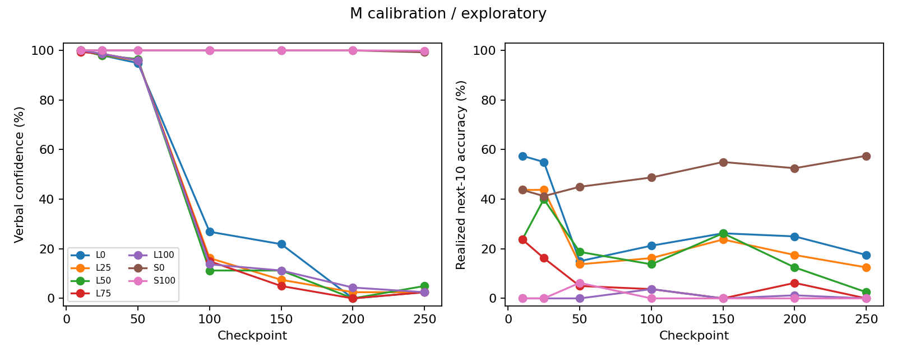
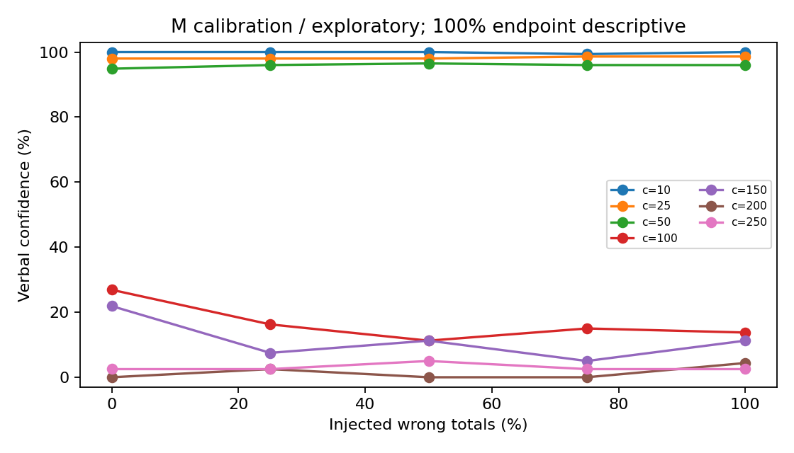
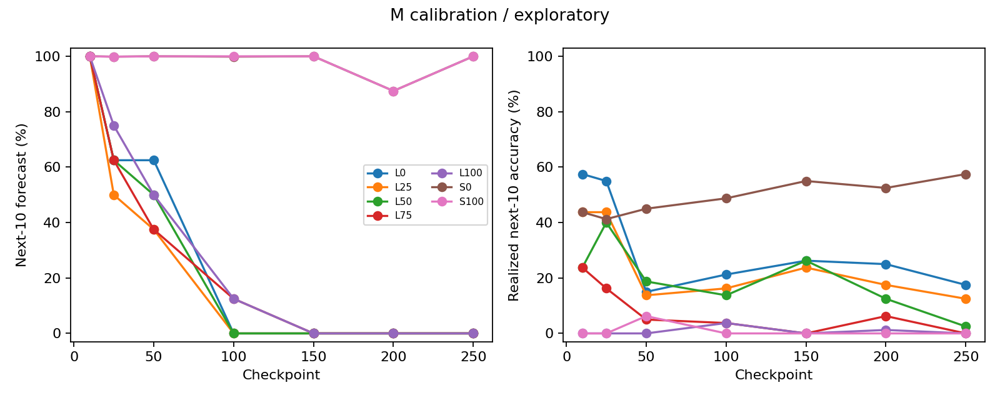
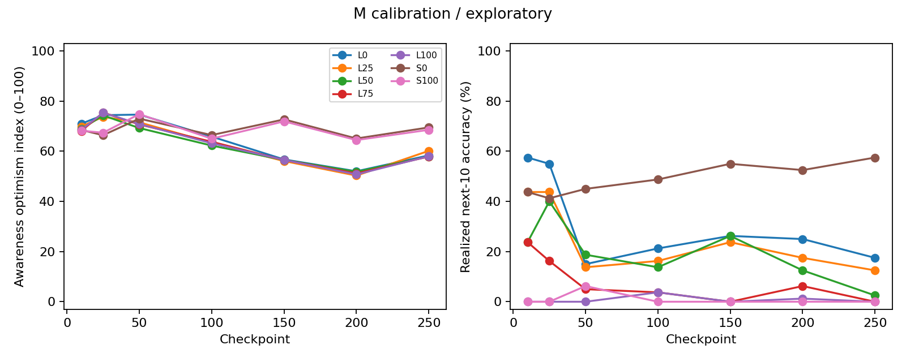

# M calibration pilot — 2026-11-18

**Complete: seven M arms × eight calibration trajectories × seven checkpoints = 392 conditions / 3,920 real task answers.**

GPU 1, local Granite 4.2 8B, bf16, greedy, utilization .38, context 6,144, eager execution, one active sequence and 512-token chunked prefill. The actual M context audit bound was 5,241. No test model inference was run.

## Validation

All seven raw arm archives validated, all eight trajectories completed in every arm, no invalid checkpoint verbal/forecast/awareness values were found, and the generation source snapshot matches the recorded hashes. All old-work artifact hashes remain preserved. The model engine exited and released its GPU memory.

## Exploratory calibration means

| Arm | Mean verbal (0–100) | Mean forecast % | Realized next-10 accuracy % |
|---|---:|---:|---:|
| L0 | 49.16 | 32.14 | 31.07 |
| L25 | 46.11 | 26.79 | 24.46 |
| L50 | 46.00 | 30.36 | 19.64 |
| L75 | 45.21 | 30.36 | 7.86 |
| L100 | 46.64 | 33.93 | 0.71 |
| S0 | 99.89 | 98.18 | 49.11 |
| S100 | 99.98 | 98.20 | 0.89 |

## Paired diagnostic contrasts

Whole-trajectory bootstrap, 10,000 draws. These are eight-trajectory calibration diagnostics; the HF main verdict is withheld.

| Contrast | Mean, percentage points | 95% CI |
|---|---:|---|
| pessimism | 50.73 | [44.57, 55.14] |
| dose | 4.78 | [0.26, 13.13] |
| endpoint | 2.52 | [-2.30, 10.02] |

The numerical classification is inconclusive: the history-truncation pessimism effect clears its practical threshold, but the dose effect neither exceeds 10 nor meets the equivalence rule after correction. Do not describe this as proof that errors have no effect or that length alone explains the reports. The short-window contrast also changes reconstruction evidence. L100 and S100 are near the accuracy floor; intermediate doses remain primary.

## Precision and runtime

Per-arm collection totaled 841.09 seconds in this shared-GPU pilot. Scaling from eight to 32 trajectories gives approximately 56.1 minutes for M main inference; MR pilot telemetry suggests another 32.8 minutes. Budget roughly 90 minutes plus startup, CPU analyses and shared-machine variability, not a fixed completion promise.

HF precision simulations retain N=32 and use joint calibration residuals at observed and doubled scales. The pilot-effect scenario often remains inconclusive, especially at doubled variance. Do not choose a larger N or altered threshold to force the desired classification. MR pilot likewise did not establish the full overall underconfidence pattern. Both studies remain worth testing and must report null/mixed outcomes.

[HF precision](../meta_precision_20261118.json) · [Doubled-variance sensitivity](../meta_precision_conservative_20261118.json) · [Full calibration table](meta_experiment.md) · [Machine-readable analysis](meta_experiment.json)

