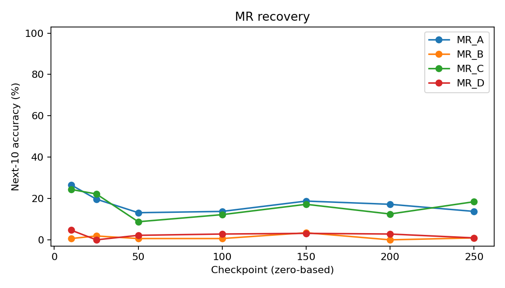
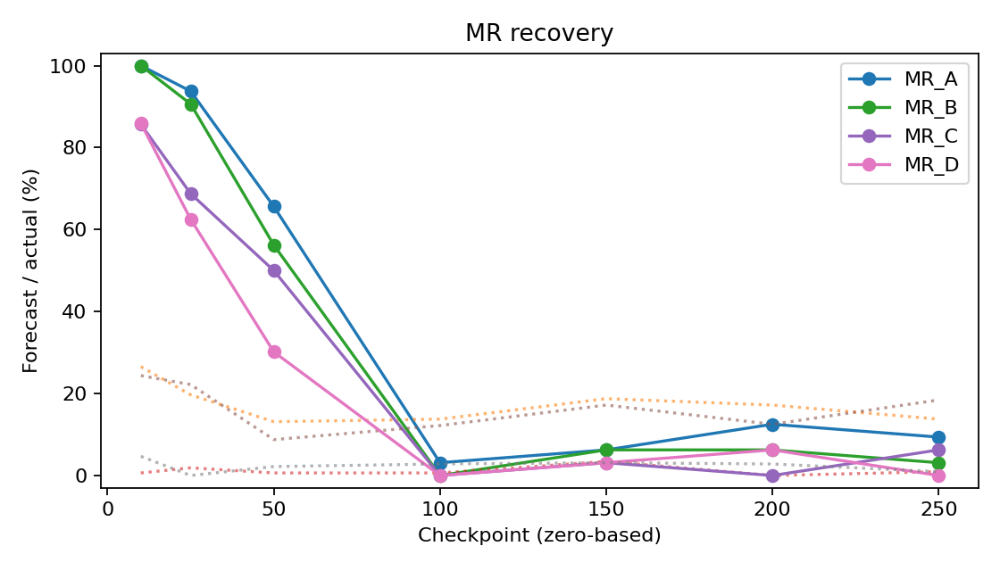
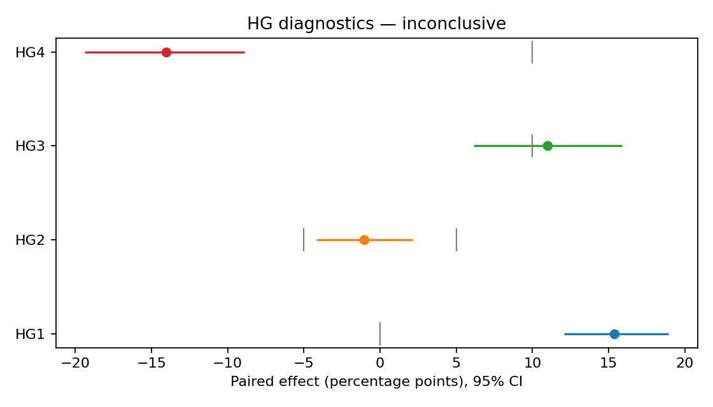
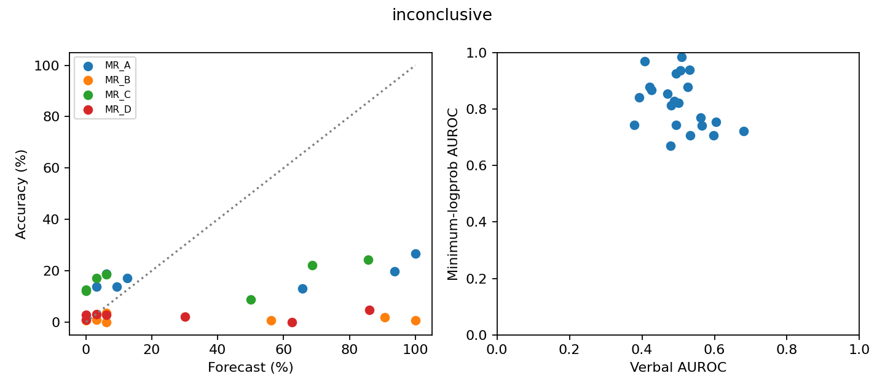

# MR / HG main results — completed 18 November 2026

**Registered verdict: inconclusive. The full proposed recovery/underconfidence
pattern is not supported.** State repair improves accuracy relative to the
wrong-state arm and reaches the low clean-reference accuracy, but the repaired
arm is overconfident on average rather than underconfident.

All 32 trajectories, four arms and seven checkpoints completed: 896 conditions,
8,960 task answers and four validated archives. The supervisor completed at
2026-11-18T13:15:26.666467+05:30. All export/checkpoint/source-snapshot/archive checks passed.
The model process exited and released its GPU allocation.

## Primary tests

| Test | Paired estimate, points | 95% CI | Holm p | Supported |
|---|---:|---|---:|---|
| HG1 | 15.36 | [12.05, 18.93] | 0.000400 | Yes |
| HG2 | -1.03 | [-4.20, 2.14] | 0.026397 | Yes |
| HG3 | 10.97 | [6.13, 15.88] | 0.690931 | No |
| HG4 | -14.03 | [-19.37, -8.88] | 1.000000 | No |

HG1 is R_C−R_B>0; HG2 is R_C−R_A equivalent within ±5; HG3 is F_A−F_C>10;
HG4 is R_C−F_C>10. The full claim requires all four registered interval/Holm
criteria. HG2's 90% interval is [-3.71, 1.65],
inside ±5. HG3's point estimate exceeds 10 but its interval does not establish
the required margin. HG4 has the opposite sign to predicted underconfidence.
No changed margin, checkpoint selection or extra sample was used to rescue it.

## Arm means

| Arm | History / supplied state | Accuracy % | Forecast % |
|---|---|---:|---:|
| MR_A | clean / true | 17.54 | 41.52 |
| MR_B | error / wrong | 1.16 | 37.50 |
| MR_C | error / true | 16.52 | 30.54 |
| MR_D | clean / wrong | 2.37 | 26.85 |

These average seven checkpoints equally within each trajectory, then 32
trajectories equally. Accuracy is the percentage of ten globally correct
answers, not all-ten success. Repair restores performance near a clean
reference of only 17.54%, not near-perfect execution.
The repaired forecast exceeds realized accuracy by 14.03
points on average. Non-support does not establish accurate metacognitive
updating or an internal mechanism.

## Missingness, floors and secondary support

Missing primary forecasts: 0; out-of-range primary forecasts:
0. A and C overall accuracy exceed the registered 5% floor, so the
main verdict is not withheld as floor-limited. B and D are low-accuracy arms;
retain all checkpoints rather than selecting apparent recoveries.

Under the strict checkpoint/offset and common-observation AUROC rule, minimum
logprob is identifiable in 0/280 global-correctness cells and
22/280 local-slip cells. This sparse support cannot establish
universal logit superiority. Calibration, awareness, interactions, pre/post
forecast changes and all per-checkpoint curves remain secondary; they do not
change the primary verdict.

## Provenance and interpretation

The original HG specification was frozen in `1d11bc5`; the GPU 0 scheduling
amendment and tested service PATH fix were committed before inference in
`e45f9df02567cab48613f96c7af9799bfcc53cbe`. GPU 1 stopped at its memory guard; GPU 2 failed
initialization on a missing executable in service PATH, before any MR answers.
GPU 0 is the same Ada model as calibration; all main MR arms used GPU 0. The
original scientific protocol, configs and analysis were unchanged. The hardware
amendments and failure logs remain part of the record, regardless of analyzer
eligibility. These are previously examined A0 sequences, not independent
replication. No mechanistic or general cross-model claim follows.

[Full report](report.md) · [All estimates and provenance](analysis.json)

