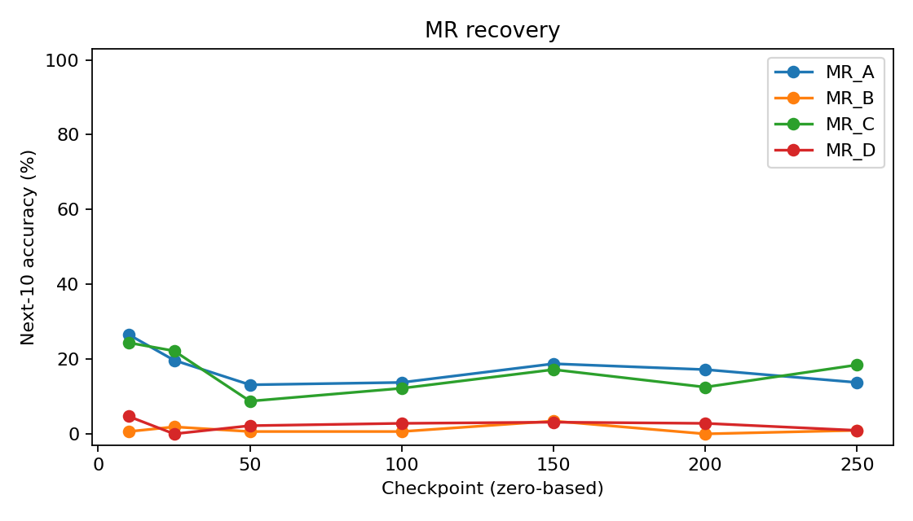
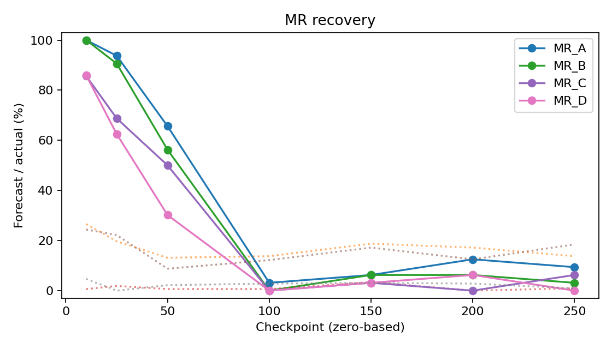
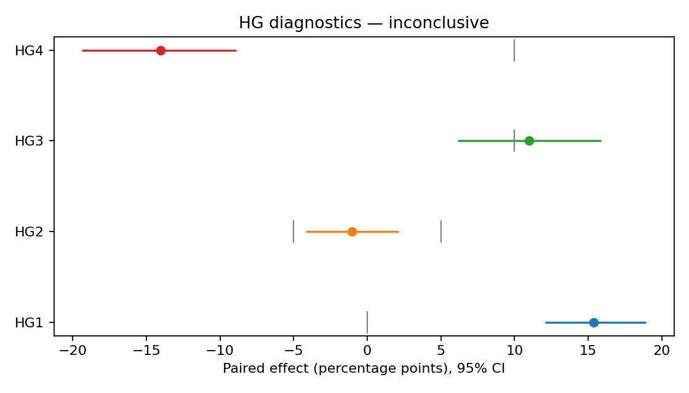
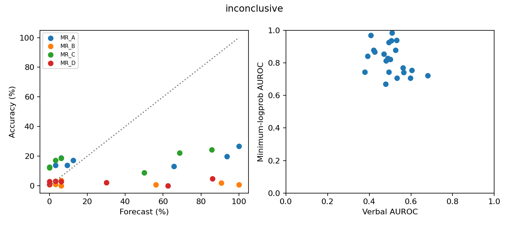

# MR recovery analysis

**inconclusive**

Real inference outputs; the eligibility checks above determine whether a main verdict is available.

| Arm | Checkpoint | n | Accuracy % | Forecast % | Missing | MAE |
|---|---:|---:|---:|---:|---:|---:|
| MR_A | 10 | 32 | 26.5625 | 100.0 | 0 | 73.4375 |
| MR_A | 25 | 32 | 19.6875 | 93.75 | 0 | 75.3125 |
| MR_A | 50 | 32 | 13.125 | 65.625 | 0 | 58.125 |
| MR_A | 100 | 32 | 13.75 | 3.125 | 0 | 16.25 |
| MR_A | 150 | 32 | 18.75 | 6.25 | 0 | 19.375 |
| MR_A | 200 | 32 | 17.1875 | 12.5 | 0 | 23.4375 |
| MR_A | 250 | 32 | 13.75 | 9.375 | 0 | 20.0 |
| MR_B | 10 | 32 | 0.625 | 100.0 | 0 | 99.375 |
| MR_B | 25 | 32 | 1.875 | 90.625 | 0 | 88.75 |
| MR_B | 50 | 32 | 0.625 | 56.21875 | 0 | 56.84375 |
| MR_B | 100 | 32 | 0.625 | 0.0 | 0 | 0.625 |
| MR_B | 150 | 32 | 3.4375 | 6.25 | 0 | 9.6875 |
| MR_B | 200 | 32 | 0.0 | 6.25 | 0 | 6.25 |
| MR_B | 250 | 32 | 0.9375 | 3.125 | 0 | 4.0625 |
| MR_C | 10 | 32 | 24.375 | 85.6875 | 0 | 63.1875 |
| MR_C | 25 | 32 | 22.1875 | 68.75 | 0 | 56.5625 |
| MR_C | 50 | 32 | 8.75 | 50.0 | 0 | 50.0 |
| MR_C | 100 | 32 | 12.1875 | 0.0 | 0 | 12.1875 |
| MR_C | 150 | 32 | 17.1875 | 3.125 | 0 | 15.3125 |
| MR_C | 200 | 32 | 12.5 | 0.0 | 0 | 12.5 |
| MR_C | 250 | 32 | 18.4375 | 6.25 | 0 | 23.4375 |
| MR_D | 10 | 32 | 4.6875 | 85.9375 | 0 | 81.25 |
| MR_D | 25 | 32 | 0.0 | 62.5 | 0 | 62.5 |
| MR_D | 50 | 32 | 2.1875 | 30.15625 | 0 | 29.21875 |
| MR_D | 100 | 32 | 2.8125 | 0.0 | 0 | 2.8125 |
| MR_D | 150 | 32 | 3.125 | 3.125 | 0 | 6.25 |
| MR_D | 200 | 32 | 2.8125 | 6.25 | 0 | 9.0625 |
| MR_D | 250 | 32 | 0.9375 | 0.0 | 0 | 0.9375 |

HG tests, adjusted p-values, CIs, class counts, parse flags, paired interactions, calibration and input provenance are in `analysis.json`.

