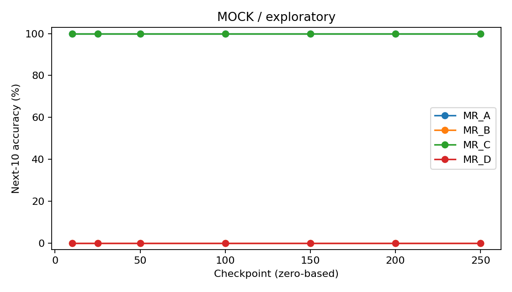
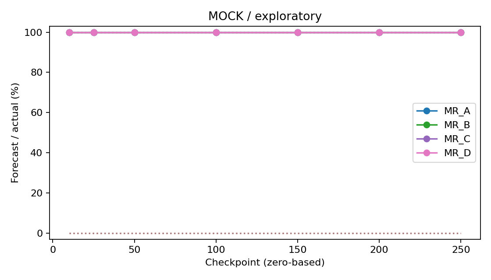
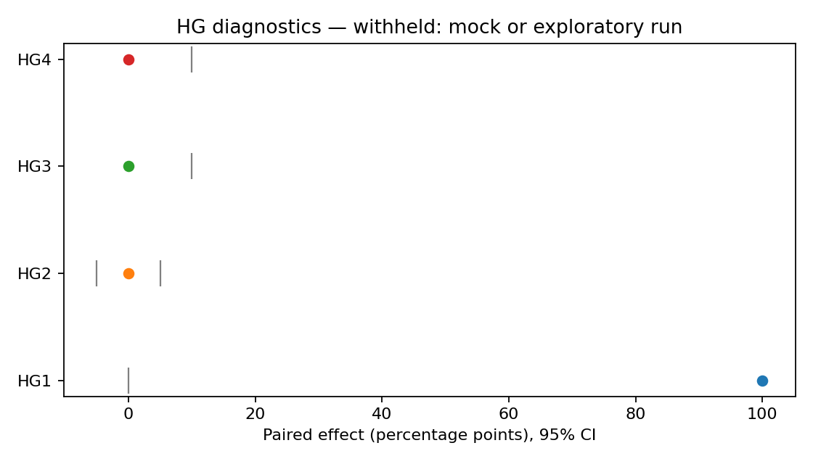
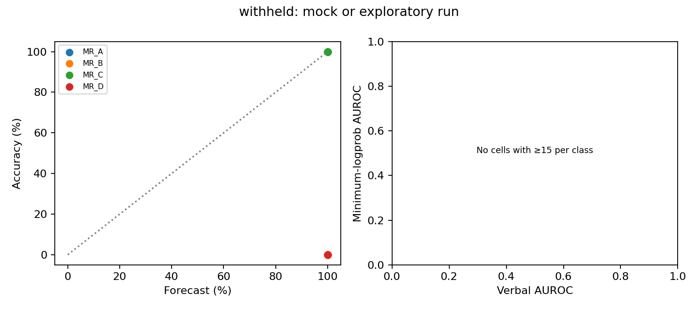

# MR recovery analysis

**withheld: mock or exploratory run**

Mock/exploratory estimates are software diagnostics, not model evidence.

| Arm | Checkpoint | n | Accuracy % | Forecast % | Missing | MAE |
|---|---:|---:|---:|---:|---:|---:|
| MR_A | 10 | 2 | 100.0 | 100.0 | 0 | 0.0 |
| MR_A | 25 | 2 | 100.0 | 100.0 | 0 | 0.0 |
| MR_A | 50 | 2 | 100.0 | 100.0 | 0 | 0.0 |
| MR_A | 100 | 2 | 100.0 | 100.0 | 0 | 0.0 |
| MR_A | 150 | 2 | 100.0 | 100.0 | 0 | 0.0 |
| MR_A | 200 | 2 | 100.0 | 100.0 | 0 | 0.0 |
| MR_A | 250 | 2 | 100.0 | 100.0 | 0 | 0.0 |
| MR_B | 10 | 2 | 0.0 | 100.0 | 0 | 100.0 |
| MR_B | 25 | 2 | 0.0 | 100.0 | 0 | 100.0 |
| MR_B | 50 | 2 | 0.0 | 100.0 | 0 | 100.0 |
| MR_B | 100 | 2 | 0.0 | 100.0 | 0 | 100.0 |
| MR_B | 150 | 2 | 0.0 | 100.0 | 0 | 100.0 |
| MR_B | 200 | 2 | 0.0 | 100.0 | 0 | 100.0 |
| MR_B | 250 | 2 | 0.0 | 100.0 | 0 | 100.0 |
| MR_C | 10 | 2 | 100.0 | 100.0 | 0 | 0.0 |
| MR_C | 25 | 2 | 100.0 | 100.0 | 0 | 0.0 |
| MR_C | 50 | 2 | 100.0 | 100.0 | 0 | 0.0 |
| MR_C | 100 | 2 | 100.0 | 100.0 | 0 | 0.0 |
| MR_C | 150 | 2 | 100.0 | 100.0 | 0 | 0.0 |
| MR_C | 200 | 2 | 100.0 | 100.0 | 0 | 0.0 |
| MR_C | 250 | 2 | 100.0 | 100.0 | 0 | 0.0 |
| MR_D | 10 | 2 | 0.0 | 100.0 | 0 | 100.0 |
| MR_D | 25 | 2 | 0.0 | 100.0 | 0 | 100.0 |
| MR_D | 50 | 2 | 0.0 | 100.0 | 0 | 100.0 |
| MR_D | 100 | 2 | 0.0 | 100.0 | 0 | 100.0 |
| MR_D | 150 | 2 | 0.0 | 100.0 | 0 | 100.0 |
| MR_D | 200 | 2 | 0.0 | 100.0 | 0 | 100.0 |
| MR_D | 250 | 2 | 0.0 | 100.0 | 0 | 100.0 |

HG tests, adjusted p-values, CIs, class counts, parse flags, paired interactions, calibration and input provenance are in `analysis.json`.

