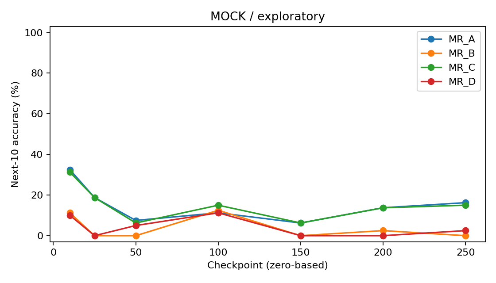
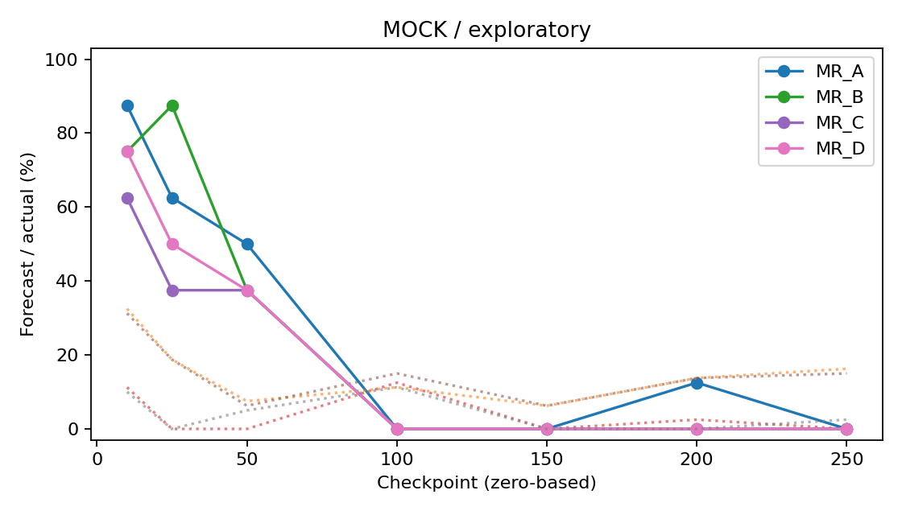
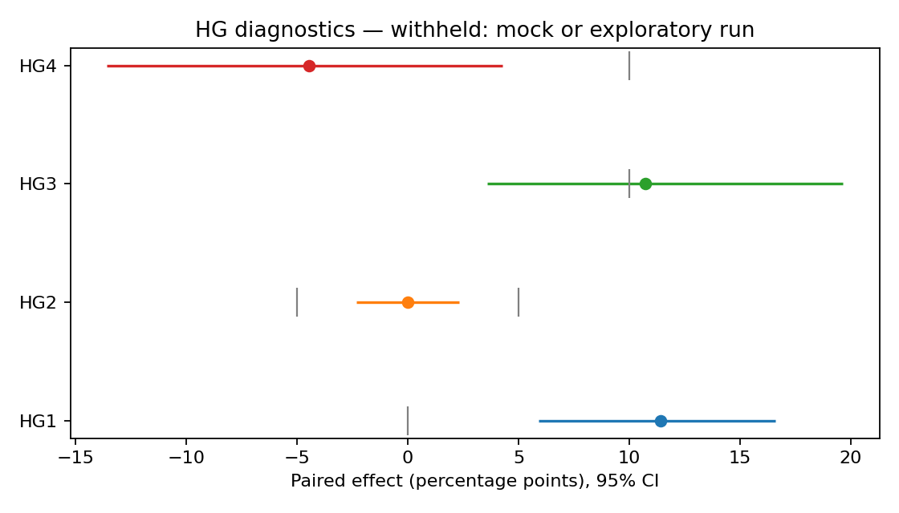
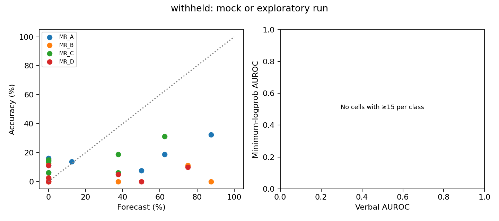

# MR recovery analysis

**withheld: mock or exploratory run**

Real calibration observations; exploratory only, without a confirmatory HG verdict.

| Arm | Checkpoint | n | Accuracy % | Forecast % | Missing | MAE |
|---|---:|---:|---:|---:|---:|---:|
| MR_A | 10 | 8 | 32.5 | 87.5 | 0 | 75.0 |
| MR_A | 25 | 8 | 18.75 | 62.5 | 0 | 48.75 |
| MR_A | 50 | 8 | 7.5 | 50.0 | 0 | 45.0 |
| MR_A | 100 | 8 | 11.25 | 0.0 | 0 | 11.25 |
| MR_A | 150 | 8 | 6.25 | 0.0 | 0 | 6.25 |
| MR_A | 200 | 8 | 13.75 | 12.5 | 0 | 23.75 |
| MR_A | 250 | 8 | 16.25 | 0.0 | 0 | 16.25 |
| MR_B | 10 | 8 | 11.25 | 75.0 | 0 | 63.75 |
| MR_B | 25 | 8 | 0.0 | 87.5 | 0 | 87.5 |
| MR_B | 50 | 8 | 0.0 | 37.5 | 0 | 37.5 |
| MR_B | 100 | 8 | 12.5 | 0.0 | 0 | 12.5 |
| MR_B | 150 | 8 | 0.0 | 0.0 | 0 | 0.0 |
| MR_B | 200 | 8 | 2.5 | 0.0 | 0 | 2.5 |
| MR_B | 250 | 8 | 0.0 | 0.0 | 0 | 0.0 |
| MR_C | 10 | 8 | 31.25 | 62.5 | 0 | 56.25 |
| MR_C | 25 | 8 | 18.75 | 37.5 | 0 | 28.75 |
| MR_C | 50 | 8 | 6.25 | 37.5 | 0 | 38.75 |
| MR_C | 100 | 8 | 15.0 | 0.0 | 0 | 15.0 |
| MR_C | 150 | 8 | 6.25 | 0.0 | 0 | 6.25 |
| MR_C | 200 | 8 | 13.75 | 0.0 | 0 | 13.75 |
| MR_C | 250 | 8 | 15.0 | 0.0 | 0 | 15.0 |
| MR_D | 10 | 8 | 10.0 | 75.0 | 0 | 70.0 |
| MR_D | 25 | 8 | 0.0 | 50.0 | 0 | 50.0 |
| MR_D | 50 | 8 | 5.0 | 37.5 | 0 | 32.5 |
| MR_D | 100 | 8 | 11.25 | 0.0 | 0 | 11.25 |
| MR_D | 150 | 8 | 0.0 | 0.0 | 0 | 0.0 |
| MR_D | 200 | 8 | 0.0 | 0.0 | 0 | 0.0 |
| MR_D | 250 | 8 | 2.5 | 0.0 | 0 | 2.5 |

HG tests, adjusted p-values, CIs, class counts, parse flags, paired interactions, calibration and input provenance are in `analysis.json`.

