# Catching Silent Collapse — All Experimental Results

Results report generated from saved data after all approved experiments. This is not a paper or submission.

Main study completion: 2026-11-18T13:15:26.666467+05:30. Confirmation completion: 2026-11-18T17:08:53.060147+05:30.

| Experiment | Trajectories | Conditions | Task answers |
| --- | --- | --- | --- |
| Main M | 32 | 1568 | 15680 |
| Main MR | 32 | 896 | 8960 |
| Fresh confirmation M | 32 | 1568 | 15680 |
| Fresh confirmation MR | 32 | 896 | 8960 |
| Core experiment total; excludes calibration/A0 | 64 unique sequences | 4928 | 49280 |

Main ids 20–51 were previously examined in A0. Independent confirmation ids 12000–12031 use fresh seeds 2000–2031 and the same dictionary. All checkpoints are 10,25,50,100,150,200,250, with ten future task answers each. Calibration is excluded from confirmatory estimates. Side probes are excluded from task-answer counts.

### Protocol and score definitions

| Setting | Saved value |
| --- | --- |
| Model | ibm-granite/granite-4.2-8b |
| Model revision | a7042144125ce5ae64f89610e8289647fc000b9a |
| Published dataset revision | 7e4901fbb42b88144a65782052d0c8d87a358edc |
| Task | K=1 key/turn; T=300; same dictionary in all cohorts |
| Inference | bf16; greedy constrained integer answers; no thinking; independent probe forks |
| Runtime | context 6144; memory fraction 0.38; one active sequence; 512-token chunked prefill; eager |
| Original scientific registration | 1d11bc5; local commit before main inference |
| Original MR execution amendment | e45f9df; before MR main inference |
| Fresh confirmation registration | ba956aa65bfb8ec4a08e9e0111a49aaa025fb554 |

M arms L0/L25/L50/L75/L100 supply long histories with the named percentage of wrong totals; S0/S100 show the last five turns of their long counterparts. Every wrong supplied total is truth+1 from the approved generator. P=S0−L0 verbal confidence; length L=−P. D is minus the confidence OLS slope over doses 0,.25,.50,.75, expressed per full dose range. The L0−L100 endpoint is descriptive at the accuracy floor.

MR_A=clean history/true supplied state; MR_B=error history/wrong state; MR_C=the same error history/true state; MR_D=the same clean history/wrong state. One neutral state cue precedes continuation. The first local label uses that supplied state; global truth does not change. Pre-cue and post-cue forecasts and actual task answers are independent forks.

C was registered after the original main results were known, retaining every original condition and decision rule. Fresh-sequence allocation used fixed seeds and content hashes rather than model outcomes. These are independent synthetic sequences within recorded project use, not an independent model or a guarantee about unknown training exposure.

| Decision | Original main | Fresh confirmation |
| --- | --- | --- |
| HF | length-driven | length-driven |
| HG | inconclusive | inconclusive |

Verbal confidence evaluates the current answer. Forecasts predict the percentage of globally correct next-ten answers. Awareness is ordinal. For local-slip AUROC, ok+inherited are positive and numeric slips negative, excluding nonanswers. MR also reports global-correctness AUROC. Secondary intervals are descriptive and do not create additional primary decisions.

Each study uses 10,000 whole-trajectory bootstrap draws and the registered separate four-test Holm families. Main and confirmation estimates are reported separately; no unregistered pooled decision is made.

Scores: verbal confidence rates the current answer; forecasts predict the percentage of globally correct next-ten answers; awareness compares performance with the start. Local correctness includes inherited wrong totals that are arithmetically consistent with the preceding state; numeric slips are fresh local errors. MR also reports global correctness, with nonanswers counted wrong. Strict AUROC cells require at least 15 per class. Secondary intervals are descriptive, not additional adjusted primary claims.

## Original main M

Reported decision: **length-driven**.

| Contrast | Estimate, points | 95% CI |
| --- | --- | --- |
| length | -53.57 | [-55.36, -51.71] |
| pessimism | 53.57 | [51.71, 55.36] |
| dose | -1.23 | [-3.86, 1.40] |
| endpoint | -1.05 | [-2.89, 0.78] |

| HF test | Raw bootstrap p | Holm p | Interval rule | Supported |
| --- | --- | --- | --- | --- |
| pessimism_gt10 | 0.000000 | 0.000000 | True | True |
| pessimism_equiv | 1.000000 | 1.000000 | False | False |
| dose_gt10 | 0.000000 | 0.000000 | False | False |
| dose_equiv | 0.000000 | 0.000000 | True | True |

Mean confidence is nonincreasing across intermediate doses at each checkpoint: {'10': True, '25': False, '50': False, '100': False, '150': False, '200': False, '250': False}. All intermediate cells at the accuracy floor: False.

Stored HF p=0 means below empirical resampling resolution, not mathematical zero. Superiority also requires the directional interval rule. Dose equivalence uses its 90% interval and the ±10-point band.

| Equivalence test | 90% interval | Registered bounds |
| --- | --- | --- |
| pessimism_equiv | [52.01, 55.08] | (-10, +10) |
| dose_equiv | [-3.43, 0.94] | (-10, +10) |

| Arm | Verbal / 100 | Forecast % | Actual accuracy % |
| --- | --- | --- | --- |
| L0 | 46.38 | 35.27 | 25.40 |
| L25 | 48.03 | 34.82 | 17.37 |
| L50 | 47.78 | 37.05 | 12.95 |
| L75 | 47.48 | 35.71 | 5.94 |
| L100 | 47.43 | 35.25 | 1.65 |
| S0 | 99.95 | 99.50 | 49.02 |
| S100 | 99.94 | 98.17 | 0.80 |

| Checkpoint | Arm | n | Confidence / forecast | Accuracy % |
| --- | --- | --- | --- | --- |
| 10 | L0 | 32 | 100.00 / 96.88 | 43.12 |
| 25 | L0 | 32 | 98.44 / 75.00 | 28.75 |
| 50 | L0 | 32 | 94.31 / 65.62 | 26.56 |
| 100 | L0 | 32 | 18.44 / 6.25 | 24.38 |
| 150 | L0 | 32 | 9.06 / 0.00 | 15.62 |
| 200 | L0 | 32 | 1.88 / 0.00 | 21.56 |
| 250 | L0 | 32 | 2.50 / 3.12 | 17.81 |
| 10 | L25 | 32 | 100.00 / 96.88 | 20.94 |
| 25 | L25 | 32 | 98.75 / 62.50 | 26.88 |
| 50 | L25 | 32 | 94.66 / 65.62 | 16.25 |
| 100 | L25 | 32 | 27.19 / 6.25 | 12.19 |
| 150 | L25 | 32 | 10.00 / 9.38 | 11.88 |
| 200 | L25 | 32 | 2.50 / 0.00 | 20.00 |
| 250 | L25 | 32 | 3.12 / 3.12 | 13.44 |
| 10 | L50 | 32 | 99.97 / 96.88 | 19.38 |
| 25 | L50 | 32 | 98.72 / 78.12 | 20.31 |
| 50 | L50 | 32 | 94.66 / 65.62 | 11.25 |
| 100 | L50 | 32 | 28.28 / 6.25 | 6.56 |
| 150 | L50 | 32 | 7.81 / 9.38 | 14.06 |
| 200 | L50 | 32 | 2.50 / 3.12 | 12.50 |
| 250 | L50 | 32 | 2.50 / 0.00 | 6.56 |
| 10 | L75 | 32 | 99.97 / 96.88 | 6.25 |
| 25 | L75 | 32 | 98.75 / 75.00 | 6.56 |
| 50 | L75 | 32 | 94.44 / 68.75 | 7.19 |
| 100 | L75 | 32 | 25.16 / 3.12 | 5.31 |
| 150 | L75 | 32 | 8.44 / 3.12 | 8.12 |
| 200 | L75 | 32 | 2.50 / 3.12 | 5.00 |
| 250 | L75 | 32 | 3.12 / 0.00 | 3.12 |
| 10 | L100 | 32 | 99.97 / 96.88 | 2.81 |
| 25 | L100 | 32 | 98.34 / 74.94 | 0.00 |
| 50 | L100 | 32 | 94.31 / 65.59 | 3.12 |
| 100 | L100 | 32 | 25.94 / 3.12 | 1.25 |
| 150 | L100 | 32 | 7.81 / 6.25 | 0.94 |
| 200 | L100 | 32 | 2.50 / 0.00 | 0.00 |
| 250 | L100 | 32 | 3.12 / 0.00 | 3.44 |
| 10 | S0 | 32 | 100.00 / 99.94 | 51.25 |
| 25 | S0 | 32 | 99.97 / 96.84 | 45.63 |
| 50 | S0 | 32 | 99.97 / 99.94 | 53.75 |
| 100 | S0 | 32 | 100.00 / 99.97 | 55.62 |
| 150 | S0 | 32 | 99.97 / 99.94 | 40.94 |
| 200 | S0 | 32 | 99.94 / 99.97 | 54.69 |
| 250 | S0 | 32 | 99.78 / 99.94 | 41.25 |
| 10 | S100 | 32 | 99.97 / 99.94 | 0.00 |
| 25 | S100 | 32 | 100.00 / 96.84 | 0.31 |
| 50 | S100 | 32 | 100.00 / 99.91 | 0.31 |
| 100 | S100 | 32 | 99.97 / 100.00 | 0.00 |
| 150 | S100 | 32 | 99.91 / 96.81 | 0.00 |
| 200 | S100 | 32 | 99.97 / 96.84 | 2.19 |
| 250 | S100 | 32 | 99.78 / 96.81 | 2.81 |

| Checkpoint / arm | Awareness optimism % | Invalid verbal | Invalid forecast | Invalid awareness |
| --- | --- | --- | --- | --- |
| 10 / L0 | 76.95 | 0 | 0 | 0 |
| 25 / L0 | 79.74 | 0 | 0 | 0 |
| 50 / L0 | 71.47 | 0 | 0 | 0 |
| 100 / L0 | 59.43 | 0 | 0 | 0 |
| 150 / L0 | 56.86 | 0 | 0 | 0 |
| 200 / L0 | 49.85 | 0 | 0 | 0 |
| 250 / L0 | 53.24 | 0 | 0 | 0 |
| 10 / L25 | 76.17 | 0 | 0 | 0 |
| 25 / L25 | 78.09 | 0 | 0 | 0 |
| 50 / L25 | 70.22 | 0 | 0 | 0 |
| 100 / L25 | 59.81 | 0 | 0 | 0 |
| 150 / L25 | 56.85 | 0 | 0 | 0 |
| 200 / L25 | 51.13 | 0 | 0 | 0 |
| 250 / L25 | 54.00 | 0 | 0 | 0 |
| 10 / L50 | 75.59 | 0 | 0 | 0 |
| 25 / L50 | 78.04 | 0 | 0 | 0 |
| 50 / L50 | 69.08 | 0 | 0 | 0 |
| 100 / L50 | 59.52 | 0 | 0 | 0 |
| 150 / L50 | 56.56 | 0 | 0 | 0 |
| 200 / L50 | 50.66 | 0 | 0 | 0 |
| 250 / L50 | 53.21 | 0 | 0 | 0 |
| 10 / L75 | 75.04 | 0 | 0 | 0 |
| 25 / L75 | 78.04 | 0 | 0 | 0 |
| 50 / L75 | 69.73 | 0 | 0 | 0 |
| 100 / L75 | 59.98 | 0 | 0 | 0 |
| 150 / L75 | 56.90 | 0 | 0 | 0 |
| 200 / L75 | 50.42 | 0 | 0 | 0 |
| 250 / L75 | 53.35 | 0 | 0 | 0 |
| 10 / L100 | 74.65 | 0 | 0 | 0 |
| 25 / L100 | 77.70 | 0 | 0 | 0 |
| 50 / L100 | 68.27 | 0 | 0 | 0 |
| 100 / L100 | 60.42 | 0 | 0 | 0 |
| 150 / L100 | 57.70 | 0 | 0 | 0 |
| 200 / L100 | 50.76 | 0 | 0 | 0 |
| 250 / L100 | 53.44 | 0 | 0 | 0 |
| 10 / S0 | 67.14 | 0 | 0 | 0 |
| 25 / S0 | 65.24 | 0 | 0 | 0 |
| 50 / S0 | 66.10 | 0 | 0 | 0 |
| 100 / S0 | 66.40 | 0 | 0 | 0 |
| 150 / S0 | 65.58 | 0 | 0 | 0 |
| 200 / S0 | 64.20 | 0 | 0 | 0 |
| 250 / S0 | 65.60 | 0 | 0 | 0 |
| 10 / S100 | 66.71 | 0 | 0 | 0 |
| 25 / S100 | 66.23 | 0 | 0 | 0 |
| 50 / S100 | 65.40 | 0 | 0 | 0 |
| 100 / S100 | 66.95 | 0 | 0 | 0 |
| 150 / S100 | 65.58 | 0 | 0 | 0 |
| 200 / S100 | 63.39 | 0 | 0 | 0 |
| 250 / S100 | 65.75 | 0 | 0 | 0 |

| Signal | Calibration slope [CI] | Intercept [CI] |
| --- | --- | --- |
| verbal | 0.130 [0.090, 0.172] | 0.075 [-0.008, 0.158] |
| fore_none | 0.100 [0.057, 0.141] | 0.108 [0.023, 0.195] |
| aware | 0.060 [-0.048, 0.141] | 0.162 [0.072, 0.269] |

Calibration regressions condition on checkpoint and bootstrap whole trajectories. Verbal confidence concerns the current answer; awareness is ordinal. Only the forecast is a next-ten probability estimate. History truncation also removes evidence; it is not a pure token-count intervention.

Invalid checkpoint probes: {'verbal': 0, 'fore_none': 0, 'aware': 0}. Floor cells (accuracy ≤5%): L75@200, L75@250, L100@10, L100@25, L100@50, L100@100, L100@150, L100@200, L100@250, S100@10, S100@25, S100@50, S100@100, S100@150, S100@200, S100@250.

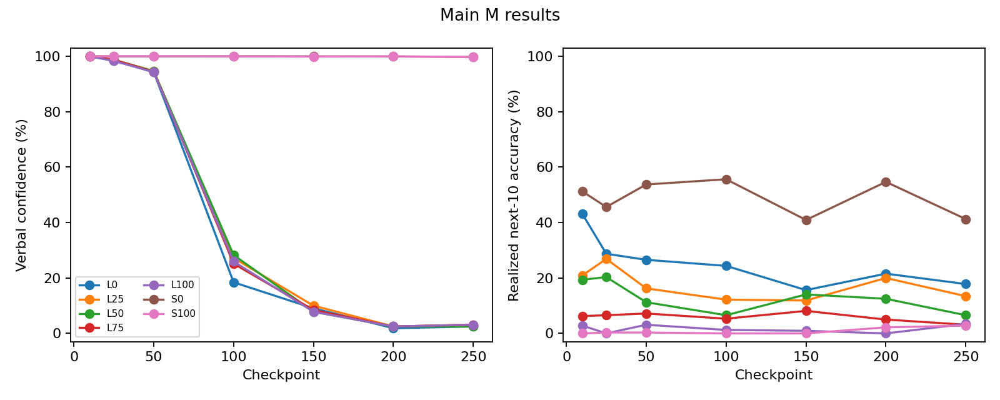

Strict minimum-logprob AUROC support: 31/490 checkpoint/offset cells. Undefined cells are not zeros and are not silently pooled. Full feature intervals are saved in the analysis JSON.

### Identifiable strict localization cells

Verbal and logit comparisons use their paired common observations. P(Yes) support may differ; inspect the saved per-feature class counts before comparison.

| Cell / score | AUROC | 95% CI | n positive / negative | Valid draws |
| --- | --- | --- | --- | --- |
| L0 / 100 / 6 / ptrue | 0.484 | [0.281, 0.679] | 16 / 16 | 3973 |
| L0 / 100 / 6 / lp_mean | 0.961 | [0.887, 1.000] | 16 / 16 | 3973 |
| L0 / 100 / 6 / neg_ent_max | 0.973 | [0.910, 1.000] | 16 / 16 | 3973 |
| L0 / 100 / 6 / margin_min | 0.947 | [0.863, 0.996] | 16 / 16 | 3973 |
| L0 / 100 / 6 / fin_lp_min | 0.977 | [0.918, 1.000] | 16 / 16 | 3973 |
| L0 / 100 / 6 / verbal | 0.473 | [0.291, 0.659] | 16 / 16 | 3973 |
| L0 / 100 / 6 / lp_min | 0.977 | [0.918, 1.000] | 16 / 16 | 3973 |
| L0 / 150 / 3 / ptrue | 0.418 | [0.216, 0.625] | 16 / 16 | 3988 |
| L0 / 150 / 3 / lp_mean | 0.793 | [0.616, 0.941] | 16 / 16 | 3988 |
| L0 / 150 / 3 / neg_ent_max | 0.781 | [0.590, 0.945] | 16 / 16 | 3988 |
| L0 / 150 / 3 / margin_min | 0.766 | [0.584, 0.925] | 16 / 16 | 3988 |
| L0 / 150 / 3 / fin_lp_min | 0.797 | [0.612, 0.957] | 16 / 16 | 3988 |
| L0 / 150 / 3 / verbal | 0.490 | [0.327, 0.656] | 16 / 16 | 3988 |
| L0 / 150 / 3 / lp_min | 0.797 | [0.612, 0.957] | 16 / 16 | 3988 |
| L0 / 150 / 7 / ptrue | 0.420 | [0.212, 0.635] | 17 / 15 | 3879 |
| L0 / 150 / 7 / lp_mean | 0.957 | [0.871, 1.000] | 17 / 15 | 3879 |
| L0 / 150 / 7 / neg_ent_max | 0.910 | [0.784, 0.992] | 17 / 15 | 3879 |
| L0 / 150 / 7 / margin_min | 0.929 | [0.812, 1.000] | 17 / 15 | 3879 |
| L0 / 150 / 7 / fin_lp_min | 0.929 | [0.824, 1.000] | 17 / 15 | 3879 |
| L0 / 150 / 7 / verbal | 0.541 | [0.376, 0.706] | 17 / 15 | 3879 |
| L0 / 150 / 7 / lp_min | 0.929 | [0.824, 1.000] | 17 / 15 | 3879 |
| L0 / 250 / 2 / ptrue | 0.402 | [0.211, 0.612] | 16 / 16 | 3981 |
| L0 / 250 / 2 / lp_mean | 0.992 | [0.965, 1.000] | 16 / 16 | 3981 |
| L0 / 250 / 2 / neg_ent_max | 0.984 | [0.945, 1.000] | 16 / 16 | 3981 |
| L0 / 250 / 2 / margin_min | 0.975 | [0.920, 1.000] | 16 / 16 | 3981 |
| L0 / 250 / 2 / fin_lp_min | 0.977 | [0.922, 1.000] | 16 / 16 | 3981 |
| L0 / 250 / 2 / verbal | 0.500 | [0.382, 0.618] | 16 / 16 | 3981 |
| L0 / 250 / 2 / lp_min | 0.977 | [0.922, 1.000] | 16 / 16 | 3981 |
| L0 / 250 / 4 / ptrue | 0.582 | [0.373, 0.777] | 16 / 16 | 3916 |
| L0 / 250 / 4 / lp_mean | 0.848 | [0.698, 0.969] | 16 / 16 | 3916 |
| L0 / 250 / 4 / neg_ent_max | 0.840 | [0.678, 0.969] | 16 / 16 | 3916 |
| L0 / 250 / 4 / margin_min | 0.885 | [0.759, 0.983] | 16 / 16 | 3916 |
| L0 / 250 / 4 / fin_lp_min | 0.848 | [0.688, 0.976] | 16 / 16 | 3916 |
| L0 / 250 / 4 / verbal | 0.531 | [0.406, 0.656] | 16 / 16 | 3916 |
| L0 / 250 / 4 / lp_min | 0.848 | [0.688, 0.976] | 16 / 16 | 3916 |
| L0 / 250 / 10 / ptrue | 0.333 | [0.145, 0.529] | 17 / 15 | 3800 |
| L0 / 250 / 10 / lp_mean | 0.969 | [0.894, 1.000] | 17 / 15 | 3800 |
| L0 / 250 / 10 / neg_ent_max | 0.992 | [0.965, 1.000] | 17 / 15 | 3800 |
| L0 / 250 / 10 / margin_min | 0.955 | [0.865, 1.000] | 17 / 15 | 3800 |
| L0 / 250 / 10 / fin_lp_min | 0.988 | [0.953, 1.000] | 17 / 15 | 3800 |
| L0 / 250 / 10 / verbal | 0.529 | [0.500, 0.600] | 17 / 15 | 3800 |
| L0 / 250 / 10 / lp_min | 0.988 | [0.953, 1.000] | 17 / 15 | 3800 |
| L25 / 50 / 8 / ptrue | 0.333 | [0.161, 0.539] | 15 / 17 | 3747 |
| L25 / 50 / 8 / lp_mean | 0.933 | [0.835, 1.000] | 15 / 17 | 3747 |
| L25 / 50 / 8 / neg_ent_max | 0.941 | [0.848, 1.000] | 15 / 17 | 3747 |
| L25 / 50 / 8 / margin_min | 0.912 | [0.790, 1.000] | 15 / 17 | 3747 |
| L25 / 50 / 8 / fin_lp_min | 0.941 | [0.844, 1.000] | 15 / 17 | 3747 |
| L25 / 50 / 8 / verbal | 0.404 | [0.264, 0.541] | 15 / 17 | 3747 |
| L25 / 50 / 8 / lp_min | 0.941 | [0.844, 1.000] | 15 / 17 | 3747 |
| L25 / 150 / 3 / ptrue | 0.387 | [0.185, 0.593] | 16 / 16 | 4048 |
| L25 / 150 / 3 / lp_mean | 0.758 | [0.569, 0.910] | 16 / 16 | 4048 |
| L25 / 150 / 3 / neg_ent_max | 0.754 | [0.566, 0.914] | 16 / 16 | 4048 |
| L25 / 150 / 3 / margin_min | 0.793 | [0.624, 0.934] | 16 / 16 | 4048 |
| L25 / 150 / 3 / fin_lp_min | 0.777 | [0.598, 0.922] | 16 / 16 | 4048 |
| L25 / 150 / 3 / verbal | 0.396 | [0.235, 0.565] | 16 / 16 | 4048 |
| L25 / 150 / 3 / lp_min | 0.777 | [0.598, 0.922] | 16 / 16 | 4048 |
| L25 / 150 / 7 / ptrue | 0.624 | [0.424, 0.812] | 15 / 17 | 3785 |
| L25 / 150 / 7 / lp_mean | 0.980 | [0.929, 1.000] | 15 / 17 | 3785 |
| L25 / 150 / 7 / neg_ent_max | 0.976 | [0.925, 1.000] | 15 / 17 | 3785 |
| L25 / 150 / 7 / margin_min | 0.918 | [0.803, 1.000] | 15 / 17 | 3785 |
| L25 / 150 / 7 / fin_lp_min | 0.945 | [0.859, 1.000] | 15 / 17 | 3785 |
| L25 / 150 / 7 / verbal | 0.539 | [0.383, 0.696] | 15 / 17 | 3785 |
| L25 / 150 / 7 / lp_min | 0.945 | [0.859, 1.000] | 15 / 17 | 3785 |
| L25 / 150 / 9 / ptrue | 0.353 | [0.168, 0.557] | 17 / 15 | 3877 |
| L25 / 150 / 9 / lp_mean | 0.937 | [0.824, 1.000] | 17 / 15 | 3877 |
| L25 / 150 / 9 / neg_ent_max | 0.910 | [0.789, 0.992] | 17 / 15 | 3877 |
| L25 / 150 / 9 / margin_min | 0.978 | [0.929, 1.000] | 17 / 15 | 3877 |
| L25 / 150 / 9 / fin_lp_min | 0.949 | [0.851, 1.000] | 17 / 15 | 3877 |
| L25 / 150 / 9 / verbal | 0.484 | [0.331, 0.641] | 17 / 15 | 3877 |
| L25 / 150 / 9 / lp_min | 0.949 | [0.851, 1.000] | 17 / 15 | 3877 |
| L25 / 200 / 9 / ptrue | 0.404 | [0.208, 0.620] | 17 / 15 | 3872 |
| L25 / 200 / 9 / lp_mean | 0.902 | [0.766, 0.996] | 17 / 15 | 3872 |
| L25 / 200 / 9 / neg_ent_max | 0.965 | [0.894, 1.000] | 17 / 15 | 3872 |
| L25 / 200 / 9 / margin_min | 0.867 | [0.708, 0.991] | 17 / 15 | 3872 |
| L25 / 200 / 9 / fin_lp_min | 0.961 | [0.883, 1.000] | 17 / 15 | 3872 |
| L25 / 200 / 9 / verbal | 0.525 | [0.429, 0.627] | 17 / 15 | 3872 |
| L25 / 200 / 9 / lp_min | 0.961 | [0.883, 1.000] | 17 / 15 | 3872 |
| L25 / 250 / 9 / ptrue | 0.525 | [0.325, 0.734] | 17 / 15 | 3838 |
| L25 / 250 / 9 / lp_mean | 0.929 | [0.831, 0.992] | 17 / 15 | 3838 |
| L25 / 250 / 9 / neg_ent_max | 0.929 | [0.831, 0.992] | 17 / 15 | 3838 |
| L25 / 250 / 9 / margin_min | 0.904 | [0.784, 0.984] | 17 / 15 | 3838 |
| L25 / 250 / 9 / fin_lp_min | 0.929 | [0.828, 1.000] | 17 / 15 | 3838 |
| L25 / 250 / 9 / verbal | 0.459 | [0.329, 0.584] | 17 / 15 | 3838 |
| L25 / 250 / 9 / lp_min | 0.929 | [0.828, 1.000] | 17 / 15 | 3838 |
| L50 / 100 / 6 / ptrue | 0.545 | [0.333, 0.745] | 17 / 15 | 3779 |
| L50 / 100 / 6 / lp_mean | 0.918 | [0.804, 0.992] | 17 / 15 | 3779 |
| L50 / 100 / 6 / neg_ent_max | 0.929 | [0.827, 0.996] | 17 / 15 | 3779 |
| L50 / 100 / 6 / margin_min | 0.886 | [0.755, 0.980] | 17 / 15 | 3779 |
| L50 / 100 / 6 / fin_lp_min | 0.925 | [0.824, 0.992] | 17 / 15 | 3779 |
| L50 / 100 / 6 / verbal | 0.537 | [0.365, 0.714] | 17 / 15 | 3779 |
| L50 / 100 / 6 / lp_min | 0.925 | [0.824, 0.992] | 17 / 15 | 3779 |
| L50 / 150 / 3 / ptrue | 0.382 | [0.200, 0.586] | 17 / 15 | 3850 |
| L50 / 150 / 3 / lp_mean | 0.796 | [0.627, 0.933] | 17 / 15 | 3850 |
| L50 / 150 / 3 / neg_ent_max | 0.788 | [0.612, 0.933] | 17 / 15 | 3850 |
| L50 / 150 / 3 / margin_min | 0.816 | [0.652, 0.953] | 17 / 15 | 3850 |
| L50 / 150 / 3 / fin_lp_min | 0.796 | [0.624, 0.941] | 17 / 15 | 3850 |
| L50 / 150 / 3 / verbal | 0.510 | [0.344, 0.672] | 17 / 15 | 3850 |
| L50 / 150 / 3 / lp_min | 0.796 | [0.624, 0.941] | 17 / 15 | 3850 |
| L50 / 150 / 6 / ptrue | 0.459 | [0.254, 0.659] | 17 / 15 | 3825 |
| L50 / 150 / 6 / lp_mean | 0.937 | [0.835, 1.000] | 17 / 15 | 3825 |
| L50 / 150 / 6 / neg_ent_max | 0.941 | [0.843, 1.000] | 17 / 15 | 3825 |
| L50 / 150 / 6 / margin_min | 0.906 | [0.783, 0.988] | 17 / 15 | 3825 |
| L50 / 150 / 6 / fin_lp_min | 0.953 | [0.871, 1.000] | 17 / 15 | 3825 |
| L50 / 150 / 6 / verbal | 0.582 | [0.425, 0.733] | 17 / 15 | 3825 |
| L50 / 150 / 6 / lp_min | 0.953 | [0.871, 1.000] | 17 / 15 | 3825 |
| L50 / 150 / 7 / ptrue | 0.496 | [0.286, 0.702] | 16 / 16 | 4041 |
| L50 / 150 / 7 / lp_mean | 0.926 | [0.816, 1.000] | 16 / 16 | 4041 |
| L50 / 150 / 7 / neg_ent_max | 0.863 | [0.718, 0.969] | 16 / 16 | 4041 |
| L50 / 150 / 7 / margin_min | 0.896 | [0.773, 0.984] | 16 / 16 | 4041 |
| L50 / 150 / 7 / fin_lp_min | 0.902 | [0.777, 0.988] | 16 / 16 | 4041 |
| L50 / 150 / 7 / verbal | 0.490 | [0.331, 0.645] | 16 / 16 | 4041 |
| L50 / 150 / 7 / lp_min | 0.902 | [0.777, 0.988] | 16 / 16 | 4041 |
| L50 / 250 / 4 / ptrue | 0.647 | [0.443, 0.828] | 15 / 17 | 3848 |
| L50 / 250 / 4 / lp_mean | 0.820 | [0.651, 0.953] | 15 / 17 | 3848 |
| L50 / 250 / 4 / neg_ent_max | 0.867 | [0.718, 0.980] | 15 / 17 | 3848 |
| L50 / 250 / 4 / margin_min | 0.763 | [0.575, 0.922] | 15 / 17 | 3848 |
| L50 / 250 / 4 / fin_lp_min | 0.855 | [0.706, 0.973] | 15 / 17 | 3848 |
| L50 / 250 / 4 / verbal | 0.571 | [0.467, 0.688] | 15 / 17 | 3848 |
| L50 / 250 / 4 / lp_min | 0.855 | [0.706, 0.973] | 15 / 17 | 3848 |
| L50 / 250 / 7 / ptrue | 0.380 | [0.180, 0.585] | 17 / 15 | 3752 |
| L50 / 250 / 7 / lp_mean | 0.878 | [0.730, 0.988] | 17 / 15 | 3752 |
| L50 / 250 / 7 / neg_ent_max | 0.863 | [0.705, 0.980] | 17 / 15 | 3752 |
| L50 / 250 / 7 / margin_min | 0.804 | [0.633, 0.937] | 17 / 15 | 3752 |
| L50 / 250 / 7 / fin_lp_min | 0.871 | [0.722, 0.984] | 17 / 15 | 3752 |
| L50 / 250 / 7 / verbal | 0.463 | [0.363, 0.562] | 17 / 15 | 3752 |
| L50 / 250 / 7 / lp_min | 0.871 | [0.722, 0.984] | 17 / 15 | 3752 |
| L75 / 100 / 6 / ptrue | 0.471 | [0.263, 0.686] | 15 / 17 | 3816 |
| L75 / 100 / 6 / lp_mean | 0.808 | [0.635, 0.941] | 15 / 17 | 3816 |
| L75 / 100 / 6 / neg_ent_max | 0.827 | [0.659, 0.961] | 15 / 17 | 3816 |
| L75 / 100 / 6 / margin_min | 0.790 | [0.611, 0.937] | 15 / 17 | 3816 |
| L75 / 100 / 6 / fin_lp_min | 0.827 | [0.659, 0.961] | 15 / 17 | 3816 |
| L75 / 100 / 6 / verbal | 0.604 | [0.430, 0.777] | 15 / 17 | 3816 |
| L75 / 100 / 6 / lp_min | 0.827 | [0.659, 0.961] | 15 / 17 | 3816 |
| L75 / 150 / 3 / ptrue | 0.367 | [0.180, 0.573] | 16 / 16 | 4001 |
| L75 / 150 / 3 / lp_mean | 0.848 | [0.694, 0.961] | 16 / 16 | 4001 |
| L75 / 150 / 3 / neg_ent_max | 0.832 | [0.675, 0.945] | 16 / 16 | 4001 |
| L75 / 150 / 3 / margin_min | 0.891 | [0.761, 0.984] | 16 / 16 | 4001 |
| L75 / 150 / 3 / fin_lp_min | 0.848 | [0.694, 0.957] | 16 / 16 | 4001 |
| L75 / 150 / 3 / verbal | 0.469 | [0.306, 0.639] | 16 / 16 | 4001 |
| L75 / 150 / 3 / lp_min | 0.848 | [0.694, 0.957] | 16 / 16 | 4001 |
| L75 / 150 / 6 / ptrue | 0.384 | [0.195, 0.582] | 15 / 17 | 3876 |
| L75 / 150 / 6 / lp_mean | 0.988 | [0.953, 1.000] | 15 / 17 | 3876 |
| L75 / 150 / 6 / neg_ent_max | 0.976 | [0.922, 1.000] | 15 / 17 | 3876 |
| L75 / 150 / 6 / margin_min | 0.941 | [0.847, 1.000] | 15 / 17 | 3876 |
| L75 / 150 / 6 / fin_lp_min | 0.973 | [0.914, 1.000] | 15 / 17 | 3876 |
| L75 / 150 / 6 / verbal | 0.578 | [0.424, 0.727] | 15 / 17 | 3876 |
| L75 / 150 / 6 / lp_min | 0.973 | [0.914, 1.000] | 15 / 17 | 3876 |
| L75 / 150 / 7 / ptrue | 0.624 | [0.412, 0.812] | 17 / 15 | 3797 |
| L75 / 150 / 7 / lp_mean | 0.945 | [0.827, 1.000] | 17 / 15 | 3797 |
| L75 / 150 / 7 / neg_ent_max | 0.945 | [0.848, 1.000] | 17 / 15 | 3797 |
| L75 / 150 / 7 / margin_min | 0.910 | [0.789, 0.985] | 17 / 15 | 3797 |
| L75 / 150 / 7 / fin_lp_min | 0.949 | [0.863, 1.000] | 17 / 15 | 3797 |
| L75 / 150 / 7 / verbal | 0.702 | [0.549, 0.851] | 17 / 15 | 3797 |
| L75 / 150 / 7 / lp_min | 0.949 | [0.863, 1.000] | 17 / 15 | 3797 |
| L75 / 200 / 8 / ptrue | 0.766 | [0.580, 0.922] | 16 / 16 | 4010 |
| L75 / 200 / 8 / lp_mean | 0.844 | [0.687, 0.969] | 16 / 16 | 4010 |
| L75 / 200 / 8 / neg_ent_max | 0.891 | [0.766, 0.980] | 16 / 16 | 4010 |
| L75 / 200 / 8 / margin_min | 0.857 | [0.707, 0.973] | 16 / 16 | 4010 |
| L75 / 200 / 8 / fin_lp_min | 0.887 | [0.762, 0.977] | 16 / 16 | 4010 |
| L75 / 200 / 8 / verbal | 0.594 | [0.500, 0.700] | 16 / 16 | 4010 |
| L75 / 200 / 8 / lp_min | 0.887 | [0.762, 0.977] | 16 / 16 | 4010 |
| L75 / 200 / 9 / ptrue | 0.508 | [0.310, 0.718] | 16 / 16 | 4101 |
| L75 / 200 / 9 / lp_mean | 0.891 | [0.750, 0.984] | 16 / 16 | 4101 |
| L75 / 200 / 9 / neg_ent_max | 0.879 | [0.722, 0.988] | 16 / 16 | 4101 |
| L75 / 200 / 9 / margin_min | 0.846 | [0.691, 0.964] | 16 / 16 | 4101 |
| L75 / 200 / 9 / fin_lp_min | 0.875 | [0.725, 0.988] | 16 / 16 | 4101 |
| L75 / 200 / 9 / verbal | 0.562 | [0.459, 0.676] | 16 / 16 | 4101 |
| L75 / 200 / 9 / lp_min | 0.875 | [0.725, 0.988] | 16 / 16 | 4101 |
| L75 / 250 / 2 / ptrue | 0.344 | [0.152, 0.549] | 16 / 16 | 4079 |
| L75 / 250 / 2 / lp_mean | 0.902 | [0.780, 0.988] | 16 / 16 | 4079 |
| L75 / 250 / 2 / neg_ent_max | 0.883 | [0.749, 0.988] | 16 / 16 | 4079 |
| L75 / 250 / 2 / margin_min | 0.852 | [0.694, 0.976] | 16 / 16 | 4079 |
| L75 / 250 / 2 / fin_lp_min | 0.875 | [0.733, 0.988] | 16 / 16 | 4079 |
| L75 / 250 / 2 / verbal | 0.500 | [0.382, 0.618] | 16 / 16 | 4079 |
| L75 / 250 / 2 / lp_min | 0.875 | [0.733, 0.988] | 16 / 16 | 4079 |
| L75 / 250 / 5 / ptrue | 0.694 | [0.477, 0.875] | 15 / 17 | 3766 |
| L75 / 250 / 5 / lp_mean | 0.890 | [0.750, 0.984] | 15 / 17 | 3766 |
| L75 / 250 / 5 / neg_ent_max | 0.894 | [0.769, 0.980] | 15 / 17 | 3766 |
| L75 / 250 / 5 / margin_min | 0.902 | [0.773, 0.988] | 15 / 17 | 3766 |
| L75 / 250 / 5 / fin_lp_min | 0.910 | [0.792, 0.984] | 15 / 17 | 3766 |
| L75 / 250 / 5 / verbal | 0.445 | [0.333, 0.559] | 15 / 17 | 3766 |
| L75 / 250 / 5 / lp_min | 0.910 | [0.792, 0.984] | 15 / 17 | 3766 |
| L100 / 100 / 6 / ptrue | 0.529 | [0.307, 0.742] | 15 / 17 | 3781 |
| L100 / 100 / 6 / lp_mean | 0.878 | [0.741, 0.976] | 15 / 17 | 3781 |
| L100 / 100 / 6 / neg_ent_max | 0.859 | [0.706, 0.973] | 15 / 17 | 3781 |
| L100 / 100 / 6 / margin_min | 0.873 | [0.729, 0.976] | 15 / 17 | 3781 |
| L100 / 100 / 6 / fin_lp_min | 0.871 | [0.725, 0.976] | 15 / 17 | 3781 |
| L100 / 100 / 6 / verbal | 0.453 | [0.275, 0.626] | 15 / 17 | 3781 |
| L100 / 100 / 6 / lp_min | 0.871 | [0.725, 0.976] | 15 / 17 | 3781 |
| L100 / 150 / 6 / ptrue | 0.395 | [0.199, 0.605] | 16 / 16 | 4060 |
| L100 / 150 / 6 / lp_mean | 0.961 | [0.882, 1.000] | 16 / 16 | 4060 |
| L100 / 150 / 6 / neg_ent_max | 0.977 | [0.922, 1.000] | 16 / 16 | 4060 |
| L100 / 150 / 6 / margin_min | 0.945 | [0.859, 1.000] | 16 / 16 | 4060 |
| L100 / 150 / 6 / fin_lp_min | 0.969 | [0.906, 1.000] | 16 / 16 | 4060 |
| L100 / 150 / 6 / verbal | 0.578 | [0.404, 0.750] | 16 / 16 | 4060 |
| L100 / 150 / 6 / lp_min | 0.969 | [0.906, 1.000] | 16 / 16 | 4060 |
| L100 / 150 / 7 / ptrue | 0.443 | [0.227, 0.652] | 17 / 15 | 3754 |
| L100 / 150 / 7 / lp_mean | 0.929 | [0.816, 1.000] | 17 / 15 | 3754 |
| L100 / 150 / 7 / neg_ent_max | 0.910 | [0.777, 0.992] | 17 / 15 | 3754 |
| L100 / 150 / 7 / margin_min | 0.922 | [0.808, 0.988] | 17 / 15 | 3754 |
| L100 / 150 / 7 / fin_lp_min | 0.906 | [0.769, 0.992] | 17 / 15 | 3754 |
| L100 / 150 / 7 / verbal | 0.535 | [0.363, 0.708] | 17 / 15 | 3754 |
| L100 / 150 / 7 / lp_min | 0.906 | [0.769, 0.992] | 17 / 15 | 3754 |
| L100 / 200 / 9 / ptrue | 0.512 | [0.305, 0.729] | 16 / 16 | 4103 |
| L100 / 200 / 9 / lp_mean | 0.895 | [0.769, 0.984] | 16 / 16 | 4103 |
| L100 / 200 / 9 / neg_ent_max | 0.898 | [0.773, 0.988] | 16 / 16 | 4103 |
| L100 / 200 / 9 / margin_min | 0.867 | [0.727, 0.969] | 16 / 16 | 4103 |
| L100 / 200 / 9 / fin_lp_min | 0.898 | [0.773, 0.988] | 16 / 16 | 4103 |
| L100 / 200 / 9 / verbal | 0.562 | [0.455, 0.688] | 16 / 16 | 4103 |
| L100 / 200 / 9 / lp_min | 0.898 | [0.773, 0.988] | 16 / 16 | 4103 |
| L100 / 250 / 4 / ptrue | 0.604 | [0.400, 0.796] | 15 / 17 | 3778 |
| L100 / 250 / 4 / lp_mean | 0.914 | [0.780, 1.000] | 15 / 17 | 3778 |
| L100 / 250 / 4 / neg_ent_max | 0.898 | [0.758, 0.992] | 15 / 17 | 3778 |
| L100 / 250 / 4 / margin_min | 0.914 | [0.781, 1.000] | 15 / 17 | 3778 |
| L100 / 250 / 4 / fin_lp_min | 0.910 | [0.773, 1.000] | 15 / 17 | 3778 |
| L100 / 250 / 4 / verbal | 0.508 | [0.392, 0.625] | 15 / 17 | 3778 |
| L100 / 250 / 4 / lp_min | 0.910 | [0.773, 1.000] | 15 / 17 | 3778 |

## Original main MR

Registered verdict: **inconclusive**.

| HG test | Estimate, points | 95% CI | Holm p | Supported |
| --- | --- | --- | --- | --- |
| HG1 | 15.36 | [12.05, 18.93] | 0.000400 | True |
| HG2 | -1.03 | [-4.20, 2.14] | 0.026397 | True |
| HG3 | 10.97 | [6.13, 15.88] | 0.690931 | False |
| HG4 | -14.03 | [-19.37, -8.88] | 1.000000 | False |

HG2 90% equivalence interval: [-3.71, 1.65]; bounds (-5, +5). Calibration diagnostics do not issue a confirmatory verdict.

HG1: repaired−wrong-state accuracy >0. HG2: repaired−clean accuracy equivalent within ±5. HG3: clean−repaired forecast >10. HG4: repaired accuracy−forecast >10. All four must pass. A lower forecast than an overconfident reference is insufficient evidence of underconfidence.

| Arm | Accuracy % | Pre-cue forecast % | Post-cue forecast % |
| --- | --- | --- | --- |
| MR_A | 17.54 | 36.16 | 41.52 |
| MR_B | 1.16 | 36.16 | 37.50 |
| MR_C | 16.52 | 36.16 | 30.54 |
| MR_D | 2.37 | 36.16 | 26.85 |

| Arm / checkpoint | Accuracy % | Forecast % | MAE | Missing |
| --- | --- | --- | --- | --- |
| MR_A / 10 | 26.56 | 100.00 | 73.44 | 0 |
| MR_A / 25 | 19.69 | 93.75 | 75.31 | 0 |
| MR_A / 50 | 13.12 | 65.62 | 58.12 | 0 |
| MR_A / 100 | 13.75 | 3.12 | 16.25 | 0 |
| MR_A / 150 | 18.75 | 6.25 | 19.38 | 0 |
| MR_A / 200 | 17.19 | 12.50 | 23.44 | 0 |
| MR_A / 250 | 13.75 | 9.38 | 20.00 | 0 |
| MR_B / 10 | 0.62 | 100.00 | 99.38 | 0 |
| MR_B / 25 | 1.88 | 90.62 | 88.75 | 0 |
| MR_B / 50 | 0.62 | 56.22 | 56.84 | 0 |
| MR_B / 100 | 0.62 | 0.00 | 0.62 | 0 |
| MR_B / 150 | 3.44 | 6.25 | 9.69 | 0 |
| MR_B / 200 | 0.00 | 6.25 | 6.25 | 0 |
| MR_B / 250 | 0.94 | 3.12 | 4.06 | 0 |
| MR_C / 10 | 24.38 | 85.69 | 63.19 | 0 |
| MR_C / 25 | 22.19 | 68.75 | 56.56 | 0 |
| MR_C / 50 | 8.75 | 50.00 | 50.00 | 0 |
| MR_C / 100 | 12.19 | 0.00 | 12.19 | 0 |
| MR_C / 150 | 17.19 | 3.12 | 15.31 | 0 |
| MR_C / 200 | 12.50 | 0.00 | 12.50 | 0 |
| MR_C / 250 | 18.44 | 6.25 | 23.44 | 0 |
| MR_D / 10 | 4.69 | 85.94 | 81.25 | 0 |
| MR_D / 25 | 0.00 | 62.50 | 62.50 | 0 |
| MR_D / 50 | 2.19 | 30.16 | 29.22 | 0 |
| MR_D / 100 | 2.81 | 0.00 | 2.81 | 0 |
| MR_D / 150 | 3.12 | 3.12 | 6.25 | 0 |
| MR_D / 200 | 2.81 | 6.25 | 9.06 | 0 |
| MR_D / 250 | 0.94 | 0.00 | 0.94 | 0 |

Primary overall floor flag: False. Missing primary forecasts: 0. Out-of-range primary forecasts: 0.

| Arm | Calibration slope [CI] | Intercept [CI] |
| --- | --- | --- |
| MR_A | 0.090 [0.004, 0.193] | 0.176 [0.040, 0.314] |
| MR_B | -0.009 [-0.032, 0.009] | 0.015 [-0.005, 0.040] |
| MR_C | 0.078 [0.007, 0.146] | 0.177 [0.071, 0.300] |
| MR_D | 0.018 [-0.007, 0.056] | 0.031 [-0.019, 0.100] |

| Arm / checkpoint | Awareness higher % | Same % | Lower % | Valid n |
| --- | --- | --- | --- | --- |
| MR_A / 10 | 50.95 | 44.97 | 4.08 | 32 |
| MR_A / 25 | 54.13 | 39.41 | 6.46 | 32 |
| MR_A / 50 | 40.38 | 54.91 | 4.71 | 32 |
| MR_A / 100 | 32.16 | 59.56 | 8.27 | 32 |
| MR_A / 150 | 28.79 | 58.68 | 12.52 | 32 |
| MR_A / 200 | 28.81 | 61.73 | 9.46 | 32 |
| MR_A / 250 | 28.60 | 58.15 | 13.25 | 32 |
| MR_B / 10 | 47.71 | 47.76 | 4.53 | 32 |
| MR_B / 25 | 53.03 | 40.92 | 6.05 | 32 |
| MR_B / 50 | 38.81 | 55.63 | 5.56 | 32 |
| MR_B / 100 | 32.77 | 57.60 | 9.63 | 32 |
| MR_B / 150 | 30.99 | 56.46 | 12.54 | 32 |
| MR_B / 200 | 27.19 | 61.24 | 11.57 | 32 |
| MR_B / 250 | 28.33 | 58.25 | 13.43 | 32 |
| MR_C / 10 | 51.53 | 43.60 | 4.88 | 32 |
| MR_C / 25 | 52.01 | 38.91 | 9.08 | 32 |
| MR_C / 50 | 39.65 | 53.34 | 7.01 | 32 |
| MR_C / 100 | 34.56 | 56.41 | 9.03 | 32 |
| MR_C / 150 | 33.36 | 52.86 | 13.78 | 32 |
| MR_C / 200 | 32.46 | 57.67 | 9.86 | 32 |
| MR_C / 250 | 30.54 | 57.07 | 12.39 | 32 |
| MR_D / 10 | 51.69 | 43.10 | 5.22 | 32 |
| MR_D / 25 | 55.19 | 36.49 | 8.32 | 32 |
| MR_D / 50 | 40.82 | 53.25 | 5.93 | 32 |
| MR_D / 100 | 34.43 | 57.92 | 7.65 | 32 |
| MR_D / 150 | 33.58 | 53.92 | 12.50 | 32 |
| MR_D / 200 | 30.84 | 58.54 | 10.62 | 32 |
| MR_D / 250 | 32.34 | 55.25 | 12.41 | 32 |

| Interaction | Estimate, points | 95% CI |
| --- | --- | --- |
| accuracy | 0.18 | [-3.12, 3.48] |
| forecast | -21.62 | [-29.24, -14.47] |

Global minimum-logprob AUROC support: 0/280 strict cells. Local minimum-logprob AUROC support: 22/280 strict cells. Calibration, interactions and discrimination are secondary and do not change the registered primary verdict.

### Identifiable strict discrimination cells

| Cell / score | AUROC | 95% CI | n positive / negative | Valid draws |
| --- | --- | --- | --- | --- |
| MR_A / 50 / 3 / local / verbal | 0.525 | [0.383, 0.671] | 17 / 15 | 3849 |
| MR_A / 50 / 3 / local / ptrue | 0.400 | [0.199, 0.617] | 17 / 15 | 3849 |
| MR_A / 50 / 3 / local / lp_min | 0.878 | [0.729, 0.992] | 17 / 15 | 3849 |
| MR_A / 50 / 3 / local / lp_mean | 0.882 | [0.742, 0.992] | 17 / 15 | 3849 |
| MR_A / 50 / 3 / local / neg_ent_max | 0.882 | [0.734, 0.984] | 17 / 15 | 3849 |
| MR_A / 50 / 3 / local / margin_min | 0.882 | [0.733, 0.999] | 17 / 15 | 3849 |
| MR_A / 50 / 3 / local / fin_lp_min | 0.878 | [0.729, 0.992] | 17 / 15 | 3849 |
| MR_A / 50 / 4 / local / verbal | 0.494 | [0.357, 0.631] | 17 / 15 | 3760 |
| MR_A / 50 / 4 / local / ptrue | 0.263 | [0.102, 0.449] | 17 / 15 | 3760 |
| MR_A / 50 / 4 / local / lp_min | 0.925 | [0.804, 1.000] | 17 / 15 | 3760 |
| MR_A / 50 / 4 / local / lp_mean | 0.929 | [0.812, 1.000] | 17 / 15 | 3760 |
| MR_A / 50 / 4 / local / neg_ent_max | 0.918 | [0.793, 1.000] | 17 / 15 | 3760 |
| MR_A / 50 / 4 / local / margin_min | 0.902 | [0.768, 1.000] | 17 / 15 | 3760 |
| MR_A / 50 / 4 / local / fin_lp_min | 0.925 | [0.804, 1.000] | 17 / 15 | 3760 |
| MR_A / 100 / 10 / local / verbal | 0.480 | [0.312, 0.649] | 16 / 16 | 4027 |
| MR_A / 100 / 10 / local / ptrue | 0.609 | [0.398, 0.792] | 16 / 16 | 4027 |
| MR_A / 100 / 10 / local / lp_min | 0.812 | [0.639, 0.957] | 16 / 16 | 4027 |
| MR_A / 100 / 10 / local / lp_mean | 0.820 | [0.651, 0.957] | 16 / 16 | 4027 |
| MR_A / 100 / 10 / local / neg_ent_max | 0.801 | [0.624, 0.945] | 16 / 16 | 4027 |
| MR_A / 100 / 10 / local / margin_min | 0.826 | [0.659, 0.965] | 16 / 16 | 4027 |
| MR_A / 100 / 10 / local / fin_lp_min | 0.812 | [0.639, 0.957] | 16 / 16 | 4027 |
| MR_A / 150 / 3 / local / verbal | 0.379 | [0.216, 0.557] | 16 / 16 | 4101 |
| MR_A / 150 / 3 / local / ptrue | 0.375 | [0.180, 0.588] | 16 / 16 | 4101 |
| MR_A / 150 / 3 / local / lp_min | 0.742 | [0.549, 0.906] | 16 / 16 | 4101 |
| MR_A / 150 / 3 / local / lp_mean | 0.773 | [0.588, 0.929] | 16 / 16 | 4101 |
| MR_A / 150 / 3 / local / neg_ent_max | 0.738 | [0.541, 0.906] | 16 / 16 | 4101 |
| MR_A / 150 / 3 / local / margin_min | 0.734 | [0.537, 0.902] | 16 / 16 | 4101 |
| MR_A / 150 / 3 / local / fin_lp_min | 0.742 | [0.549, 0.906] | 16 / 16 | 4101 |
| MR_A / 250 / 4 / local / verbal | 0.422 | [0.250, 0.613] | 15 / 17 | 3780 |
| MR_A / 250 / 4 / local / ptrue | 0.345 | [0.169, 0.549] | 15 / 17 | 3780 |
| MR_A / 250 / 4 / local / lp_min | 0.878 | [0.729, 0.984] | 15 / 17 | 3780 |
| MR_A / 250 / 4 / local / lp_mean | 0.863 | [0.710, 0.980] | 15 / 17 | 3780 |
| MR_A / 250 / 4 / local / neg_ent_max | 0.894 | [0.755, 0.992] | 15 / 17 | 3780 |
| MR_A / 250 / 4 / local / margin_min | 0.812 | [0.647, 0.949] | 15 / 17 | 3780 |
| MR_A / 250 / 4 / local / fin_lp_min | 0.878 | [0.729, 0.984] | 15 / 17 | 3780 |
| MR_B / 100 / 3 / local / verbal | 0.488 | [0.329, 0.651] | 16 / 16 | 4057 |
| MR_B / 100 / 3 / local / ptrue | 0.559 | [0.355, 0.765] | 16 / 16 | 4057 |
| MR_B / 100 / 3 / local / lp_min | 0.828 | [0.671, 0.949] | 16 / 16 | 4057 |
| MR_B / 100 / 3 / local / lp_mean | 0.773 | [0.599, 0.925] | 16 / 16 | 4057 |
| MR_B / 100 / 3 / local / neg_ent_max | 0.812 | [0.648, 0.941] | 16 / 16 | 4057 |
| MR_B / 100 / 3 / local / margin_min | 0.814 | [0.651, 0.941] | 16 / 16 | 4057 |
| MR_B / 100 / 3 / local / fin_lp_min | 0.828 | [0.671, 0.949] | 16 / 16 | 4057 |
| MR_B / 150 / 3 / local / verbal | 0.562 | [0.386, 0.739] | 16 / 16 | 4103 |
| MR_B / 150 / 3 / local / ptrue | 0.473 | [0.271, 0.682] | 16 / 16 | 4103 |
| MR_B / 150 / 3 / local / lp_min | 0.770 | [0.584, 0.931] | 16 / 16 | 4103 |
| MR_B / 150 / 3 / local / lp_mean | 0.727 | [0.531, 0.902] | 16 / 16 | 4103 |
| MR_B / 150 / 3 / local / neg_ent_max | 0.742 | [0.553, 0.906] | 16 / 16 | 4103 |
| MR_B / 150 / 3 / local / margin_min | 0.799 | [0.625, 0.941] | 16 / 16 | 4103 |
| MR_B / 150 / 3 / local / fin_lp_min | 0.770 | [0.584, 0.931] | 16 / 16 | 4103 |
| MR_B / 150 / 6 / local / verbal | 0.408 | [0.224, 0.598] | 16 / 16 | 4042 |
| MR_B / 150 / 6 / local / ptrue | 0.422 | [0.219, 0.629] | 16 / 16 | 4042 |
| MR_B / 150 / 6 / local / lp_min | 0.969 | [0.894, 1.000] | 16 / 16 | 4042 |
| MR_B / 150 / 6 / local / lp_mean | 0.977 | [0.918, 1.000] | 16 / 16 | 4042 |
| MR_B / 150 / 6 / local / neg_ent_max | 0.965 | [0.883, 1.000] | 16 / 16 | 4042 |
| MR_B / 150 / 6 / local / margin_min | 0.910 | [0.792, 0.996] | 16 / 16 | 4042 |
| MR_B / 150 / 6 / local / fin_lp_min | 0.969 | [0.894, 1.000] | 16 / 16 | 4042 |
| MR_B / 250 / 2 / local / verbal | 0.533 | [0.335, 0.725] | 15 / 17 | 3866 |
| MR_B / 250 / 2 / local / ptrue | 0.663 | [0.467, 0.839] | 15 / 17 | 3866 |
| MR_B / 250 / 2 / local / lp_min | 0.706 | [0.494, 0.898] | 15 / 17 | 3866 |
| MR_B / 250 / 2 / local / lp_mean | 0.671 | [0.460, 0.863] | 15 / 17 | 3866 |
| MR_B / 250 / 2 / local / neg_ent_max | 0.690 | [0.475, 0.883] | 15 / 17 | 3866 |
| MR_B / 250 / 2 / local / margin_min | 0.684 | [0.469, 0.879] | 15 / 17 | 3866 |
| MR_B / 250 / 2 / local / fin_lp_min | 0.706 | [0.494, 0.898] | 15 / 17 | 3866 |
| MR_C / 25 / 2 / local / verbal | 0.604 | [0.422, 0.773] | 16 / 16 | 4052 |
| MR_C / 25 / 2 / local / ptrue | 0.305 | [0.121, 0.510] | 16 / 16 | 4052 |
| MR_C / 25 / 2 / local / lp_min | 0.754 | [0.569, 0.910] | 16 / 16 | 4052 |
| MR_C / 25 / 2 / local / lp_mean | 0.707 | [0.510, 0.882] | 16 / 16 | 4052 |
| MR_C / 25 / 2 / local / neg_ent_max | 0.758 | [0.573, 0.918] | 16 / 16 | 4052 |
| MR_C / 25 / 2 / local / margin_min | 0.719 | [0.529, 0.881] | 16 / 16 | 4052 |
| MR_C / 25 / 2 / local / fin_lp_min | 0.754 | [0.569, 0.910] | 16 / 16 | 4052 |
| MR_C / 50 / 2 / local / verbal | 0.500 | [0.386, 0.614] | 16 / 16 | 3983 |
| MR_C / 50 / 2 / local / ptrue | 0.281 | [0.122, 0.475] | 16 / 16 | 3983 |
| MR_C / 50 / 2 / local / lp_min | 0.820 | [0.659, 0.953] | 16 / 16 | 3983 |
| MR_C / 50 / 2 / local / lp_mean | 0.785 | [0.608, 0.934] | 16 / 16 | 3983 |
| MR_C / 50 / 2 / local / neg_ent_max | 0.816 | [0.654, 0.949] | 16 / 16 | 3983 |
| MR_C / 50 / 2 / local / margin_min | 0.801 | [0.634, 0.941] | 16 / 16 | 3983 |
| MR_C / 50 / 2 / local / fin_lp_min | 0.820 | [0.659, 0.953] | 16 / 16 | 3983 |
| MR_C / 150 / 2 / local / verbal | 0.598 | [0.418, 0.766] | 15 / 17 | 3766 |
| MR_C / 150 / 2 / local / ptrue | 0.596 | [0.384, 0.788] | 15 / 17 | 3766 |
| MR_C / 150 / 2 / local / lp_min | 0.706 | [0.510, 0.867] | 15 / 17 | 3766 |
| MR_C / 150 / 2 / local / lp_mean | 0.671 | [0.471, 0.843] | 15 / 17 | 3766 |
| MR_C / 150 / 2 / local / neg_ent_max | 0.725 | [0.537, 0.882] | 15 / 17 | 3766 |
| MR_C / 150 / 2 / local / margin_min | 0.659 | [0.457, 0.844] | 15 / 17 | 3766 |
| MR_C / 150 / 2 / local / fin_lp_min | 0.706 | [0.510, 0.867] | 15 / 17 | 3766 |
| MR_C / 150 / 3 / local / verbal | 0.565 | [0.373, 0.749] | 15 / 17 | 3798 |
| MR_C / 150 / 3 / local / ptrue | 0.478 | [0.278, 0.690] | 15 / 17 | 3798 |
| MR_C / 150 / 3 / local / lp_min | 0.741 | [0.545, 0.902] | 15 / 17 | 3798 |
| MR_C / 150 / 3 / local / lp_mean | 0.792 | [0.624, 0.929] | 15 / 17 | 3798 |
| MR_C / 150 / 3 / local / neg_ent_max | 0.714 | [0.516, 0.878] | 15 / 17 | 3798 |
| MR_C / 150 / 3 / local / margin_min | 0.776 | [0.596, 0.929] | 15 / 17 | 3798 |
| MR_C / 150 / 3 / local / fin_lp_min | 0.741 | [0.545, 0.902] | 15 / 17 | 3798 |
| MR_C / 150 / 6 / local / verbal | 0.510 | [0.312, 0.708] | 16 / 16 | 4016 |
| MR_C / 150 / 6 / local / ptrue | 0.461 | [0.264, 0.672] | 16 / 16 | 4016 |
| MR_C / 150 / 6 / local / lp_min | 0.984 | [0.941, 1.000] | 16 / 16 | 4016 |
| MR_C / 150 / 6 / local / lp_mean | 0.996 | [0.976, 1.000] | 16 / 16 | 4016 |
| MR_C / 150 / 6 / local / neg_ent_max | 0.969 | [0.898, 1.000] | 16 / 16 | 4016 |
| MR_C / 150 / 6 / local / margin_min | 0.977 | [0.922, 1.000] | 16 / 16 | 4016 |
| MR_C / 150 / 6 / local / fin_lp_min | 0.984 | [0.941, 1.000] | 16 / 16 | 4016 |
| MR_C / 250 / 6 / local / verbal | 0.471 | [0.279, 0.666] | 17 / 15 | 3845 |
| MR_C / 250 / 6 / local / ptrue | 0.361 | [0.157, 0.574] | 17 / 15 | 3845 |
| MR_C / 250 / 6 / local / lp_min | 0.855 | [0.696, 0.980] | 17 / 15 | 3845 |
| MR_C / 250 / 6 / local / lp_mean | 0.867 | [0.695, 1.000] | 17 / 15 | 3845 |
| MR_C / 250 / 6 / local / neg_ent_max | 0.859 | [0.695, 0.988] | 17 / 15 | 3845 |
| MR_C / 250 / 6 / local / margin_min | 0.831 | [0.663, 0.964] | 17 / 15 | 3845 |
| MR_C / 250 / 6 / local / fin_lp_min | 0.855 | [0.696, 0.980] | 17 / 15 | 3845 |
| MR_C / 250 / 9 / local / verbal | 0.426 | [0.241, 0.619] | 16 / 16 | 4057 |
| MR_C / 250 / 9 / local / ptrue | 0.438 | [0.246, 0.652] | 16 / 16 | 4057 |
| MR_C / 250 / 9 / local / lp_min | 0.867 | [0.714, 0.984] | 16 / 16 | 4057 |
| MR_C / 250 / 9 / local / lp_mean | 0.902 | [0.773, 0.992] | 16 / 16 | 4057 |
| MR_C / 250 / 9 / local / neg_ent_max | 0.875 | [0.722, 0.996] | 16 / 16 | 4057 |
| MR_C / 250 / 9 / local / margin_min | 0.832 | [0.655, 0.973] | 16 / 16 | 4057 |
| MR_C / 250 / 9 / local / fin_lp_min | 0.867 | [0.714, 0.984] | 16 / 16 | 4057 |
| MR_D / 10 / 2 / local / verbal | 0.531 | [0.500, 0.600] | 16 / 16 | 3941 |
| MR_D / 10 / 2 / local / ptrue | 0.734 | [0.551, 0.886] | 16 / 16 | 3941 |
| MR_D / 10 / 2 / local / lp_min | 0.938 | [0.839, 1.000] | 16 / 16 | 3941 |
| MR_D / 10 / 2 / local / lp_mean | 0.922 | [0.801, 1.000] | 16 / 16 | 3941 |
| MR_D / 10 / 2 / local / neg_ent_max | 0.938 | [0.839, 1.000] | 16 / 16 | 3941 |
| MR_D / 10 / 2 / local / margin_min | 0.918 | [0.784, 1.000] | 16 / 16 | 3941 |
| MR_D / 10 / 2 / local / fin_lp_min | 0.938 | [0.839, 1.000] | 16 / 16 | 3941 |
| MR_D / 25 / 2 / local / verbal | 0.680 | [0.500, 0.845] | 17 / 15 | 3808 |
| MR_D / 25 / 2 / local / ptrue | 0.365 | [0.169, 0.568] | 17 / 15 | 3808 |
| MR_D / 25 / 2 / local / lp_min | 0.722 | [0.529, 0.887] | 17 / 15 | 3808 |
| MR_D / 25 / 2 / local / lp_mean | 0.682 | [0.480, 0.863] | 17 / 15 | 3808 |
| MR_D / 25 / 2 / local / neg_ent_max | 0.722 | [0.531, 0.886] | 17 / 15 | 3808 |
| MR_D / 25 / 2 / local / margin_min | 0.680 | [0.478, 0.859] | 17 / 15 | 3808 |
| MR_D / 25 / 2 / local / fin_lp_min | 0.722 | [0.529, 0.887] | 17 / 15 | 3808 |
| MR_D / 100 / 2 / local / verbal | 0.494 | [0.317, 0.672] | 16 / 16 | 3969 |
| MR_D / 100 / 2 / local / ptrue | 0.570 | [0.365, 0.776] | 16 / 16 | 3969 |
| MR_D / 100 / 2 / local / lp_min | 0.742 | [0.561, 0.901] | 16 / 16 | 3969 |
| MR_D / 100 / 2 / local / lp_mean | 0.730 | [0.549, 0.890] | 16 / 16 | 3969 |
| MR_D / 100 / 2 / local / neg_ent_max | 0.742 | [0.557, 0.898] | 16 / 16 | 3969 |
| MR_D / 100 / 2 / local / margin_min | 0.750 | [0.573, 0.906] | 16 / 16 | 3969 |
| MR_D / 100 / 2 / local / fin_lp_min | 0.742 | [0.561, 0.901] | 16 / 16 | 3969 |
| MR_D / 200 / 2 / local / verbal | 0.478 | [0.285, 0.672] | 15 / 17 | 3872 |
| MR_D / 200 / 2 / local / ptrue | 0.596 | [0.390, 0.800] | 15 / 17 | 3872 |
| MR_D / 200 / 2 / local / lp_min | 0.671 | [0.475, 0.851] | 15 / 17 | 3872 |
| MR_D / 200 / 2 / local / lp_mean | 0.616 | [0.414, 0.805] | 15 / 17 | 3872 |
| MR_D / 200 / 2 / local / neg_ent_max | 0.639 | [0.439, 0.824] | 15 / 17 | 3872 |
| MR_D / 200 / 2 / local / margin_min | 0.647 | [0.445, 0.839] | 15 / 17 | 3872 |
| MR_D / 200 / 2 / local / fin_lp_min | 0.671 | [0.475, 0.851] | 15 / 17 | 3872 |
| MR_D / 250 / 2 / local / verbal | 0.393 | [0.210, 0.583] | 16 / 16 | 4104 |
| MR_D / 250 / 2 / local / ptrue | 0.566 | [0.359, 0.773] | 16 / 16 | 4104 |
| MR_D / 250 / 2 / local / lp_min | 0.840 | [0.688, 0.957] | 16 / 16 | 4104 |
| MR_D / 250 / 2 / local / lp_mean | 0.859 | [0.714, 0.969] | 16 / 16 | 4104 |
| MR_D / 250 / 2 / local / neg_ent_max | 0.855 | [0.706, 0.969] | 16 / 16 | 4104 |
| MR_D / 250 / 2 / local / margin_min | 0.801 | [0.633, 0.937] | 16 / 16 | 4104 |
| MR_D / 250 / 2 / local / fin_lp_min | 0.840 | [0.688, 0.957] | 16 / 16 | 4104 |
| MR_D / 250 / 4 / local / verbal | 0.506 | [0.303, 0.704] | 15 / 17 | 3830 |
| MR_D / 250 / 4 / local / ptrue | 0.518 | [0.306, 0.730] | 15 / 17 | 3830 |
| MR_D / 250 / 4 / local / lp_min | 0.937 | [0.812, 1.000] | 15 / 17 | 3830 |
| MR_D / 250 / 4 / local / lp_mean | 0.949 | [0.835, 1.000] | 15 / 17 | 3830 |
| MR_D / 250 / 4 / local / neg_ent_max | 0.941 | [0.820, 1.000] | 15 / 17 | 3830 |
| MR_D / 250 / 4 / local / margin_min | 0.929 | [0.797, 1.000] | 15 / 17 | 3830 |
| MR_D / 250 / 4 / local / fin_lp_min | 0.937 | [0.812, 1.000] | 15 / 17 | 3830 |

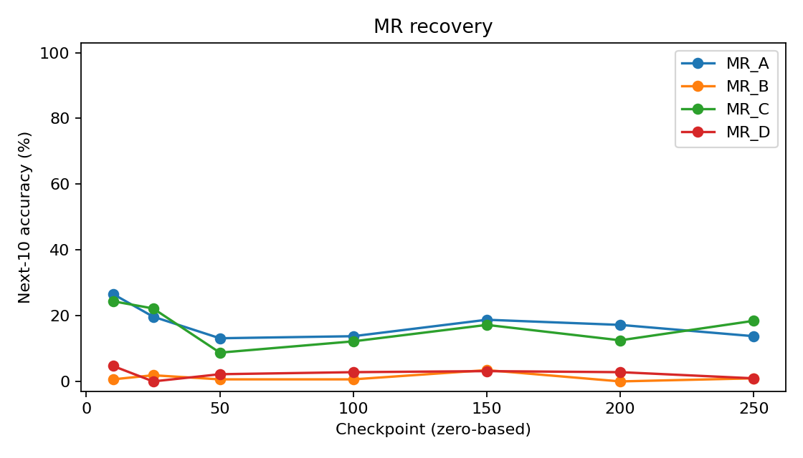

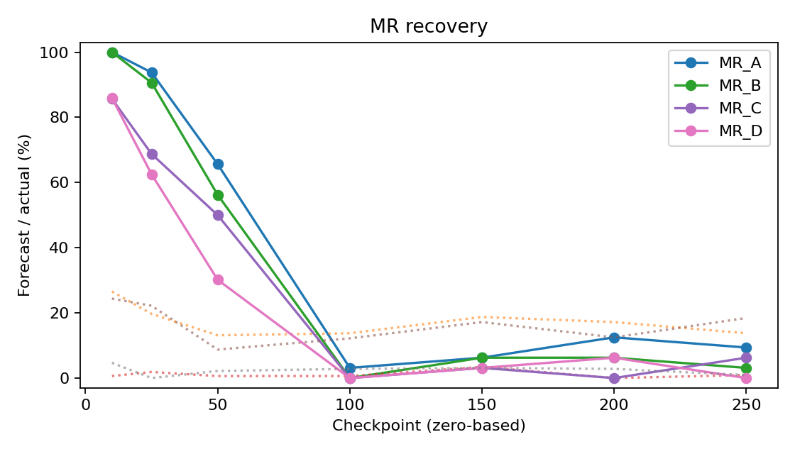

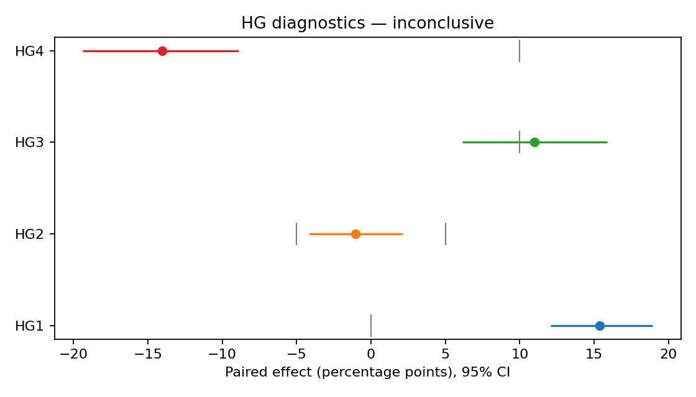

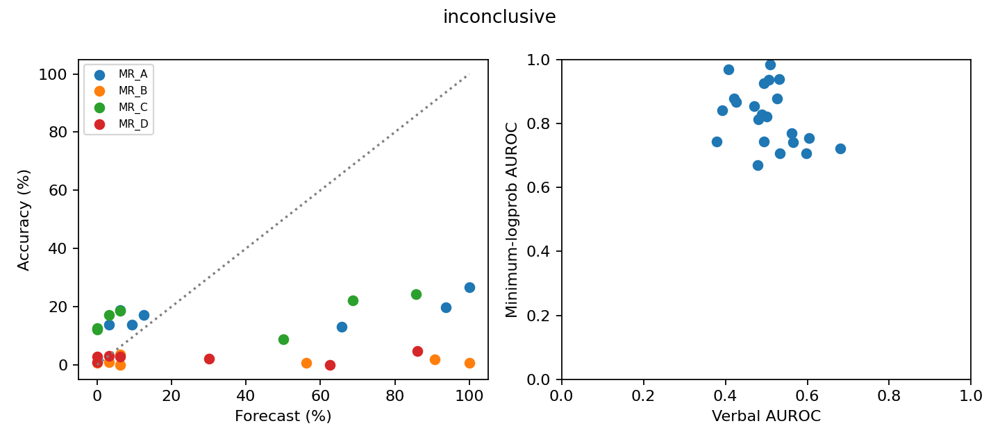

## Fresh confirmation C-M

Reported decision: **length-driven**.

| Contrast | Estimate, points | 95% CI |
| --- | --- | --- |
| length | -52.70 | [-54.95, -50.19] |
| pessimism | 52.70 | [50.19, 54.95] |
| dose | -0.26 | [-1.80, 1.36] |
| endpoint | -1.70 | [-3.63, -0.08] |

| HF test | Raw bootstrap p | Holm p | Interval rule | Supported |
| --- | --- | --- | --- | --- |
| pessimism_gt10 | 0.000000 | 0.000000 | True | True |
| pessimism_equiv | 1.000000 | 1.000000 | False | False |
| dose_gt10 | 0.000000 | 0.000000 | False | False |
| dose_equiv | 0.000000 | 0.000000 | True | True |

Mean confidence is nonincreasing across intermediate doses at each checkpoint: {'10': True, '25': False, '50': False, '100': False, '150': False, '200': False, '250': True}. All intermediate cells at the accuracy floor: False.

Stored HF p=0 means below empirical resampling resolution, not mathematical zero. Superiority also requires the directional interval rule. Dose equivalence uses its 90% interval and the ±10-point band.

| Equivalence test | 90% interval | Registered bounds |
| --- | --- | --- |
| pessimism_equiv | [50.63, 54.61] | (-10, +10) |
| dose_equiv | [-1.56, 1.06] | (-10, +10) |

| Arm | Verbal / 100 | Forecast % | Actual accuracy % |
| --- | --- | --- | --- |
| L0 | 47.23 | 37.50 | 27.05 |
| L25 | 46.78 | 36.61 | 18.88 |
| L50 | 46.43 | 36.61 | 14.29 |
| L75 | 47.56 | 36.16 | 8.75 |
| L100 | 48.93 | 37.50 | 1.25 |
| S0 | 99.93 | 95.50 | 50.09 |
| S100 | 99.92 | 96.38 | 1.34 |

| Checkpoint | Arm | n | Confidence / forecast | Accuracy % |
| --- | --- | --- | --- | --- |
| 10 | L0 | 32 | 100.00 / 100.00 | 48.12 |
| 25 | L0 | 32 | 98.34 / 71.88 | 30.31 |
| 50 | L0 | 32 | 95.22 / 81.25 | 28.12 |
| 100 | L0 | 32 | 21.56 / 0.00 | 20.31 |
| 150 | L0 | 32 | 7.97 / 6.25 | 22.19 |
| 200 | L0 | 32 | 3.75 / 3.12 | 20.31 |
| 250 | L0 | 32 | 3.75 / 0.00 | 20.00 |
| 10 | L25 | 32 | 100.00 / 93.75 | 35.31 |
| 25 | L25 | 32 | 98.16 / 71.88 | 19.06 |
| 50 | L25 | 32 | 95.22 / 84.38 | 18.75 |
| 100 | L25 | 32 | 22.50 / 0.00 | 21.88 |
| 150 | L25 | 32 | 6.56 / 6.25 | 15.00 |
| 200 | L25 | 32 | 2.50 / 0.00 | 8.75 |
| 250 | L25 | 32 | 2.50 / 0.00 | 13.44 |
| 10 | L50 | 32 | 100.00 / 96.88 | 30.63 |
| 25 | L50 | 32 | 98.41 / 71.88 | 13.75 |
| 50 | L50 | 32 | 94.25 / 81.25 | 14.06 |
| 100 | L50 | 32 | 17.81 / 3.12 | 10.62 |
| 150 | L50 | 32 | 8.59 / 3.12 | 13.44 |
| 200 | L50 | 32 | 3.44 / 0.00 | 6.25 |
| 250 | L50 | 32 | 2.50 / 0.00 | 11.25 |
| 10 | L75 | 32 | 100.00 / 93.75 | 22.19 |
| 25 | L75 | 32 | 98.22 / 68.75 | 3.44 |
| 50 | L75 | 32 | 94.69 / 84.38 | 5.62 |
| 100 | L75 | 32 | 24.06 / 3.12 | 7.50 |
| 150 | L75 | 32 | 10.94 / 3.12 | 6.56 |
| 200 | L75 | 32 | 2.50 / 0.00 | 6.88 |
| 250 | L75 | 32 | 2.50 / 0.00 | 9.06 |
| 10 | L100 | 32 | 100.00 / 96.88 | 3.44 |
| 25 | L100 | 32 | 98.09 / 75.00 | 0.00 |
| 50 | L100 | 32 | 95.81 / 84.38 | 0.94 |
| 100 | L100 | 32 | 27.34 / 0.00 | 1.25 |
| 150 | L100 | 32 | 15.00 / 3.12 | 1.88 |
| 200 | L100 | 32 | 3.75 / 3.12 | 0.00 |
| 250 | L100 | 32 | 2.50 / 0.00 | 1.25 |
| 10 | S0 | 32 | 100.00 / 99.97 | 63.44 |
| 25 | S0 | 32 | 99.97 / 96.84 | 56.88 |
| 50 | S0 | 32 | 99.97 / 90.59 | 47.50 |
| 100 | S0 | 32 | 99.97 / 96.81 | 51.56 |
| 150 | S0 | 32 | 99.81 / 87.44 | 43.75 |
| 200 | S0 | 32 | 99.94 / 99.97 | 42.19 |
| 250 | S0 | 32 | 99.84 / 96.84 | 45.31 |
| 10 | S100 | 32 | 100.00 / 99.97 | 0.00 |
| 25 | S100 | 32 | 99.97 / 99.97 | 0.00 |
| 50 | S100 | 32 | 100.00 / 93.69 | 2.81 |
| 100 | S100 | 32 | 99.94 / 96.81 | 3.12 |
| 150 | S100 | 32 | 99.88 / 87.41 | 0.00 |
| 200 | S100 | 32 | 99.91 / 99.94 | 0.00 |
| 250 | S100 | 32 | 99.75 / 96.88 | 3.44 |

| Checkpoint / arm | Awareness optimism % | Invalid verbal | Invalid forecast | Invalid awareness |
| --- | --- | --- | --- | --- |
| 10 / L0 | 80.63 | 0 | 0 | 0 |
| 25 / L0 | 81.28 | 0 | 0 | 0 |
| 50 / L0 | 71.16 | 0 | 0 | 0 |
| 100 / L0 | 54.03 | 0 | 0 | 0 |
| 150 / L0 | 49.93 | 0 | 0 | 0 |
| 200 / L0 | 45.78 | 0 | 0 | 0 |
| 250 / L0 | 45.53 | 0 | 0 | 0 |
| 10 / L25 | 78.70 | 0 | 0 | 0 |
| 25 / L25 | 79.53 | 0 | 0 | 0 |
| 50 / L25 | 69.57 | 0 | 0 | 0 |
| 100 / L25 | 54.40 | 0 | 0 | 0 |
| 150 / L25 | 50.52 | 0 | 0 | 0 |
| 200 / L25 | 45.97 | 0 | 0 | 0 |
| 250 / L25 | 45.43 | 0 | 0 | 0 |
| 10 / L50 | 78.56 | 0 | 0 | 0 |
| 25 / L50 | 78.25 | 0 | 0 | 0 |
| 50 / L50 | 67.94 | 0 | 0 | 0 |
| 100 / L50 | 55.64 | 0 | 0 | 0 |
| 150 / L50 | 49.22 | 0 | 0 | 0 |
| 200 / L50 | 46.21 | 0 | 0 | 0 |
| 250 / L50 | 45.59 | 0 | 0 | 0 |
| 10 / L75 | 78.21 | 0 | 0 | 0 |
| 25 / L75 | 78.57 | 0 | 0 | 0 |
| 50 / L75 | 69.51 | 0 | 0 | 0 |
| 100 / L75 | 54.50 | 0 | 0 | 0 |
| 150 / L75 | 50.15 | 0 | 0 | 0 |
| 200 / L75 | 46.41 | 0 | 0 | 0 |
| 250 / L75 | 45.01 | 0 | 0 | 0 |
| 10 / L100 | 77.66 | 0 | 0 | 0 |
| 25 / L100 | 78.59 | 0 | 0 | 0 |
| 50 / L100 | 69.74 | 0 | 0 | 0 |
| 100 / L100 | 55.12 | 0 | 0 | 0 |
| 150 / L100 | 49.58 | 0 | 0 | 0 |
| 200 / L100 | 46.33 | 0 | 0 | 0 |
| 250 / L100 | 45.09 | 0 | 0 | 0 |
| 10 / S0 | 67.98 | 0 | 0 | 0 |
| 25 / S0 | 69.00 | 0 | 0 | 0 |
| 50 / S0 | 66.39 | 0 | 0 | 0 |
| 100 / S0 | 66.04 | 0 | 0 | 0 |
| 150 / S0 | 65.53 | 0 | 0 | 0 |
| 200 / S0 | 67.91 | 0 | 0 | 0 |
| 250 / S0 | 64.78 | 0 | 0 | 0 |
| 10 / S100 | 68.28 | 0 | 0 | 0 |
| 25 / S100 | 69.39 | 0 | 0 | 0 |
| 50 / S100 | 65.78 | 0 | 0 | 0 |
| 100 / S100 | 65.63 | 0 | 0 | 0 |
| 150 / S100 | 66.19 | 0 | 0 | 0 |
| 200 / S100 | 68.48 | 0 | 0 | 0 |
| 250 / S100 | 64.89 | 0 | 0 | 0 |

| Signal | Calibration slope [CI] | Intercept [CI] |
| --- | --- | --- |
| verbal | 0.128 [0.083, 0.175] | 0.162 [0.075, 0.250] |
| fore_none | 0.124 [0.083, 0.164] | 0.170 [0.089, 0.253] |
| aware | 0.176 [0.110, 0.252] | 0.157 [0.066, 0.244] |

Calibration regressions condition on checkpoint and bootstrap whole trajectories. Verbal confidence concerns the current answer; awareness is ordinal. Only the forecast is a next-ten probability estimate. History truncation also removes evidence; it is not a pure token-count intervention.

Invalid checkpoint probes: {'verbal': 0, 'fore_none': 0, 'aware': 0}. Floor cells (accuracy ≤5%): L75@25, L100@10, L100@25, L100@50, L100@100, L100@150, L100@200, L100@250, S100@10, S100@25, S100@50, S100@100, S100@150, S100@200, S100@250.

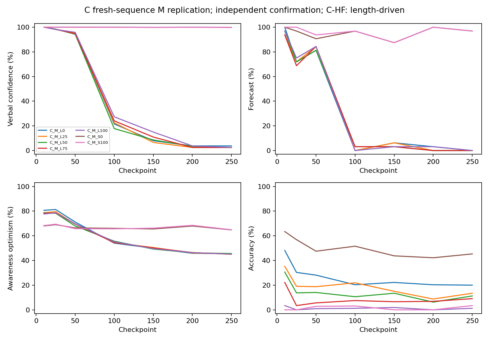

Strict minimum-logprob AUROC support: 23/490 checkpoint/offset cells. Undefined cells are not zeros and are not silently pooled. Full feature intervals are saved in the analysis JSON.

### Identifiable strict localization cells

Verbal and logit comparisons use their paired common observations. P(Yes) support may differ; inspect the saved per-feature class counts before comparison.

| Cell / score | AUROC | 95% CI | n positive / negative | Valid draws |
| --- | --- | --- | --- | --- |
| L0 / 200 / 7 / ptrue | 0.624 | [0.401, 0.827] | 15 / 17 | 3777 |
| L0 / 200 / 7 / lp_mean | 0.969 | [0.906, 1.000] | 15 / 17 | 3777 |
| L0 / 200 / 7 / neg_ent_max | 0.973 | [0.914, 1.000] | 15 / 17 | 3777 |
| L0 / 200 / 7 / margin_min | 0.980 | [0.930, 1.000] | 15 / 17 | 3777 |
| L0 / 200 / 7 / fin_lp_min | 0.973 | [0.914, 1.000] | 15 / 17 | 3777 |
| L0 / 200 / 7 / verbal | 0.600 | [0.500, 0.700] | 15 / 17 | 3777 |
| L0 / 200 / 7 / lp_min | 0.973 | [0.914, 1.000] | 15 / 17 | 3777 |
| L0 / 200 / 10 / ptrue | 0.557 | [0.353, 0.761] | 17 / 15 | 3807 |
| L0 / 200 / 10 / lp_mean | 0.902 | [0.780, 0.984] | 17 / 15 | 3807 |
| L0 / 200 / 10 / neg_ent_max | 0.925 | [0.809, 1.000] | 17 / 15 | 3807 |
| L0 / 200 / 10 / margin_min | 0.859 | [0.714, 0.965] | 17 / 15 | 3807 |
| L0 / 200 / 10 / fin_lp_min | 0.906 | [0.780, 0.992] | 17 / 15 | 3807 |
| L0 / 200 / 10 / verbal | 0.488 | [0.353, 0.625] | 17 / 15 | 3807 |
| L0 / 200 / 10 / lp_min | 0.906 | [0.780, 0.992] | 17 / 15 | 3807 |
| L0 / 250 / 7 / ptrue | 0.549 | [0.344, 0.749] | 17 / 15 | 3712 |
| L0 / 250 / 7 / lp_mean | 0.933 | [0.835, 0.992] | 17 / 15 | 3712 |
| L0 / 250 / 7 / neg_ent_max | 0.922 | [0.812, 0.992] | 17 / 15 | 3712 |
| L0 / 250 / 7 / margin_min | 0.886 | [0.749, 0.980] | 17 / 15 | 3712 |
| L0 / 250 / 7 / fin_lp_min | 0.922 | [0.812, 0.992] | 17 / 15 | 3712 |
| L0 / 250 / 7 / verbal | 0.522 | [0.392, 0.647] | 17 / 15 | 3712 |
| L0 / 250 / 7 / lp_min | 0.922 | [0.812, 0.992] | 17 / 15 | 3712 |
| L0 / 250 / 10 / ptrue | 0.525 | [0.302, 0.723] | 17 / 15 | 3775 |
| L0 / 250 / 10 / lp_mean | 0.902 | [0.773, 0.992] | 17 / 15 | 3775 |
| L0 / 250 / 10 / neg_ent_max | 0.859 | [0.703, 0.976] | 17 / 15 | 3775 |
| L0 / 250 / 10 / margin_min | 0.906 | [0.777, 0.992] | 17 / 15 | 3775 |
| L0 / 250 / 10 / fin_lp_min | 0.894 | [0.757, 0.992] | 17 / 15 | 3775 |
| L0 / 250 / 10 / verbal | 0.429 | [0.312, 0.537] | 17 / 15 | 3775 |
| L0 / 250 / 10 / lp_min | 0.894 | [0.757, 0.992] | 17 / 15 | 3775 |
| L25 / 100 / 10 / ptrue | 0.624 | [0.420, 0.812] | 17 / 15 | 3845 |
| L25 / 100 / 10 / lp_mean | 0.906 | [0.765, 1.000] | 17 / 15 | 3845 |
| L25 / 100 / 10 / neg_ent_max | 0.878 | [0.723, 0.992] | 17 / 15 | 3845 |
| L25 / 100 / 10 / margin_min | 0.892 | [0.759, 0.988] | 17 / 15 | 3845 |
| L25 / 100 / 10 / fin_lp_min | 0.898 | [0.761, 0.992] | 17 / 15 | 3845 |
| L25 / 100 / 10 / verbal | 0.531 | [0.357, 0.706] | 17 / 15 | 3845 |
| L25 / 100 / 10 / lp_min | 0.898 | [0.761, 0.992] | 17 / 15 | 3845 |
| L25 / 200 / 7 / ptrue | 0.580 | [0.365, 0.785] | 17 / 15 | 3803 |
| L25 / 200 / 7 / lp_mean | 0.784 | [0.606, 0.937] | 17 / 15 | 3803 |
| L25 / 200 / 7 / neg_ent_max | 0.780 | [0.594, 0.933] | 17 / 15 | 3803 |
| L25 / 200 / 7 / margin_min | 0.802 | [0.633, 0.939] | 17 / 15 | 3803 |
| L25 / 200 / 7 / fin_lp_min | 0.784 | [0.608, 0.930] | 17 / 15 | 3803 |
| L25 / 200 / 7 / verbal | 0.588 | [0.500, 0.688] | 17 / 15 | 3803 |
| L25 / 200 / 7 / lp_min | 0.784 | [0.608, 0.930] | 17 / 15 | 3803 |
| L25 / 200 / 10 / ptrue | 0.541 | [0.333, 0.737] | 17 / 15 | 3811 |
| L25 / 200 / 10 / lp_mean | 0.859 | [0.710, 0.969] | 17 / 15 | 3811 |
| L25 / 200 / 10 / neg_ent_max | 0.886 | [0.753, 0.980] | 17 / 15 | 3811 |
| L25 / 200 / 10 / margin_min | 0.855 | [0.706, 0.965] | 17 / 15 | 3811 |
| L25 / 200 / 10 / fin_lp_min | 0.878 | [0.742, 0.976] | 17 / 15 | 3811 |
| L25 / 200 / 10 / verbal | 0.555 | [0.441, 0.673] | 17 / 15 | 3811 |
| L25 / 200 / 10 / lp_min | 0.878 | [0.742, 0.976] | 17 / 15 | 3811 |
| L25 / 250 / 2 / ptrue | 0.539 | [0.318, 0.750] | 16 / 16 | 3997 |
| L25 / 250 / 2 / lp_mean | 0.980 | [0.929, 1.000] | 16 / 16 | 3997 |
| L25 / 250 / 2 / neg_ent_max | 0.973 | [0.902, 1.000] | 16 / 16 | 3997 |
| L25 / 250 / 2 / margin_min | 0.953 | [0.871, 1.000] | 16 / 16 | 3997 |
| L25 / 250 / 2 / fin_lp_min | 0.973 | [0.902, 1.000] | 16 / 16 | 3997 |
| L25 / 250 / 2 / verbal | 0.594 | [0.469, 0.708] | 16 / 16 | 3997 |
| L25 / 250 / 2 / lp_min | 0.973 | [0.902, 1.000] | 16 / 16 | 3997 |
| L25 / 250 / 5 / ptrue | 0.451 | [0.255, 0.655] | 15 / 17 | 3802 |
| L25 / 250 / 5 / lp_mean | 0.835 | [0.680, 0.965] | 15 / 17 | 3802 |
| L25 / 250 / 5 / neg_ent_max | 0.804 | [0.633, 0.941] | 15 / 17 | 3802 |
| L25 / 250 / 5 / margin_min | 0.916 | [0.787, 1.000] | 15 / 17 | 3802 |
| L25 / 250 / 5 / fin_lp_min | 0.843 | [0.686, 0.965] | 15 / 17 | 3802 |
| L25 / 250 / 5 / verbal | 0.600 | [0.500, 0.706] | 15 / 17 | 3802 |
| L25 / 250 / 5 / lp_min | 0.843 | [0.686, 0.965] | 15 / 17 | 3802 |
| L25 / 250 / 10 / ptrue | 0.502 | [0.290, 0.706] | 17 / 15 | 3764 |
| L25 / 250 / 10 / lp_mean | 0.847 | [0.694, 0.973] | 17 / 15 | 3764 |
| L25 / 250 / 10 / neg_ent_max | 0.859 | [0.714, 0.969] | 17 / 15 | 3764 |
| L25 / 250 / 10 / margin_min | 0.831 | [0.671, 0.955] | 17 / 15 | 3764 |
| L25 / 250 / 10 / fin_lp_min | 0.863 | [0.718, 0.969] | 17 / 15 | 3764 |
| L25 / 250 / 10 / verbal | 0.429 | [0.312, 0.533] | 17 / 15 | 3764 |
| L25 / 250 / 10 / lp_min | 0.863 | [0.718, 0.969] | 17 / 15 | 3764 |
| L50 / 150 / 2 / ptrue | 0.518 | [0.317, 0.737] | 17 / 15 | 3821 |
| L50 / 150 / 2 / lp_mean | 0.922 | [0.812, 1.000] | 17 / 15 | 3821 |
| L50 / 150 / 2 / neg_ent_max | 0.882 | [0.749, 0.973] | 17 / 15 | 3821 |
| L50 / 150 / 2 / margin_min | 0.937 | [0.841, 1.000] | 17 / 15 | 3821 |
| L50 / 150 / 2 / fin_lp_min | 0.898 | [0.775, 0.980] | 17 / 15 | 3821 |
| L50 / 150 / 2 / verbal | 0.565 | [0.392, 0.731] | 17 / 15 | 3821 |
| L50 / 150 / 2 / lp_min | 0.898 | [0.775, 0.980] | 17 / 15 | 3821 |
| L50 / 200 / 2 / ptrue | 0.659 | [0.457, 0.847] | 17 / 15 | 3801 |
| L50 / 200 / 2 / lp_mean | 0.812 | [0.647, 0.938] | 17 / 15 | 3801 |
| L50 / 200 / 2 / neg_ent_max | 0.835 | [0.682, 0.953] | 17 / 15 | 3801 |
| L50 / 200 / 2 / margin_min | 0.800 | [0.627, 0.937] | 17 / 15 | 3801 |
| L50 / 200 / 2 / fin_lp_min | 0.831 | [0.672, 0.949] | 17 / 15 | 3801 |
| L50 / 200 / 2 / verbal | 0.584 | [0.469, 0.704] | 17 / 15 | 3801 |
| L50 / 200 / 2 / lp_min | 0.831 | [0.672, 0.949] | 17 / 15 | 3801 |
| L50 / 200 / 4 / ptrue | 0.655 | [0.447, 0.844] | 17 / 15 | 3810 |
| L50 / 200 / 4 / lp_mean | 0.925 | [0.809, 1.000] | 17 / 15 | 3810 |
| L50 / 200 / 4 / neg_ent_max | 0.918 | [0.789, 1.000] | 17 / 15 | 3810 |
| L50 / 200 / 4 / margin_min | 0.929 | [0.812, 1.000] | 17 / 15 | 3810 |
| L50 / 200 / 4 / fin_lp_min | 0.922 | [0.797, 1.000] | 17 / 15 | 3810 |
| L50 / 200 / 4 / verbal | 0.525 | [0.433, 0.625] | 17 / 15 | 3810 |
| L50 / 200 / 4 / lp_min | 0.922 | [0.797, 1.000] | 17 / 15 | 3810 |
| L50 / 200 / 5 / ptrue | 0.588 | [0.380, 0.784] | 17 / 15 | 3775 |
| L50 / 200 / 5 / lp_mean | 0.937 | [0.827, 1.000] | 17 / 15 | 3775 |
| L50 / 200 / 5 / neg_ent_max | 0.867 | [0.723, 0.969] | 17 / 15 | 3775 |
| L50 / 200 / 5 / margin_min | 0.871 | [0.725, 0.973] | 17 / 15 | 3775 |
| L50 / 200 / 5 / fin_lp_min | 0.894 | [0.765, 0.988] | 17 / 15 | 3775 |
| L50 / 200 / 5 / verbal | 0.525 | [0.433, 0.625] | 17 / 15 | 3775 |
| L50 / 200 / 5 / lp_min | 0.894 | [0.765, 0.988] | 17 / 15 | 3775 |
| L50 / 200 / 10 / ptrue | 0.580 | [0.367, 0.773] | 17 / 15 | 3850 |
| L50 / 200 / 10 / lp_mean | 0.784 | [0.594, 0.941] | 17 / 15 | 3850 |
| L50 / 200 / 10 / neg_ent_max | 0.855 | [0.690, 0.973] | 17 / 15 | 3850 |
| L50 / 200 / 10 / margin_min | 0.855 | [0.692, 0.973] | 17 / 15 | 3850 |
| L50 / 200 / 10 / fin_lp_min | 0.867 | [0.710, 0.984] | 17 / 15 | 3850 |
| L50 / 200 / 10 / verbal | 0.522 | [0.392, 0.641] | 17 / 15 | 3850 |
| L50 / 200 / 10 / lp_min | 0.867 | [0.710, 0.984] | 17 / 15 | 3850 |
| L50 / 250 / 5 / ptrue | 0.441 | [0.238, 0.651] | 16 / 16 | 3994 |
| L50 / 250 / 5 / lp_mean | 0.945 | [0.859, 1.000] | 16 / 16 | 3994 |
| L50 / 250 / 5 / neg_ent_max | 0.934 | [0.836, 0.996] | 16 / 16 | 3994 |
| L50 / 250 / 5 / margin_min | 0.943 | [0.832, 1.000] | 16 / 16 | 3994 |
| L50 / 250 / 5 / fin_lp_min | 0.949 | [0.867, 1.000] | 16 / 16 | 3994 |
| L50 / 250 / 5 / verbal | 0.625 | [0.529, 0.735] | 16 / 16 | 3994 |
| L50 / 250 / 5 / lp_min | 0.949 | [0.867, 1.000] | 16 / 16 | 3994 |
| L75 / 150 / 5 / ptrue | 0.490 | [0.285, 0.699] | 17 / 15 | 3798 |
| L75 / 150 / 5 / lp_mean | 0.957 | [0.875, 1.000] | 17 / 15 | 3798 |
| L75 / 150 / 5 / neg_ent_max | 0.976 | [0.922, 1.000] | 17 / 15 | 3798 |
| L75 / 150 / 5 / margin_min | 0.906 | [0.765, 1.000] | 17 / 15 | 3798 |
| L75 / 150 / 5 / fin_lp_min | 0.969 | [0.902, 1.000] | 17 / 15 | 3798 |
| L75 / 150 / 5 / verbal | 0.612 | [0.451, 0.766] | 17 / 15 | 3798 |
| L75 / 150 / 5 / lp_min | 0.969 | [0.902, 1.000] | 17 / 15 | 3798 |
| L75 / 200 / 4 / ptrue | 0.582 | [0.373, 0.784] | 16 / 16 | 4004 |
| L75 / 200 / 4 / lp_mean | 0.922 | [0.797, 1.000] | 16 / 16 | 4004 |
| L75 / 200 / 4 / neg_ent_max | 0.922 | [0.796, 1.000] | 16 / 16 | 4004 |
| L75 / 200 / 4 / margin_min | 0.918 | [0.800, 1.000] | 16 / 16 | 4004 |
| L75 / 200 / 4 / fin_lp_min | 0.922 | [0.796, 1.000] | 16 / 16 | 4004 |
| L75 / 200 / 4 / verbal | 0.531 | [0.438, 0.633] | 16 / 16 | 4004 |
| L75 / 200 / 4 / lp_min | 0.922 | [0.796, 1.000] | 16 / 16 | 4004 |
| L75 / 250 / 5 / ptrue | 0.459 | [0.250, 0.664] | 17 / 15 | 3778 |
| L75 / 250 / 5 / lp_mean | 0.925 | [0.812, 1.000] | 17 / 15 | 3778 |
| L75 / 250 / 5 / neg_ent_max | 0.867 | [0.723, 0.975] | 17 / 15 | 3778 |
| L75 / 250 / 5 / margin_min | 0.876 | [0.729, 0.996] | 17 / 15 | 3778 |
| L75 / 250 / 5 / fin_lp_min | 0.886 | [0.750, 0.984] | 17 / 15 | 3778 |
| L75 / 250 / 5 / verbal | 0.584 | [0.469, 0.706] | 17 / 15 | 3778 |
| L75 / 250 / 5 / lp_min | 0.886 | [0.750, 0.984] | 17 / 15 | 3778 |
| L100 / 200 / 8 / ptrue | 0.616 | [0.421, 0.808] | 17 / 15 | 3912 |
| L100 / 200 / 8 / lp_mean | 0.902 | [0.776, 0.980] | 17 / 15 | 3912 |
| L100 / 200 / 8 / neg_ent_max | 0.914 | [0.795, 0.988] | 17 / 15 | 3912 |
| L100 / 200 / 8 / margin_min | 0.863 | [0.706, 0.976] | 17 / 15 | 3912 |
| L100 / 200 / 8 / fin_lp_min | 0.902 | [0.776, 0.980] | 17 / 15 | 3912 |
| L100 / 200 / 8 / verbal | 0.559 | [0.500, 0.647] | 17 / 15 | 3912 |
| L100 / 200 / 8 / lp_min | 0.902 | [0.776, 0.980] | 17 / 15 | 3912 |
| L100 / 200 / 10 / ptrue | 0.637 | [0.427, 0.820] | 16 / 16 | 3958 |
| L100 / 200 / 10 / lp_mean | 0.828 | [0.651, 0.965] | 16 / 16 | 3958 |
| L100 / 200 / 10 / neg_ent_max | 0.879 | [0.741, 0.980] | 16 / 16 | 3958 |
| L100 / 200 / 10 / margin_min | 0.857 | [0.699, 0.973] | 16 / 16 | 3958 |
| L100 / 200 / 10 / fin_lp_min | 0.871 | [0.729, 0.976] | 16 / 16 | 3958 |
| L100 / 200 / 10 / verbal | 0.469 | [0.367, 0.562] | 16 / 16 | 3958 |
| L100 / 200 / 10 / lp_min | 0.871 | [0.729, 0.976] | 16 / 16 | 3958 |
| L100 / 250 / 2 / ptrue | 0.533 | [0.323, 0.729] | 17 / 15 | 3781 |
| L100 / 250 / 2 / lp_mean | 0.992 | [0.965, 1.000] | 17 / 15 | 3781 |
| L100 / 250 / 2 / neg_ent_max | 1.000 | [1.000, 1.000] | 17 / 15 | 3781 |
| L100 / 250 / 2 / margin_min | 0.957 | [0.875, 1.000] | 17 / 15 | 3781 |
| L100 / 250 / 2 / fin_lp_min | 0.992 | [0.965, 1.000] | 17 / 15 | 3781 |
| L100 / 250 / 2 / verbal | 0.555 | [0.445, 0.671] | 17 / 15 | 3781 |
| L100 / 250 / 2 / lp_min | 0.992 | [0.965, 1.000] | 17 / 15 | 3781 |
| L100 / 250 / 5 / ptrue | 0.435 | [0.235, 0.651] | 17 / 15 | 3720 |
| L100 / 250 / 5 / lp_mean | 0.922 | [0.808, 1.000] | 17 / 15 | 3720 |
| L100 / 250 / 5 / neg_ent_max | 0.871 | [0.733, 0.969] | 17 / 15 | 3720 |
| L100 / 250 / 5 / margin_min | 0.920 | [0.808, 0.996] | 17 / 15 | 3720 |
| L100 / 250 / 5 / fin_lp_min | 0.894 | [0.766, 0.984] | 17 / 15 | 3720 |
| L100 / 250 / 5 / verbal | 0.584 | [0.469, 0.706] | 17 / 15 | 3720 |
| L100 / 250 / 5 / lp_min | 0.894 | [0.766, 0.984] | 17 / 15 | 3720 |

## Fresh confirmation C-MR

Registered verdict: **inconclusive**.

| HG test | Estimate, points | 95% CI | Holm p | Supported |
| --- | --- | --- | --- | --- |
| HG1 | 17.99 | [14.60, 21.34] | 0.000400 | True |
| HG2 | -0.22 | [-3.35, 2.99] | 0.004500 | True |
| HG3 | 4.49 | [0.49, 8.48] | 1.000000 | False |
| HG4 | -12.92 | [-18.59, -7.19] | 1.000000 | False |

HG2 90% equivalence interval: [-2.81, 2.46]; bounds (-5, +5). Calibration diagnostics do not issue a confirmatory verdict.

HG1: repaired−wrong-state accuracy >0. HG2: repaired−clean accuracy equivalent within ±5. HG3: clean−repaired forecast >10. HG4: repaired accuracy−forecast >10. All four must pass. A lower forecast than an overconfident reference is insufficient evidence of underconfidence.

| Arm | Accuracy % | Pre-cue forecast % | Post-cue forecast % |
| --- | --- | --- | --- |
| MR_A | 18.97 | 38.39 | 36.16 |
| MR_B | 0.76 | 34.38 | 35.71 |
| MR_C | 18.75 | 34.38 | 31.67 |
| MR_D | 1.56 | 38.39 | 30.18 |

| Arm / checkpoint | Accuracy % | Forecast % | MAE | Missing |
| --- | --- | --- | --- | --- |
| MR_A / 10 | 31.25 | 96.88 | 68.12 | 0 |
| MR_A / 25 | 27.81 | 78.12 | 59.06 | 0 |
| MR_A / 50 | 19.38 | 68.75 | 55.00 | 0 |
| MR_A / 100 | 15.00 | 0.00 | 15.00 | 0 |
| MR_A / 150 | 18.75 | 0.00 | 18.75 | 0 |
| MR_A / 200 | 10.31 | 6.25 | 15.94 | 0 |
| MR_A / 250 | 10.31 | 3.12 | 13.44 | 0 |
| MR_B / 10 | 0.31 | 90.62 | 90.31 | 0 |
| MR_B / 25 | 1.56 | 81.25 | 79.69 | 0 |
| MR_B / 50 | 0.31 | 65.62 | 65.31 | 0 |
| MR_B / 100 | 1.56 | 0.00 | 1.56 | 0 |
| MR_B / 150 | 0.62 | 0.00 | 0.62 | 0 |
| MR_B / 200 | 0.31 | 3.12 | 3.44 | 0 |
| MR_B / 250 | 0.62 | 9.38 | 10.00 | 0 |
| MR_C / 10 | 39.38 | 87.50 | 56.25 | 0 |
| MR_C / 25 | 20.62 | 71.72 | 64.22 | 0 |
| MR_C / 50 | 22.19 | 53.12 | 47.19 | 0 |
| MR_C / 100 | 12.50 | 0.00 | 12.50 | 0 |
| MR_C / 150 | 11.88 | 0.00 | 11.88 | 0 |
| MR_C / 200 | 12.81 | 0.00 | 12.81 | 0 |
| MR_C / 250 | 11.88 | 9.38 | 21.25 | 0 |
| MR_D / 10 | 5.00 | 84.38 | 80.62 | 0 |
| MR_D / 25 | 1.88 | 71.88 | 70.00 | 0 |
| MR_D / 50 | 0.62 | 55.00 | 54.38 | 0 |
| MR_D / 100 | 0.00 | 0.00 | 0.00 | 0 |
| MR_D / 150 | 1.56 | 0.00 | 1.56 | 0 |
| MR_D / 200 | 0.94 | 0.00 | 0.94 | 0 |
| MR_D / 250 | 0.94 | 0.00 | 0.94 | 0 |

Primary overall floor flag: False. Missing primary forecasts: 0. Out-of-range primary forecasts: 0.

| Arm | Calibration slope [CI] | Intercept [CI] |
| --- | --- | --- |
| MR_A | 0.080 [-0.029, 0.191] | 0.235 [0.086, 0.392] |
| MR_B | 0.006 [-0.001, 0.020] | -0.003 [-0.016, 0.008] |
| MR_C | 0.020 [-0.132, 0.175] | 0.376 [0.207, 0.558] |
| MR_D | 0.017 [-0.007, 0.046] | 0.036 [-0.007, 0.099] |

| Arm / checkpoint | Awareness higher % | Same % | Lower % | Valid n |
| --- | --- | --- | --- | --- |
| MR_A / 10 | 47.88 | 49.46 | 2.65 | 32 |
| MR_A / 25 | 59.59 | 33.89 | 6.52 | 32 |
| MR_A / 50 | 34.25 | 58.78 | 6.96 | 32 |
| MR_A / 100 | 22.53 | 62.42 | 15.05 | 32 |
| MR_A / 150 | 26.61 | 58.29 | 15.09 | 32 |
| MR_A / 200 | 23.33 | 61.11 | 15.56 | 32 |
| MR_A / 250 | 22.19 | 56.09 | 21.72 | 32 |
| MR_B / 10 | 49.84 | 47.06 | 3.10 | 32 |
| MR_B / 25 | 61.01 | 32.60 | 6.39 | 32 |
| MR_B / 50 | 34.11 | 57.64 | 8.25 | 32 |
| MR_B / 100 | 24.52 | 60.77 | 14.71 | 32 |
| MR_B / 150 | 27.47 | 58.39 | 14.13 | 32 |
| MR_B / 200 | 20.92 | 64.68 | 14.40 | 32 |
| MR_B / 250 | 21.03 | 55.94 | 23.03 | 32 |
| MR_C / 10 | 45.15 | 51.29 | 3.57 | 32 |
| MR_C / 25 | 59.32 | 32.59 | 8.09 | 32 |
| MR_C / 50 | 35.26 | 53.57 | 11.17 | 32 |
| MR_C / 100 | 27.67 | 57.04 | 15.29 | 32 |
| MR_C / 150 | 26.40 | 57.84 | 15.76 | 32 |
| MR_C / 200 | 23.97 | 59.90 | 16.13 | 32 |
| MR_C / 250 | 24.17 | 52.96 | 22.87 | 32 |
| MR_D / 10 | 49.19 | 47.59 | 3.23 | 32 |
| MR_D / 25 | 63.23 | 29.94 | 6.83 | 32 |
| MR_D / 50 | 35.41 | 55.46 | 9.13 | 32 |
| MR_D / 100 | 25.90 | 59.62 | 14.48 | 32 |
| MR_D / 150 | 30.38 | 56.28 | 13.34 | 32 |
| MR_D / 200 | 23.58 | 62.61 | 13.81 | 32 |
| MR_D / 250 | 24.84 | 52.00 | 23.16 | 32 |

| Interaction | Estimate, points | 95% CI |
| --- | --- | --- |
| accuracy | 0.58 | [-3.39, 4.78] |
| forecast | -10.02 | [-14.46, -5.54] |

Global minimum-logprob AUROC support: 3/280 strict cells. Local minimum-logprob AUROC support: 22/280 strict cells. Calibration, interactions and discrimination are secondary and do not change the registered primary verdict.

### Identifiable strict discrimination cells

| Cell / score | AUROC | 95% CI | n positive / negative | Valid draws |
| --- | --- | --- | --- | --- |
| MR_A / 10 / 2 / global / verbal | 0.500 | [0.500, 0.500] | 17 / 15 | 3727 |
| MR_A / 10 / 2 / global / ptrue | 0.424 | [0.216, 0.629] | 17 / 15 | 3727 |
| MR_A / 10 / 2 / global / lp_min | 0.675 | [0.463, 0.871] | 17 / 15 | 3727 |
| MR_A / 10 / 2 / global / lp_mean | 0.663 | [0.451, 0.855] | 17 / 15 | 3727 |
| MR_A / 10 / 2 / global / neg_ent_max | 0.663 | [0.451, 0.867] | 17 / 15 | 3727 |
| MR_A / 10 / 2 / global / margin_min | 0.655 | [0.439, 0.859] | 17 / 15 | 3727 |
| MR_A / 10 / 2 / global / fin_lp_min | 0.675 | [0.463, 0.871] | 17 / 15 | 3727 |
| MR_A / 50 / 2 / local / verbal | 0.639 | [0.506, 0.767] | 15 / 17 | 3757 |
| MR_A / 50 / 2 / local / ptrue | 0.584 | [0.376, 0.785] | 15 / 17 | 3757 |
| MR_A / 50 / 2 / local / lp_min | 0.718 | [0.529, 0.882] | 15 / 17 | 3757 |
| MR_A / 50 / 2 / local / lp_mean | 0.694 | [0.500, 0.864] | 15 / 17 | 3757 |
| MR_A / 50 / 2 / local / neg_ent_max | 0.729 | [0.545, 0.890] | 15 / 17 | 3757 |
| MR_A / 50 / 2 / local / margin_min | 0.671 | [0.471, 0.855] | 15 / 17 | 3757 |
| MR_A / 50 / 2 / local / fin_lp_min | 0.718 | [0.529, 0.882] | 15 / 17 | 3757 |
| MR_A / 50 / 3 / local / verbal | 0.500 | [0.412, 0.594] | 16 / 16 | 4074 |
| MR_A / 50 / 3 / local / ptrue | 0.555 | [0.341, 0.751] | 16 / 16 | 4074 |
| MR_A / 50 / 3 / local / lp_min | 0.934 | [0.832, 0.996] | 16 / 16 | 4074 |
| MR_A / 50 / 3 / local / lp_mean | 0.918 | [0.805, 0.988] | 16 / 16 | 4074 |
| MR_A / 50 / 3 / local / neg_ent_max | 0.938 | [0.840, 0.996] | 16 / 16 | 4074 |
| MR_A / 50 / 3 / local / margin_min | 0.936 | [0.834, 1.000] | 16 / 16 | 4074 |
| MR_A / 50 / 3 / local / fin_lp_min | 0.934 | [0.832, 0.996] | 16 / 16 | 4074 |
| MR_A / 50 / 9 / local / verbal | 0.590 | [0.467, 0.707] | 16 / 16 | 3990 |
| MR_A / 50 / 9 / local / ptrue | 0.578 | [0.369, 0.773] | 16 / 16 | 3990 |
| MR_A / 50 / 9 / local / lp_min | 1.000 | [1.000, 1.000] | 16 / 16 | 3990 |
| MR_A / 50 / 9 / local / lp_mean | 1.000 | [1.000, 1.000] | 16 / 16 | 3990 |
| MR_A / 50 / 9 / local / neg_ent_max | 1.000 | [1.000, 1.000] | 16 / 16 | 3990 |
| MR_A / 50 / 9 / local / margin_min | 1.000 | [1.000, 1.000] | 16 / 16 | 3990 |
| MR_A / 50 / 9 / local / fin_lp_min | 1.000 | [1.000, 1.000] | 16 / 16 | 3990 |
| MR_A / 150 / 2 / local / verbal | 0.500 | [0.333, 0.669] | 15 / 17 | 3917 |
| MR_A / 150 / 2 / local / ptrue | 0.576 | [0.367, 0.769] | 15 / 17 | 3917 |
| MR_A / 150 / 2 / local / lp_min | 0.773 | [0.596, 0.918] | 15 / 17 | 3917 |
| MR_A / 150 / 2 / local / lp_mean | 0.761 | [0.580, 0.910] | 15 / 17 | 3917 |
| MR_A / 150 / 2 / local / neg_ent_max | 0.725 | [0.533, 0.886] | 15 / 17 | 3917 |
| MR_A / 150 / 2 / local / margin_min | 0.753 | [0.570, 0.910] | 15 / 17 | 3917 |
| MR_A / 150 / 2 / local / fin_lp_min | 0.773 | [0.596, 0.918] | 15 / 17 | 3917 |
| MR_A / 150 / 3 / local / verbal | 0.457 | [0.275, 0.635] | 17 / 15 | 3825 |
| MR_A / 150 / 3 / local / ptrue | 0.545 | [0.328, 0.745] | 17 / 15 | 3825 |
| MR_A / 150 / 3 / local / lp_min | 0.761 | [0.574, 0.925] | 17 / 15 | 3825 |
| MR_A / 150 / 3 / local / lp_mean | 0.741 | [0.545, 0.915] | 17 / 15 | 3825 |
| MR_A / 150 / 3 / local / neg_ent_max | 0.765 | [0.576, 0.926] | 17 / 15 | 3825 |
| MR_A / 150 / 3 / local / margin_min | 0.753 | [0.561, 0.918] | 17 / 15 | 3825 |
| MR_A / 150 / 3 / local / fin_lp_min | 0.761 | [0.574, 0.925] | 17 / 15 | 3825 |
| MR_A / 200 / 10 / local / verbal | 0.531 | [0.335, 0.727] | 17 / 15 | 3780 |
| MR_A / 200 / 10 / local / ptrue | 0.533 | [0.325, 0.737] | 17 / 15 | 3780 |
| MR_A / 200 / 10 / local / lp_min | 0.953 | [0.867, 1.000] | 17 / 15 | 3780 |
| MR_A / 200 / 10 / local / lp_mean | 0.933 | [0.816, 1.000] | 17 / 15 | 3780 |
| MR_A / 200 / 10 / local / neg_ent_max | 0.945 | [0.851, 1.000] | 17 / 15 | 3780 |
| MR_A / 200 / 10 / local / margin_min | 0.955 | [0.875, 1.000] | 17 / 15 | 3780 |
| MR_A / 200 / 10 / local / fin_lp_min | 0.953 | [0.867, 1.000] | 17 / 15 | 3780 |
| MR_B / 50 / 2 / local / verbal | 0.616 | [0.469, 0.765] | 17 / 15 | 3821 |
| MR_B / 50 / 2 / local / ptrue | 0.580 | [0.373, 0.784] | 17 / 15 | 3821 |
| MR_B / 50 / 2 / local / lp_min | 0.749 | [0.561, 0.906] | 17 / 15 | 3821 |
| MR_B / 50 / 2 / local / lp_mean | 0.753 | [0.566, 0.902] | 17 / 15 | 3821 |
| MR_B / 50 / 2 / local / neg_ent_max | 0.741 | [0.548, 0.900] | 17 / 15 | 3821 |
| MR_B / 50 / 2 / local / margin_min | 0.767 | [0.582, 0.922] | 17 / 15 | 3821 |
| MR_B / 50 / 2 / local / fin_lp_min | 0.749 | [0.561, 0.906] | 17 / 15 | 3821 |
| MR_B / 50 / 3 / local / verbal | 0.496 | [0.361, 0.639] | 17 / 15 | 3855 |
| MR_B / 50 / 3 / local / ptrue | 0.447 | [0.247, 0.655] | 17 / 15 | 3855 |
| MR_B / 50 / 3 / local / lp_min | 0.949 | [0.847, 1.000] | 17 / 15 | 3855 |
| MR_B / 50 / 3 / local / lp_mean | 0.929 | [0.824, 1.000] | 17 / 15 | 3855 |
| MR_B / 50 / 3 / local / neg_ent_max | 0.941 | [0.827, 1.000] | 17 / 15 | 3855 |
| MR_B / 50 / 3 / local / margin_min | 0.973 | [0.914, 1.000] | 17 / 15 | 3855 |
| MR_B / 50 / 3 / local / fin_lp_min | 0.949 | [0.847, 1.000] | 17 / 15 | 3855 |
| MR_B / 50 / 8 / local / verbal | 0.496 | [0.359, 0.633] | 17 / 15 | 3874 |
| MR_B / 50 / 8 / local / ptrue | 0.616 | [0.418, 0.804] | 17 / 15 | 3874 |
| MR_B / 50 / 8 / local / lp_min | 0.875 | [0.738, 0.973] | 17 / 15 | 3874 |
| MR_B / 50 / 8 / local / lp_mean | 0.902 | [0.780, 0.984] | 17 / 15 | 3874 |
| MR_B / 50 / 8 / local / neg_ent_max | 0.867 | [0.726, 0.973] | 17 / 15 | 3874 |
| MR_B / 50 / 8 / local / margin_min | 0.908 | [0.785, 0.984] | 17 / 15 | 3874 |
| MR_B / 50 / 8 / local / fin_lp_min | 0.875 | [0.738, 0.973] | 17 / 15 | 3874 |
| MR_B / 100 / 3 / local / verbal | 0.510 | [0.345, 0.675] | 16 / 16 | 4038 |
| MR_B / 100 / 3 / local / ptrue | 0.590 | [0.384, 0.780] | 16 / 16 | 4038 |
| MR_B / 100 / 3 / local / lp_min | 0.906 | [0.788, 0.984] | 16 / 16 | 4038 |
| MR_B / 100 / 3 / local / lp_mean | 0.895 | [0.769, 0.980] | 16 / 16 | 4038 |
| MR_B / 100 / 3 / local / neg_ent_max | 0.891 | [0.765, 0.980] | 16 / 16 | 4038 |
| MR_B / 100 / 3 / local / margin_min | 0.906 | [0.788, 0.984] | 16 / 16 | 4038 |
| MR_B / 100 / 3 / local / fin_lp_min | 0.906 | [0.788, 0.984] | 16 / 16 | 4038 |
| MR_B / 150 / 1 / local / verbal | 0.492 | [0.344, 0.641] | 16 / 16 | 4087 |
| MR_B / 150 / 1 / local / ptrue | 0.477 | [0.271, 0.690] | 16 / 16 | 4087 |
| MR_B / 150 / 1 / local / lp_min | 0.836 | [0.680, 0.964] | 16 / 16 | 4087 |
| MR_B / 150 / 1 / local / lp_mean | 0.828 | [0.667, 0.965] | 16 / 16 | 4087 |
| MR_B / 150 / 1 / local / neg_ent_max | 0.844 | [0.698, 0.961] | 16 / 16 | 4087 |
| MR_B / 150 / 1 / local / margin_min | 0.814 | [0.651, 0.945] | 16 / 16 | 4087 |
| MR_B / 150 / 1 / local / fin_lp_min | 0.836 | [0.680, 0.964] | 16 / 16 | 4087 |
| MR_B / 150 / 2 / local / verbal | 0.535 | [0.375, 0.704] | 15 / 17 | 3917 |
| MR_B / 150 / 2 / local / ptrue | 0.510 | [0.298, 0.706] | 15 / 17 | 3917 |
| MR_B / 150 / 2 / local / lp_min | 0.682 | [0.486, 0.863] | 15 / 17 | 3917 |
| MR_B / 150 / 2 / local / lp_mean | 0.706 | [0.510, 0.882] | 15 / 17 | 3917 |
| MR_B / 150 / 2 / local / neg_ent_max | 0.667 | [0.461, 0.840] | 15 / 17 | 3917 |
| MR_B / 150 / 2 / local / margin_min | 0.682 | [0.488, 0.859] | 15 / 17 | 3917 |
| MR_B / 150 / 2 / local / fin_lp_min | 0.682 | [0.486, 0.863] | 15 / 17 | 3917 |
| MR_B / 150 / 3 / local / verbal | 0.365 | [0.204, 0.543] | 16 / 16 | 3980 |
| MR_B / 150 / 3 / local / ptrue | 0.520 | [0.305, 0.725] | 16 / 16 | 3980 |
| MR_B / 150 / 3 / local / lp_min | 0.828 | [0.655, 0.965] | 16 / 16 | 3980 |
| MR_B / 150 / 3 / local / lp_mean | 0.832 | [0.655, 0.976] | 16 / 16 | 3980 |
| MR_B / 150 / 3 / local / neg_ent_max | 0.816 | [0.641, 0.957] | 16 / 16 | 3980 |
| MR_B / 150 / 3 / local / margin_min | 0.807 | [0.620, 0.959] | 16 / 16 | 3980 |
| MR_B / 150 / 3 / local / fin_lp_min | 0.828 | [0.655, 0.965] | 16 / 16 | 3980 |
| MR_B / 150 / 6 / local / verbal | 0.427 | [0.252, 0.608] | 17 / 15 | 3743 |
| MR_B / 150 / 6 / local / ptrue | 0.459 | [0.254, 0.661] | 17 / 15 | 3743 |
| MR_B / 150 / 6 / local / lp_min | 0.957 | [0.875, 1.000] | 17 / 15 | 3743 |
| MR_B / 150 / 6 / local / lp_mean | 0.965 | [0.890, 1.000] | 17 / 15 | 3743 |
| MR_B / 150 / 6 / local / neg_ent_max | 0.953 | [0.871, 1.000] | 17 / 15 | 3743 |
| MR_B / 150 / 6 / local / margin_min | 0.937 | [0.835, 1.000] | 17 / 15 | 3743 |
| MR_B / 150 / 6 / local / fin_lp_min | 0.957 | [0.875, 1.000] | 17 / 15 | 3743 |
| MR_C / 25 / 2 / local / verbal | 0.742 | [0.592, 0.877] | 16 / 16 | 4012 |
| MR_C / 25 / 2 / local / ptrue | 0.504 | [0.294, 0.709] | 16 / 16 | 4012 |
| MR_C / 25 / 2 / local / lp_min | 0.516 | [0.310, 0.727] | 16 / 16 | 4012 |
| MR_C / 25 / 2 / local / lp_mean | 0.457 | [0.262, 0.678] | 16 / 16 | 4012 |
| MR_C / 25 / 2 / local / neg_ent_max | 0.512 | [0.309, 0.722] | 16 / 16 | 4012 |
| MR_C / 25 / 2 / local / margin_min | 0.436 | [0.239, 0.651] | 16 / 16 | 4012 |
| MR_C / 25 / 2 / local / fin_lp_min | 0.516 | [0.310, 0.727] | 16 / 16 | 4012 |
| MR_C / 50 / 1 / global / verbal | 0.500 | [0.325, 0.661] | 16 / 16 | 4055 |
| MR_C / 50 / 1 / global / ptrue | 0.625 | [0.413, 0.816] | 16 / 16 | 4055 |
| MR_C / 50 / 1 / global / lp_min | 0.852 | [0.710, 0.957] | 16 / 16 | 4055 |
| MR_C / 50 / 1 / global / lp_mean | 0.875 | [0.745, 0.973] | 16 / 16 | 4055 |
| MR_C / 50 / 1 / global / neg_ent_max | 0.875 | [0.741, 0.969] | 16 / 16 | 4055 |
| MR_C / 50 / 1 / global / margin_min | 0.809 | [0.645, 0.941] | 16 / 16 | 4055 |
| MR_C / 50 / 1 / global / fin_lp_min | 0.852 | [0.710, 0.957] | 16 / 16 | 4055 |
| MR_C / 50 / 1 / local / verbal | 0.500 | [0.325, 0.661] | 16 / 16 | 4055 |
| MR_C / 50 / 1 / local / ptrue | 0.625 | [0.413, 0.816] | 16 / 16 | 4055 |
| MR_C / 50 / 1 / local / lp_min | 0.852 | [0.710, 0.957] | 16 / 16 | 4055 |
| MR_C / 50 / 1 / local / lp_mean | 0.875 | [0.745, 0.973] | 16 / 16 | 4055 |
| MR_C / 50 / 1 / local / neg_ent_max | 0.875 | [0.741, 0.969] | 16 / 16 | 4055 |
| MR_C / 50 / 1 / local / margin_min | 0.809 | [0.645, 0.941] | 16 / 16 | 4055 |
| MR_C / 50 / 1 / local / fin_lp_min | 0.852 | [0.710, 0.957] | 16 / 16 | 4055 |
| MR_C / 100 / 3 / local / verbal | 0.510 | [0.331, 0.688] | 16 / 16 | 4038 |
| MR_C / 100 / 3 / local / ptrue | 0.574 | [0.365, 0.769] | 16 / 16 | 4038 |
| MR_C / 100 / 3 / local / lp_min | 0.883 | [0.741, 0.980] | 16 / 16 | 4038 |
| MR_C / 100 / 3 / local / lp_mean | 0.871 | [0.725, 0.976] | 16 / 16 | 4038 |
| MR_C / 100 / 3 / local / neg_ent_max | 0.879 | [0.741, 0.977] | 16 / 16 | 4038 |
| MR_C / 100 / 3 / local / margin_min | 0.879 | [0.733, 0.984] | 16 / 16 | 4038 |
| MR_C / 100 / 3 / local / fin_lp_min | 0.883 | [0.741, 0.980] | 16 / 16 | 4038 |
| MR_C / 150 / 2 / local / verbal | 0.375 | [0.219, 0.535] | 16 / 16 | 4047 |
| MR_C / 150 / 2 / local / ptrue | 0.383 | [0.195, 0.592] | 16 / 16 | 4047 |
| MR_C / 150 / 2 / local / lp_min | 0.695 | [0.498, 0.863] | 16 / 16 | 4047 |
| MR_C / 150 / 2 / local / lp_mean | 0.703 | [0.508, 0.871] | 16 / 16 | 4047 |
| MR_C / 150 / 2 / local / neg_ent_max | 0.668 | [0.463, 0.848] | 16 / 16 | 4047 |
| MR_C / 150 / 2 / local / margin_min | 0.703 | [0.504, 0.871] | 16 / 16 | 4047 |
| MR_C / 150 / 2 / local / fin_lp_min | 0.695 | [0.498, 0.863] | 16 / 16 | 4047 |
| MR_C / 150 / 3 / local / verbal | 0.490 | [0.309, 0.675] | 17 / 15 | 3811 |
| MR_C / 150 / 3 / local / ptrue | 0.573 | [0.359, 0.761] | 17 / 15 | 3811 |
| MR_C / 150 / 3 / local / lp_min | 0.690 | [0.484, 0.879] | 17 / 15 | 3811 |
| MR_C / 150 / 3 / local / lp_mean | 0.690 | [0.482, 0.883] | 17 / 15 | 3811 |
| MR_C / 150 / 3 / local / neg_ent_max | 0.729 | [0.529, 0.906] | 17 / 15 | 3811 |
| MR_C / 150 / 3 / local / margin_min | 0.684 | [0.486, 0.871] | 17 / 15 | 3811 |
| MR_C / 150 / 3 / local / fin_lp_min | 0.690 | [0.484, 0.879] | 17 / 15 | 3811 |
| MR_C / 200 / 5 / local / verbal | 0.523 | [0.327, 0.716] | 16 / 16 | 3977 |
| MR_C / 200 / 5 / local / ptrue | 0.547 | [0.341, 0.753] | 16 / 16 | 3977 |
| MR_C / 200 / 5 / local / lp_min | 0.891 | [0.753, 1.000] | 16 / 16 | 3977 |
| MR_C / 200 / 5 / local / lp_mean | 0.910 | [0.781, 1.000] | 16 / 16 | 3977 |
| MR_C / 200 / 5 / local / neg_ent_max | 0.871 | [0.729, 0.984] | 16 / 16 | 3977 |
| MR_C / 200 / 5 / local / margin_min | 0.914 | [0.788, 1.000] | 16 / 16 | 3977 |
| MR_C / 200 / 5 / local / fin_lp_min | 0.891 | [0.753, 1.000] | 16 / 16 | 3977 |
| MR_C / 250 / 1 / global / verbal | 0.471 | [0.293, 0.652] | 15 / 17 | 3776 |
| MR_C / 250 / 1 / global / ptrue | 0.420 | [0.220, 0.627] | 15 / 17 | 3776 |
| MR_C / 250 / 1 / global / lp_min | 0.843 | [0.687, 0.965] | 15 / 17 | 3776 |
| MR_C / 250 / 1 / global / lp_mean | 0.886 | [0.757, 0.976] | 15 / 17 | 3776 |
| MR_C / 250 / 1 / global / neg_ent_max | 0.859 | [0.708, 0.976] | 15 / 17 | 3776 |
| MR_C / 250 / 1 / global / margin_min | 0.804 | [0.636, 0.941] | 15 / 17 | 3776 |
| MR_C / 250 / 1 / global / fin_lp_min | 0.843 | [0.687, 0.965] | 15 / 17 | 3776 |
| MR_C / 250 / 1 / local / verbal | 0.471 | [0.293, 0.652] | 15 / 17 | 3776 |
| MR_C / 250 / 1 / local / ptrue | 0.420 | [0.220, 0.627] | 15 / 17 | 3776 |
| MR_C / 250 / 1 / local / lp_min | 0.843 | [0.687, 0.965] | 15 / 17 | 3776 |
| MR_C / 250 / 1 / local / lp_mean | 0.886 | [0.757, 0.976] | 15 / 17 | 3776 |
| MR_C / 250 / 1 / local / neg_ent_max | 0.859 | [0.708, 0.976] | 15 / 17 | 3776 |
| MR_C / 250 / 1 / local / margin_min | 0.804 | [0.636, 0.941] | 15 / 17 | 3776 |
| MR_C / 250 / 1 / local / fin_lp_min | 0.843 | [0.687, 0.965] | 15 / 17 | 3776 |
| MR_D / 25 / 2 / local / verbal | 0.703 | [0.520, 0.869] | 16 / 16 | 4050 |
| MR_D / 25 / 2 / local / ptrue | 0.660 | [0.459, 0.844] | 16 / 16 | 4050 |
| MR_D / 25 / 2 / local / lp_min | 0.562 | [0.344, 0.761] | 16 / 16 | 4050 |
| MR_D / 25 / 2 / local / lp_mean | 0.523 | [0.305, 0.725] | 16 / 16 | 4050 |
| MR_D / 25 / 2 / local / neg_ent_max | 0.562 | [0.345, 0.765] | 16 / 16 | 4050 |
| MR_D / 25 / 2 / local / margin_min | 0.508 | [0.297, 0.714] | 16 / 16 | 4050 |
| MR_D / 25 / 2 / local / fin_lp_min | 0.562 | [0.344, 0.761] | 16 / 16 | 4050 |

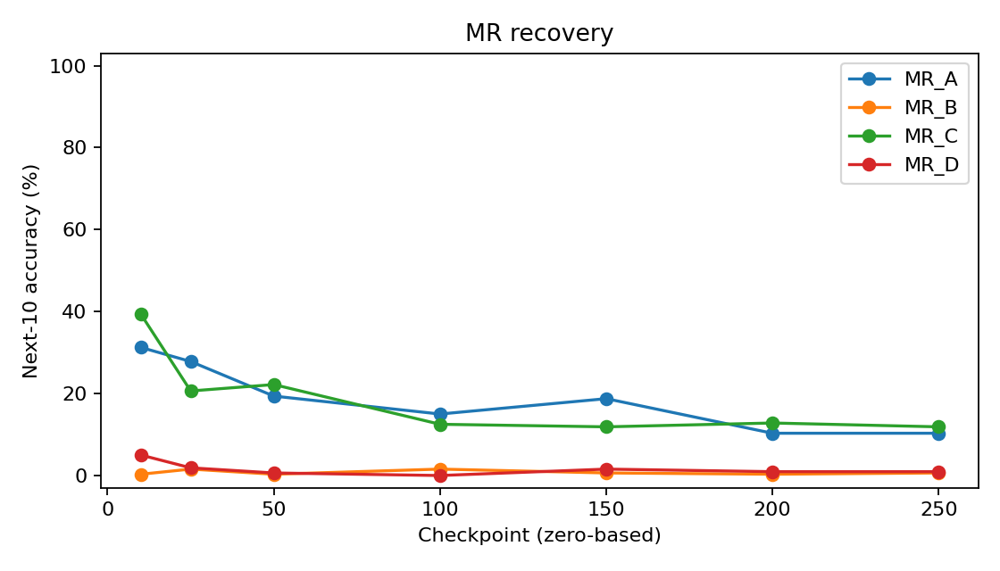

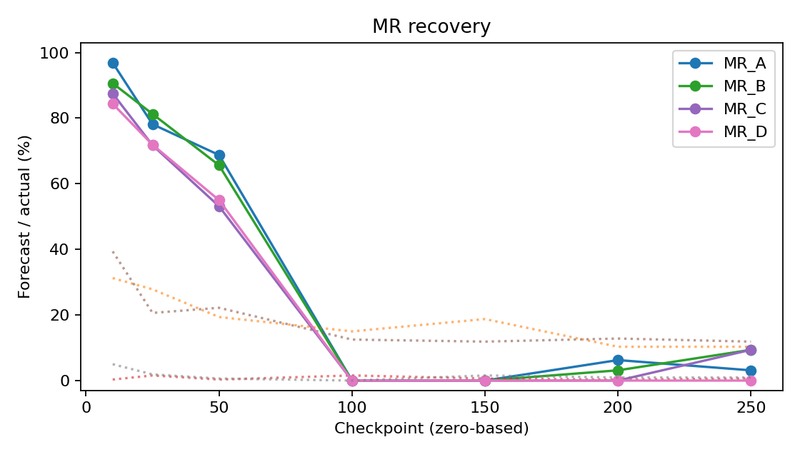

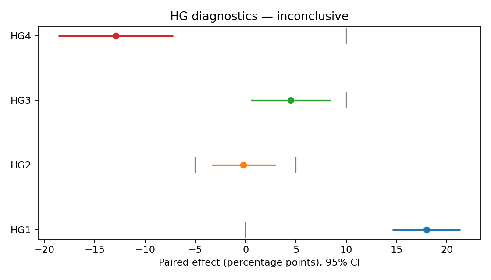

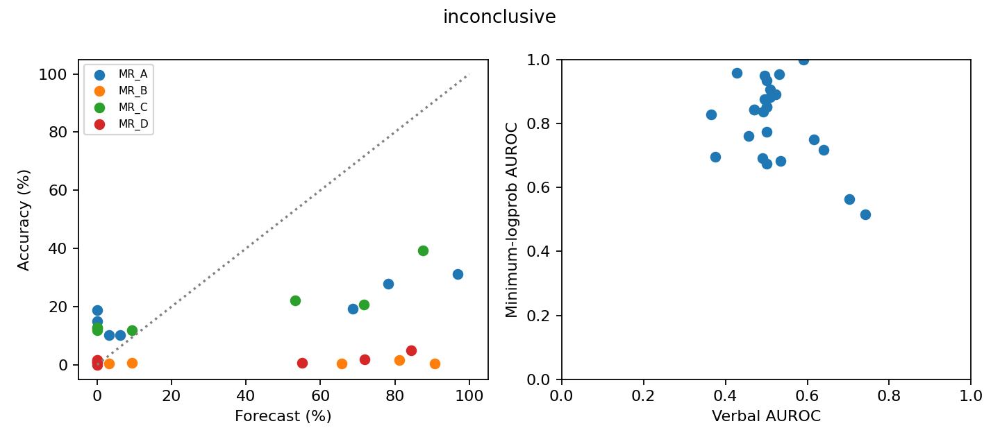

## Calibration and technical checks — exploratory only

| Calibration run | Trajectories | Conditions | Task answers |
| --- | --- | --- | --- |
| MR initial smoke | 2 | 8 | 80 |
| MR full feasibility | 8 | 224 | 2240 |
| M full calibration | 8 | 392 | 3920 |

These calibration observations informed feasibility/runtime and prospective precision review. They are not confirmation observations. Precision simulations resample small-pilot residuals; doubling their scale means fourfold variance, not a guarantee of power. Mock values are software fixtures and are excluded from all experimental tables.

## Exploratory MR calibration pilot

Registered verdict: **withheld: mock or exploratory run**.

| HG test | Estimate, points | 95% CI | Holm p | Supported |
| --- | --- | --- | --- | --- |
| HG1 | 11.43 | [5.89, 16.61] | 0.000400 | True |
| HG2 | 0.00 | [-2.32, 2.32] | 0.000400 | True |
| HG3 | 10.71 | [3.57, 19.64] | 0.801720 | False |
| HG4 | -4.46 | [-13.57, 4.29] | 0.999300 | False |

HG2 90% equivalence interval: [-1.79, 1.96]; bounds (-5, +5). Calibration diagnostics do not issue a confirmatory verdict.

HG1: repaired−wrong-state accuracy >0. HG2: repaired−clean accuracy equivalent within ±5. HG3: clean−repaired forecast >10. HG4: repaired accuracy−forecast >10. All four must pass. A lower forecast than an overconfident reference is insufficient evidence of underconfidence.

| Arm | Accuracy % | Pre-cue forecast % | Post-cue forecast % |
| --- | --- | --- | --- |
| MR_A | 15.18 | 32.14 | 30.36 |
| MR_B | 3.75 | 30.36 | 28.57 |
| MR_C | 15.18 | 30.36 | 19.64 |
| MR_D | 4.11 | 32.14 | 23.21 |

| Arm / checkpoint | Accuracy % | Forecast % | MAE | Missing |
| --- | --- | --- | --- | --- |
| MR_A / 10 | 32.50 | 87.50 | 75.00 | 0 |
| MR_A / 25 | 18.75 | 62.50 | 48.75 | 0 |
| MR_A / 50 | 7.50 | 50.00 | 45.00 | 0 |
| MR_A / 100 | 11.25 | 0.00 | 11.25 | 0 |
| MR_A / 150 | 6.25 | 0.00 | 6.25 | 0 |
| MR_A / 200 | 13.75 | 12.50 | 23.75 | 0 |
| MR_A / 250 | 16.25 | 0.00 | 16.25 | 0 |
| MR_B / 10 | 11.25 | 75.00 | 63.75 | 0 |
| MR_B / 25 | 0.00 | 87.50 | 87.50 | 0 |
| MR_B / 50 | 0.00 | 37.50 | 37.50 | 0 |
| MR_B / 100 | 12.50 | 0.00 | 12.50 | 0 |
| MR_B / 150 | 0.00 | 0.00 | 0.00 | 0 |
| MR_B / 200 | 2.50 | 0.00 | 2.50 | 0 |
| MR_B / 250 | 0.00 | 0.00 | 0.00 | 0 |
| MR_C / 10 | 31.25 | 62.50 | 56.25 | 0 |
| MR_C / 25 | 18.75 | 37.50 | 28.75 | 0 |
| MR_C / 50 | 6.25 | 37.50 | 38.75 | 0 |
| MR_C / 100 | 15.00 | 0.00 | 15.00 | 0 |
| MR_C / 150 | 6.25 | 0.00 | 6.25 | 0 |
| MR_C / 200 | 13.75 | 0.00 | 13.75 | 0 |
| MR_C / 250 | 15.00 | 0.00 | 15.00 | 0 |
| MR_D / 10 | 10.00 | 75.00 | 70.00 | 0 |
| MR_D / 25 | 0.00 | 50.00 | 50.00 | 0 |
| MR_D / 50 | 5.00 | 37.50 | 32.50 | 0 |
| MR_D / 100 | 11.25 | 0.00 | 11.25 | 0 |
| MR_D / 150 | 0.00 | 0.00 | 0.00 | 0 |
| MR_D / 200 | 0.00 | 0.00 | 0.00 | 0 |
| MR_D / 250 | 2.50 | 0.00 | 2.50 | 0 |

Primary overall floor flag: see JSON. Missing primary forecasts: 0. Out-of-range primary forecasts: 0.

| Arm | Calibration slope [CI] | Intercept [CI] |
| --- | --- | --- |
| MR_A | 0.009 [-0.178, 0.293] | 0.317 [-0.110, 0.618] |
| MR_B | 0.053 [-0.000, 0.180] | 0.073 [-0.000, 0.256] |
| MR_C | 0.087 [-0.148, 0.313] | 0.258 [-0.041, 0.561] |
| MR_D | 0.047 [-0.081, 0.179] | 0.065 [-0.011, 0.155] |

| Arm / checkpoint | Awareness higher % | Same % | Lower % | Valid n |
| --- | --- | --- | --- | --- |
| MR_A / 10 | 39.69 | 56.10 | 4.20 | 8 |
| MR_A / 25 | 61.35 | 36.25 | 2.40 | 8 |
| MR_A / 50 | 40.34 | 57.14 | 2.52 | 8 |
| MR_A / 100 | 24.28 | 72.70 | 3.02 | 8 |
| MR_A / 150 | 23.07 | 65.22 | 11.72 | 8 |
| MR_A / 200 | 23.58 | 65.08 | 11.35 | 8 |
| MR_A / 250 | 23.87 | 71.98 | 4.15 | 8 |
| MR_B / 10 | 45.47 | 49.00 | 5.53 | 8 |
| MR_B / 25 | 57.19 | 38.67 | 4.14 | 8 |
| MR_B / 50 | 35.56 | 61.25 | 3.19 | 8 |
| MR_B / 100 | 24.17 | 72.60 | 3.23 | 8 |
| MR_B / 150 | 27.71 | 60.47 | 11.82 | 8 |
| MR_B / 200 | 23.84 | 66.46 | 9.70 | 8 |
| MR_B / 250 | 26.35 | 68.90 | 4.75 | 8 |
| MR_C / 10 | 36.43 | 58.00 | 5.57 | 8 |
| MR_C / 25 | 56.56 | 39.94 | 3.50 | 8 |
| MR_C / 50 | 32.89 | 63.50 | 3.61 | 8 |
| MR_C / 100 | 21.87 | 73.73 | 4.40 | 8 |
| MR_C / 150 | 28.54 | 58.11 | 13.34 | 8 |
| MR_C / 200 | 21.68 | 65.02 | 13.29 | 8 |
| MR_C / 250 | 27.26 | 67.36 | 5.38 | 8 |
| MR_D / 10 | 43.37 | 50.91 | 5.72 | 8 |
| MR_D / 25 | 59.15 | 36.74 | 4.11 | 8 |
| MR_D / 50 | 47.97 | 49.37 | 2.65 | 8 |
| MR_D / 100 | 28.69 | 68.33 | 2.98 | 8 |
| MR_D / 150 | 31.85 | 57.32 | 10.83 | 8 |
| MR_D / 200 | 24.53 | 61.14 | 14.33 | 8 |
| MR_D / 250 | 27.51 | 69.07 | 3.42 | 8 |

| Interaction | Estimate, points | 95% CI |
| --- | --- | --- |
| accuracy | 0.36 | [-5.36, 4.46] |
| forecast | -16.07 | [-25.00, -7.14] |

Global minimum-logprob AUROC support: 0/280 strict cells. Local minimum-logprob AUROC support: 0/280 strict cells. Calibration, interactions and discrimination are secondary and do not change the registered primary verdict.

### Identifiable strict discrimination cells

No identifiable strict cells.

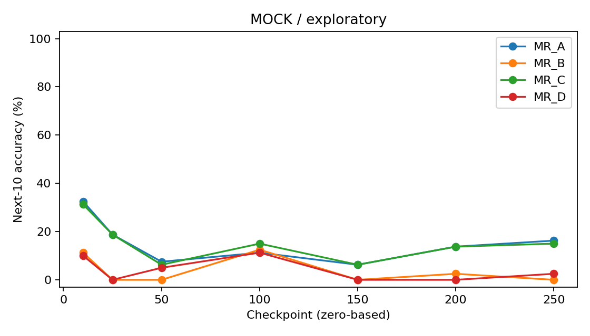

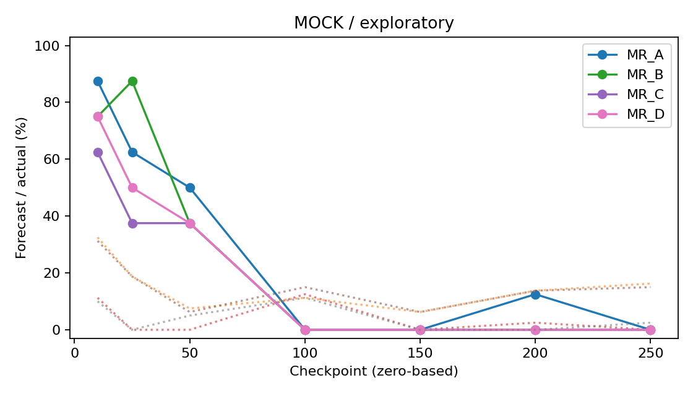

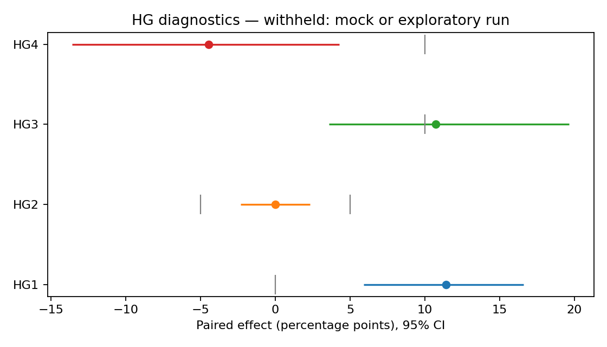

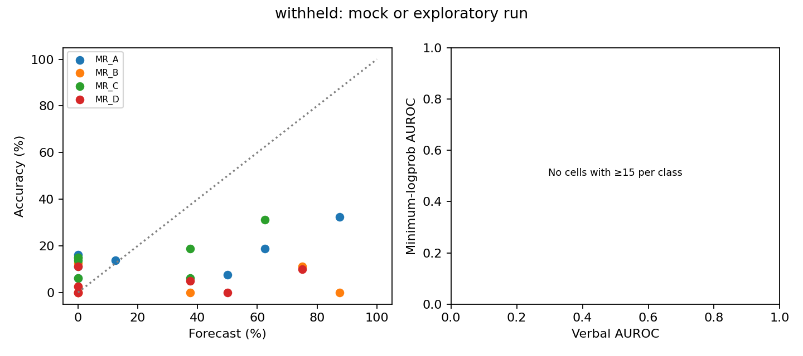

## Exploratory M calibration

Reported decision: **not issued: incomplete / exploratory**.

| Contrast | Estimate, points | 95% CI |
| --- | --- | --- |
| length | -50.73 | [-55.14, -44.57] |
| pessimism | 50.73 | [44.57, 55.14] |
| dose | 4.78 | [0.26, 13.13] |
| endpoint | 2.52 | [-2.30, 10.02] |

| HF test | Raw bootstrap p | Holm p | Interval rule | Supported |
| --- | --- | --- | --- | --- |
| pessimism_gt10 | 0.000000 | 0.000000 | True | True |
| pessimism_equiv | 1.000000 | 1.000000 | False | False |
| dose_gt10 | 0.133400 | 0.266800 | False | False |
| dose_equiv | 0.066700 | 0.200100 | False | False |

Mean confidence is nonincreasing across intermediate doses at each checkpoint: {'10': True, '25': False, '50': False, '100': False, '150': False, '200': False, '250': False}. All intermediate cells at the accuracy floor: False.

Stored HF p=0 means below empirical resampling resolution, not mathematical zero. Superiority also requires the directional interval rule. Dose equivalence uses its 90% interval and the ±10-point band.

| Equivalence test | 90% interval | Registered bounds |
| --- | --- | --- |
| pessimism_equiv | [45.64, 54.68] | (-10, +10) |
| dose_equiv | [0.38, 12.88] | (-10, +10) |

| Arm | Verbal / 100 | Forecast % | Actual accuracy % |
| --- | --- | --- | --- |
| L0 | 49.16 | 32.14 | 31.07 |
| L25 | 46.11 | 26.79 | 24.46 |
| L50 | 46.00 | 30.36 | 19.64 |
| L75 | 45.21 | 30.36 | 7.86 |
| L100 | 46.64 | 33.93 | 0.71 |
| S0 | 99.89 | 98.18 | 49.11 |
| S100 | 99.98 | 98.20 | 0.89 |

| Checkpoint | Arm | n | Confidence / forecast | Accuracy % |
| --- | --- | --- | --- | --- |
| 10 | L0 | 8 | 100.00 / 100.00 | 57.50 |
| 25 | L0 | 8 | 98.00 / 62.50 | 55.00 |
| 50 | L0 | 8 | 94.88 / 62.50 | 15.00 |
| 100 | L0 | 8 | 26.88 / 0.00 | 21.25 |
| 150 | L0 | 8 | 21.88 / 0.00 | 26.25 |
| 200 | L0 | 8 | 0.00 / 0.00 | 25.00 |
| 250 | L0 | 8 | 2.50 / 0.00 | 17.50 |
| 10 | L25 | 8 | 100.00 / 100.00 | 43.75 |
| 25 | L25 | 8 | 98.00 / 50.00 | 43.75 |
| 50 | L25 | 8 | 96.00 / 37.50 | 13.75 |
| 100 | L25 | 8 | 16.25 / 0.00 | 16.25 |
| 150 | L25 | 8 | 7.50 / 0.00 | 23.75 |
| 200 | L25 | 8 | 2.50 / 0.00 | 17.50 |
| 250 | L25 | 8 | 2.50 / 0.00 | 12.50 |
| 10 | L50 | 8 | 100.00 / 100.00 | 23.75 |
| 25 | L50 | 8 | 98.00 / 62.50 | 40.00 |
| 50 | L50 | 8 | 96.50 / 50.00 | 18.75 |
| 100 | L50 | 8 | 11.25 / 0.00 | 13.75 |
| 150 | L50 | 8 | 11.25 / 0.00 | 26.25 |
| 200 | L50 | 8 | 0.00 / 0.00 | 12.50 |
| 250 | L50 | 8 | 5.00 / 0.00 | 2.50 |
| 10 | L75 | 8 | 99.38 / 100.00 | 23.75 |
| 25 | L75 | 8 | 98.62 / 62.50 | 16.25 |
| 50 | L75 | 8 | 96.00 / 37.50 | 5.00 |
| 100 | L75 | 8 | 15.00 / 12.50 | 3.75 |
| 150 | L75 | 8 | 5.00 / 0.00 | 0.00 |
| 200 | L75 | 8 | 0.00 / 0.00 | 6.25 |
| 250 | L75 | 8 | 2.50 / 0.00 | 0.00 |
| 10 | L100 | 8 | 100.00 / 100.00 | 0.00 |
| 25 | L100 | 8 | 98.62 / 75.00 | 0.00 |
| 50 | L100 | 8 | 96.00 / 50.00 | 0.00 |
| 100 | L100 | 8 | 13.75 / 12.50 | 3.75 |
| 150 | L100 | 8 | 11.25 / 0.00 | 0.00 |
| 200 | L100 | 8 | 4.38 / 0.00 | 1.25 |
| 250 | L100 | 8 | 2.50 / 0.00 | 0.00 |
| 10 | S0 | 8 | 100.00 / 100.00 | 43.75 |
| 25 | S0 | 8 | 100.00 / 99.88 | 41.25 |
| 50 | S0 | 8 | 100.00 / 100.00 | 45.00 |
| 100 | S0 | 8 | 100.00 / 99.88 | 48.75 |
| 150 | S0 | 8 | 100.00 / 100.00 | 55.00 |
| 200 | S0 | 8 | 100.00 / 87.50 | 52.50 |
| 250 | S0 | 8 | 99.25 / 100.00 | 57.50 |
| 10 | S100 | 8 | 100.00 / 100.00 | 0.00 |
| 25 | S100 | 8 | 100.00 / 99.88 | 0.00 |
| 50 | S100 | 8 | 100.00 / 100.00 | 6.25 |
| 100 | S100 | 8 | 100.00 / 100.00 | 0.00 |
| 150 | S100 | 8 | 100.00 / 100.00 | 0.00 |
| 200 | S100 | 8 | 100.00 / 87.50 | 0.00 |
| 250 | S100 | 8 | 99.88 / 100.00 | 0.00 |

| Checkpoint / arm | Awareness optimism % | Invalid verbal | Invalid forecast | Invalid awareness |
| --- | --- | --- | --- | --- |
| 10 / L0 | 71.01 | 0 | 0 | 0 |
| 25 / L0 | 74.39 | 0 | 0 | 0 |
| 50 / L0 | 74.62 | 0 | 0 | 0 |
| 100 / L0 | 65.85 | 0 | 0 | 0 |
| 150 / L0 | 56.74 | 0 | 0 | 0 |
| 200 / L0 | 52.03 | 0 | 0 | 0 |
| 250 / L0 | 58.37 | 0 | 0 | 0 |
| 10 / L25 | 69.90 | 0 | 0 | 0 |
| 25 / L25 | 73.71 | 0 | 0 | 0 |
| 50 / L25 | 71.54 | 0 | 0 | 0 |
| 100 / L25 | 63.40 | 0 | 0 | 0 |
| 150 / L25 | 56.10 | 0 | 0 | 0 |
| 200 / L25 | 50.30 | 0 | 0 | 0 |
| 250 / L25 | 60.17 | 0 | 0 | 0 |
| 10 / L50 | 68.87 | 0 | 0 | 0 |
| 25 / L50 | 74.31 | 0 | 0 | 0 |
| 50 / L50 | 69.26 | 0 | 0 | 0 |
| 100 / L50 | 62.27 | 0 | 0 | 0 |
| 150 / L50 | 56.53 | 0 | 0 | 0 |
| 200 / L50 | 51.83 | 0 | 0 | 0 |
| 250 / L50 | 57.95 | 0 | 0 | 0 |
| 10 / L75 | 68.09 | 0 | 0 | 0 |
| 25 / L75 | 75.45 | 0 | 0 | 0 |
| 50 / L75 | 70.68 | 0 | 0 | 0 |
| 100 / L75 | 63.79 | 0 | 0 | 0 |
| 150 / L75 | 56.50 | 0 | 0 | 0 |
| 200 / L75 | 51.16 | 0 | 0 | 0 |
| 250 / L75 | 57.91 | 0 | 0 | 0 |
| 10 / L100 | 68.58 | 0 | 0 | 0 |
| 25 / L100 | 75.33 | 0 | 0 | 0 |
| 50 / L100 | 70.87 | 0 | 0 | 0 |
| 100 / L100 | 63.21 | 0 | 0 | 0 |
| 150 / L100 | 56.54 | 0 | 0 | 0 |
| 200 / L100 | 50.75 | 0 | 0 | 0 |
| 250 / L100 | 58.03 | 0 | 0 | 0 |
| 10 / S0 | 68.48 | 0 | 0 | 0 |
| 25 / S0 | 66.40 | 0 | 0 | 0 |
| 50 / S0 | 73.01 | 0 | 0 | 0 |
| 100 / S0 | 66.46 | 0 | 0 | 0 |
| 150 / S0 | 72.71 | 0 | 0 | 0 |
| 200 / S0 | 65.09 | 0 | 0 | 0 |
| 250 / S0 | 69.51 | 0 | 0 | 0 |
| 10 / S100 | 68.22 | 0 | 0 | 0 |
| 25 / S100 | 67.41 | 0 | 0 | 0 |
| 50 / S100 | 74.81 | 0 | 0 | 0 |
| 100 / S100 | 65.01 | 0 | 0 | 0 |
| 150 / S100 | 71.92 | 0 | 0 | 0 |
| 200 / S100 | 64.47 | 0 | 0 | 0 |
| 250 / S100 | 68.55 | 0 | 0 | 0 |

| Signal | Calibration slope [CI] | Intercept [CI] |
| --- | --- | --- |
| verbal | 0.159 [0.041, 0.264] | 0.116 [0.012, 0.207] |
| fore_none | 0.125 [0.028, 0.213] | 0.150 [0.059, 0.237] |
| aware | 0.302 [-0.016, 0.568] | 0.066 [-0.122, 0.259] |

Calibration regressions condition on checkpoint and bootstrap whole trajectories. Verbal confidence concerns the current answer; awareness is ordinal. Only the forecast is a next-ten probability estimate. History truncation also removes evidence; it is not a pure token-count intervention.

Invalid checkpoint probes: {'verbal': 0, 'fore_none': 0, 'aware': 0}. Floor cells (accuracy ≤5%): L50@250, L75@50, L75@100, L75@150, L75@250, L100@10, L100@25, L100@50, L100@100, L100@150, L100@200, L100@250, S100@10, S100@25, S100@100, S100@150, S100@200, S100@250.

Strict minimum-logprob AUROC support: 0/490 checkpoint/offset cells. Undefined cells are not zeros and are not silently pooled. Full feature intervals are saved in the analysis JSON.

### Identifiable strict localization cells

Verbal and logit comparisons use their paired common observations. P(Yes) support may differ; inspect the saved per-feature class counts before comparison.

No identifiable strict cells.

## Exploratory A0 metacognition — existing data only

This exploratory analysis uses 32 trajectories / 9600 task rows and 10000 trajectory-bootstrap draws. It is not part of fresh confirmation. Position, errors in context and performance are confounded; pooled AUROC is not a causal monitoring test.

| Position / signal | Mean [95% CI], 0–100 | n | Matched next-10 accuracy % |
| --- | --- | --- | --- |
| 0-49 / verbal | 96.72 [94.96, 97.96] | 1600 | 4.56 |
| 0-49 / ptrue | 19.58 [17.03, 22.18] | 1600 | 4.56 |
| 0-49 / fore_none | 76.53 [64.06, 87.47] | 64 | 4.22 |
| 0-49 / fore_true | 11.95 [4.53, 21.33] | 64 | 4.22 |
| 0-49 / fore_placebo | 28.61 [18.75, 39.00] | 64 | 4.22 |
| 0-49 / higher | 51.21 [43.76, 58.50] | 64 | 4.22 |
| 0-49 / same | 41.44 [34.96, 48.53] | 64 | 4.22 |
| 0-49 / lower | 7.35 [5.16, 9.76] | 64 | 4.22 |
| 50-99 / verbal | 55.13 [46.20, 64.22] | 1600 | 0.05 |
| 50-99 / ptrue | 3.72 [2.62, 5.00] | 1600 | 0.05 |
| 50-99 / fore_none | 62.47 [46.81, 78.12] | 32 | 0.00 |
| 50-99 / fore_true | 0.00 [0.00, 0.00] | 32 | 0.00 |
| 50-99 / fore_placebo | 0.00 [0.00, 0.00] | 32 | 0.00 |
| 50-99 / higher | 37.23 [29.50, 45.39] | 32 | 0.00 |
| 50-99 / same | 42.98 [36.25, 50.30] | 32 | 0.00 |
| 50-99 / lower | 19.79 [13.47, 26.91] | 32 | 0.00 |
| 100-199 / verbal | 6.88 [3.18, 11.11] | 3200 | 0.04 |
| 100-199 / ptrue | 2.94 [2.13, 3.89] | 3200 | 0.04 |
| 100-199 / fore_none | 1.56 [0.00, 4.69] | 64 | 0.16 |
| 100-199 / fore_true | 0.00 [0.00, 0.00] | 64 | 0.16 |
| 100-199 / fore_placebo | 0.00 [0.00, 0.00] | 64 | 0.16 |
| 100-199 / higher | 17.77 [12.32, 23.97] | 64 | 0.16 |
| 100-199 / same | 44.87 [38.67, 51.23] | 64 | 0.16 |
| 100-199 / lower | 37.37 [27.76, 46.69] | 64 | 0.16 |
| 200-299 / verbal | 1.20 [0.11, 2.70] | 3200 | 0.00 |
| 200-299 / ptrue | 2.45 [1.85, 3.19] | 3200 | 0.00 |
| 200-299 / fore_none | 0.00 [0.00, 0.00] | 64 | 0.00 |
| 200-299 / fore_true | 0.00 [0.00, 0.00] | 64 | 0.00 |
| 200-299 / fore_placebo | 0.00 [0.00, 0.00] | 64 | 0.00 |
| 200-299 / higher | 11.76 [7.54, 16.88] | 64 | 0.00 |
| 200-299 / same | 37.67 [30.95, 44.72] | 64 | 0.00 |
| 200-299 / lower | 50.57 [40.55, 60.12] | 64 | 0.00 |

| Checkpoint | Verbal / 100 | No-evidence forecast % | Truth / placebo forecast % | Actual next-10 % |
| --- | --- | --- | --- | --- |
| 10 | 100.00 | 90.62 | 20.78 / 35.34 | 7.19 |
| 25 | 98.12 | 62.44 | 3.12 / 21.88 | 1.25 |
| 50 | 87.81 | 62.47 | 0.00 / 0.00 | 0.00 |
| 100 | 20.31 | 0.00 | 0.00 / 0.00 | 0.31 |
| 150 | 5.47 | 3.12 | 0.00 / 0.00 | 0.00 |
| 200 | 1.88 | 0.00 | 0.00 / 0.00 | 0.00 |
| 250 | 1.25 | 0.00 | 0.00 / 0.00 | 0.00 |

A0 no-evidence forecasts are high early, then reach zero from checkpoint 100; “about 100” is not an appropriate description of the full trajectory. Awareness category probabilities and P(Yes) are expressed as percentages in this section.

| Position / score | Local-correctness AUROC [95% CI] | n locally correct | n numeric slips |
| --- | --- | --- | --- |
| all / verbal | 0.613 [0.596, 0.631] | 5322 | 4278 |
| all / ptrue | 0.489 [0.447, 0.526] | 5322 | 4278 |
| all / lp_min | 0.792 [0.659, 0.901] | 5322 | 4278 |
| all / lp_mean | 0.790 [0.657, 0.899] | 5322 | 4278 |
| all / neg_ent_max | 0.792 [0.659, 0.902] | 5322 | 4278 |
| all / margin_min | 0.778 [0.647, 0.886] | 5322 | 4278 |
| all / fin_lp_min | 0.792 [0.659, 0.901] | 5322 | 4278 |
| 0-49 / verbal | 0.539 [0.488, 0.600] | 1198 | 402 |
| 0-49 / ptrue | 0.519 [0.468, 0.570] | 1198 | 402 |
| 0-49 / lp_min | 0.830 [0.735, 0.934] | 1198 | 402 |
| 0-49 / lp_mean | 0.830 [0.737, 0.932] | 1198 | 402 |
| 0-49 / neg_ent_max | 0.829 [0.731, 0.934] | 1198 | 402 |
| 0-49 / margin_min | 0.812 [0.706, 0.928] | 1198 | 402 |
| 0-49 / fin_lp_min | 0.830 [0.735, 0.934] | 1198 | 402 |
| 50-99 / verbal | 0.562 [0.495, 0.634] | 955 | 645 |
| 50-99 / ptrue | 0.423 [0.370, 0.476] | 955 | 645 |
| 50-99 / lp_min | 0.772 [0.629, 0.898] | 955 | 645 |
| 50-99 / lp_mean | 0.770 [0.628, 0.895] | 955 | 645 |
| 50-99 / neg_ent_max | 0.773 [0.630, 0.900] | 955 | 645 |
| 50-99 / margin_min | 0.755 [0.612, 0.883] | 955 | 645 |
| 50-99 / fin_lp_min | 0.772 [0.629, 0.898] | 955 | 645 |
| 100-199 / verbal | 0.549 [0.517, 0.583] | 1697 | 1503 |
| 100-199 / ptrue | 0.417 [0.363, 0.464] | 1697 | 1503 |
| 100-199 / lp_min | 0.776 [0.639, 0.888] | 1697 | 1503 |
| 100-199 / lp_mean | 0.773 [0.636, 0.886] | 1697 | 1503 |
| 100-199 / neg_ent_max | 0.776 [0.638, 0.889] | 1697 | 1503 |
| 100-199 / margin_min | 0.765 [0.631, 0.876] | 1697 | 1503 |
| 100-199 / fin_lp_min | 0.776 [0.639, 0.888] | 1697 | 1503 |
| 200-299 / verbal | 0.524 [0.503, 0.549] | 1472 | 1728 |
| 200-299 / ptrue | 0.431 [0.388, 0.472] | 1472 | 1728 |
| 200-299 / lp_min | 0.785 [0.651, 0.891] | 1472 | 1728 |
| 200-299 / lp_mean | 0.785 [0.651, 0.890] | 1472 | 1728 |
| 200-299 / neg_ent_max | 0.788 [0.653, 0.894] | 1472 | 1728 |
| 200-299 / margin_min | 0.766 [0.636, 0.869] | 1472 | 1728 |
| 200-299 / fin_lp_min | 0.785 [0.651, 0.891] | 1472 | 1728 |

Exact-position clean-versus-previous-error comparison: error−clean verbal difference -0.48, 95% CI [-0.76, -0.21]. Positions with both groups receive equal weight; sparse cells have n<30. No-current-error history definition: prior_error.

| Turn / prior history | n | Verbal mean | 95% CI | Sparse n<30 |
| --- | --- | --- | --- | --- |
| 0 / clean | 32 | 100.00 | [100.00, 100.00] | False |
| 0 / error | 0 | unavailable | [unavailable, unavailable] | True |
| 1 / clean | 21 | 100.00 | [100.00, 100.00] | True |
| 1 / error | 11 | 100.00 | [100.00, 100.00] | True |
| 2 / clean | 11 | 100.00 | [100.00, 100.00] | True |
| 2 / error | 21 | 100.00 | [100.00, 100.00] | True |
| 3 / clean | 11 | 100.00 | [100.00, 100.00] | True |
| 3 / error | 21 | 100.00 | [100.00, 100.00] | True |
| 4 / clean | 10 | 100.00 | [100.00, 100.00] | True |
| 4 / error | 22 | 100.00 | [100.00, 100.00] | True |
| 5 / clean | 9 | 100.00 | [100.00, 100.00] | True |
| 5 / error | 23 | 100.00 | [100.00, 100.00] | True |
| 6 / clean | 9 | 100.00 | [100.00, 100.00] | True |
| 6 / error | 23 | 100.00 | [100.00, 100.00] | True |
| 7 / clean | 7 | 100.00 | [100.00, 100.00] | True |
| 7 / error | 25 | 100.00 | [100.00, 100.00] | True |
| 8 / clean | 7 | 100.00 | [100.00, 100.00] | True |
| 8 / error | 25 | 100.00 | [100.00, 100.00] | True |
| 9 / clean | 6 | 100.00 | [100.00, 100.00] | True |
| 9 / error | 26 | 100.00 | [100.00, 100.00] | True |
| 10 / clean | 6 | 100.00 | [100.00, 100.00] | True |
| 10 / error | 26 | 100.00 | [100.00, 100.00] | True |
| 11 / clean | 5 | 100.00 | [100.00, 100.00] | True |
| 11 / error | 27 | 100.00 | [100.00, 100.00] | True |
| 12 / clean | 5 | 100.00 | [100.00, 100.00] | True |
| 12 / error | 27 | 99.81 | [99.40, 100.00] | True |
| 13 / clean | 4 | 100.00 | [100.00, 100.00] | True |
| 13 / error | 28 | 99.96 | [99.88, 100.00] | True |
| 14 / clean | 3 | 100.00 | [100.00, 100.00] | True |
| 14 / error | 29 | 100.00 | [100.00, 100.00] | True |
| 15 / clean | 2 | 100.00 | [100.00, 100.00] | True |
| 15 / error | 30 | 99.83 | [99.48, 100.00] | False |
| 16 / clean | 2 | 100.00 | [100.00, 100.00] | True |
| 16 / error | 30 | 99.53 | [99.03, 99.91] | False |
| 17 / clean | 2 | 100.00 | [100.00, 100.00] | True |
| 17 / error | 30 | 99.57 | [99.06, 99.94] | False |
| 18 / clean | 2 | 99.50 | [99.00, 100.00] | True |
| 18 / error | 30 | 99.53 | [99.03, 99.90] | False |
| 19 / clean | 1 | 99.00 | [99.00, 99.00] | True |
| 19 / error | 31 | 99.00 | [98.34, 99.58] | False |
| 20 / clean | 1 | 99.00 | [99.00, 99.00] | True |
| 20 / error | 31 | 99.03 | [98.37, 99.61] | False |
| 21 / clean | 1 | 100.00 | [100.00, 100.00] | True |
| 21 / error | 31 | 98.48 | [97.73, 99.17] | False |
| 22 / clean | 1 | 99.00 | [99.00, 99.00] | True |
| 22 / error | 31 | 98.61 | [97.90, 99.28] | False |
| 23 / clean | 1 | 99.00 | [99.00, 99.00] | True |
| 23 / error | 31 | 98.03 | [97.23, 98.81] | False |
| 24 / clean | 1 | 100.00 | [100.00, 100.00] | True |
| 24 / error | 31 | 98.48 | [97.75, 99.19] | False |
| 25 / clean | 1 | 100.00 | [100.00, 100.00] | True |
| 25 / error | 31 | 98.06 | [97.26, 98.87] | False |
| 26 / clean | 1 | 99.00 | [99.00, 99.00] | True |
| 26 / error | 31 | 97.90 | [97.09, 98.71] | False |
| 27 / clean | 1 | 99.00 | [99.00, 99.00] | True |
| 27 / error | 31 | 97.55 | [96.72, 98.38] | False |
| 28 / clean | 1 | 99.00 | [99.00, 99.00] | True |
| 28 / error | 31 | 97.48 | [96.67, 98.29] | False |
| 29 / clean | 1 | 99.00 | [99.00, 99.00] | True |
| 29 / error | 31 | 97.68 | [96.87, 98.48] | False |
| 30 / clean | 1 | 99.00 | [99.00, 99.00] | True |
| 30 / error | 31 | 97.58 | [96.81, 98.35] | False |
| 31 / clean | 0 | unavailable | [unavailable, unavailable] | True |
| 31 / error | 32 | 96.97 | [96.19, 97.75] | False |
| 32 / clean | 0 | unavailable | [unavailable, unavailable] | True |
| 32 / error | 32 | 97.09 | [96.31, 97.88] | False |
| 33 / clean | 0 | unavailable | [unavailable, unavailable] | True |
| 33 / error | 32 | 96.56 | [95.84, 97.34] | False |
| 34 / clean | 0 | unavailable | [unavailable, unavailable] | True |
| 34 / error | 32 | 96.53 | [95.81, 97.28] | False |
| 35 / clean | 0 | unavailable | [unavailable, unavailable] | True |
| 35 / error | 32 | 96.31 | [95.59, 97.06] | False |
| 36 / clean | 0 | unavailable | [unavailable, unavailable] | True |
| 36 / error | 32 | 96.41 | [95.69, 97.16] | False |
| 37 / clean | 0 | unavailable | [unavailable, unavailable] | True |
| 37 / error | 32 | 97.00 | [96.25, 97.81] | False |
| 38 / clean | 0 | unavailable | [unavailable, unavailable] | True |
| 38 / error | 32 | 96.41 | [95.72, 97.16] | False |
| 39 / clean | 0 | unavailable | [unavailable, unavailable] | True |
| 39 / error | 32 | 90.06 | [80.88, 96.34] | False |
| 40 / clean | 0 | unavailable | [unavailable, unavailable] | True |
| 40 / error | 32 | 89.34 | [80.31, 95.44] | False |
| 41 / clean | 0 | unavailable | [unavailable, unavailable] | True |
| 41 / error | 32 | 89.44 | [80.41, 95.62] | False |
| 42 / clean | 0 | unavailable | [unavailable, unavailable] | True |
| 42 / error | 32 | 88.09 | [79.06, 95.12] | False |
| 43 / clean | 0 | unavailable | [unavailable, unavailable] | True |
| 43 / error | 32 | 89.31 | [80.28, 95.38] | False |
| 44 / clean | 0 | unavailable | [unavailable, unavailable] | True |
| 44 / error | 32 | 88.22 | [79.12, 95.25] | False |
| 45 / clean | 0 | unavailable | [unavailable, unavailable] | True |
| 45 / error | 32 | 92.75 | [86.41, 96.19] | False |
| 46 / clean | 0 | unavailable | [unavailable, unavailable] | True |
| 46 / error | 32 | 89.47 | [80.41, 95.66] | False |
| 47 / clean | 0 | unavailable | [unavailable, unavailable] | True |
| 47 / error | 32 | 89.19 | [80.16, 95.25] | False |
| 48 / clean | 0 | unavailable | [unavailable, unavailable] | True |
| 48 / error | 32 | 89.06 | [80.16, 95.00] | False |
| 49 / clean | 0 | unavailable | [unavailable, unavailable] | True |
| 49 / error | 32 | 91.09 | [83.91, 95.31] | False |
| 50 / clean | 0 | unavailable | [unavailable, unavailable] | True |
| 50 / error | 32 | 87.81 | [78.75, 94.84] | False |
| 51 / clean | 0 | unavailable | [unavailable, unavailable] | True |
| 51 / error | 32 | 87.97 | [79.06, 95.00] | False |
| 52 / clean | 0 | unavailable | [unavailable, unavailable] | True |
| 52 / error | 32 | 87.81 | [78.75, 94.69] | False |
| 53 / clean | 0 | unavailable | [unavailable, unavailable] | True |
| 53 / error | 32 | 88.09 | [79.06, 95.12] | False |
| 54 / clean | 0 | unavailable | [unavailable, unavailable] | True |
| 54 / error | 32 | 85.56 | [74.47, 94.34] | False |
| 55 / clean | 0 | unavailable | [unavailable, unavailable] | True |
| 55 / error | 32 | 84.47 | [73.62, 92.97] | False |
| 56 / clean | 0 | unavailable | [unavailable, unavailable] | True |
| 56 / error | 32 | 89.00 | [79.97, 95.25] | False |
| 57 / clean | 0 | unavailable | [unavailable, unavailable] | True |
| 57 / error | 32 | 78.75 | [66.56, 89.22] | False |
| 58 / clean | 0 | unavailable | [unavailable, unavailable] | True |
| 58 / error | 32 | 80.78 | [69.06, 90.78] | False |
| 59 / clean | 0 | unavailable | [unavailable, unavailable] | True |
| 59 / error | 32 | 83.75 | [74.22, 91.25] | False |
| 60 / clean | 0 | unavailable | [unavailable, unavailable] | True |
| 60 / error | 32 | 80.59 | [69.94, 89.75] | False |

## Interpretation and reproducibility limits

The long/short comparison changes available evidence as well as tokens. All errors are controlled +1 totals in teacher-forced histories. The task and model are narrow; no internal metacognitive mechanism or cross-model generality is established. Relative repair to a low clean baseline is not near-perfect execution. Sparse AUROC cells restrict localization claims. Missing or invalid estimates are reported as unavailable.

Original M used GPU 1; original MR used GPU 0 after documented hardware/scheduling amendments. GPU 2 failed initialization before MR task generation because service PATH omitted ninja. The corrected PATH uses the already installed tool. Confirmation uses GPU 0 with its own frozen sample/source/config manifest. Model weights and original arm outputs were preserved.

All raw archives, checkpoint envelopes, JSONL rows, trajectories, analysis JSON, class-support counts, source snapshots and failure logs remain saved. Statistical decisions and missingness must be read alongside the arm curves. Original registration, execution amendments and C registration are separate records. Nothing is submitted or sent externally by this report.

## Saved measurement sources

| Study | Raw / checkpoint root | Analysis |
| --- | --- | --- |
| M | runs/meta_HF_main_20261118/ | results/meta_HF_main_20261118/ |
| MR | runs/recovery_HG_gpu0_main_20261118/ | results/recovery_HG_gpu0_main_20261118/ |
| C | runs/confirmation_C_main_20261118 | runs/confirmation_C_main_20261118/analysis |

